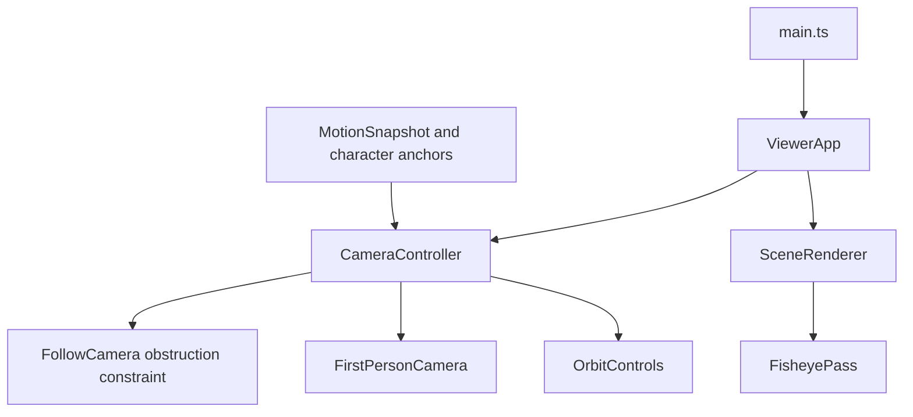

# Technical Design
## Overview
將里程碑 3 的鏡頭協調責任移至 CameraController，保留 FollowCamera 遮擋保護與 FirstPersonCamera 眼位實作。SceneRenderer 按需使用 FisheyePass，其他模式仍直接 render。無新增依賴或外部資產。
### Goals / Non-Goals
完成前方、人物俯視、低角度、魚眼及跟隨獨立切換；不增加 mouse-look、pointer lock、動畫資產或表情功能。

## Boundary Commitments
### This Spec Owns
構圖、鏡頭模式／Follow 狀態、轉場、魚眼投影、resize 與鏡頭 UI 同步。
### Out of Boundary
人物運動／碰撞權威仍為 CharacterController／CityScene；Character 外觀不改動。不改上游骨架或資產格式。
### Allowed Dependencies
Three.js 現有版本及 DOM 控制；CameraController 依 motion snapshot、高度、眼位與可注入 Orbit／Follow／FirstPerson 介面，不依 DOM 或 ViewerApp。FisheyePass 不讀人物／輸入。
### Revalidation Triggers
CameraPreset 擴充為 overview／street／overhead／first-person／third-person／front／character-overhead／low-angle／fisheye；CharacterStatus 新增 cameraView。UI 需重驗，character-expressions-ui 之後以新狀態為準。Follow 開關不再強制切換第三人稱；這是本里程碑刻意調整，須回歸上游切換與人物顯示。

## Architecture

方向：motion／Three → 鏡頭獨立模組 → ViewerApp → main。SceneRenderer 只接 scene 與 fisheye boolean，不依相機 UI。原 loop 與單一 PerspectiveCamera 保留。

## File Structure Plan
| 檔案 | 方式／責任 |
|---|---|
| src/camera/CameraController.ts | 新增；模式、構圖、Follow、球面轉場及可見性 |
| src/camera/FollowCamera.ts | 修改；公開既有 constrain，不重複 raycast |
| src/engine/FisheyePass.ts | 新增；正方形離屏渲染與等距魚眼 shader |
| src/engine/SceneRenderer.ts | 修改；按需魚眼、resize、dispose |
| src/engine/ViewerApp.ts | 修改；委派相機責任，傳角色 snapshot |
| src/main.ts、src/style.css | 修改；新卡片、跟隨狀態、響應式 |
| tests/camera-modes.test.mjs、tests/fisheye.test.mjs | 新增；狀態／構圖／轉場／渲染資源測試 |
README、roadmap、steering、上游 validation 只同步驗證與行為改變。既有未提交第一／第三人稱修改保留，不重設 checkout。

## Components & Interfaces
### 1. CameraController
`CameraSubject` 為 Readonly<MotionSnapshot> 加 height／eyeHeight／eyeForward。`CameraView` 為前述 union。建構注入 PerspectiveCamera、Orbit（target／enabled／enableDamping／update）、FollowCamera 及 FirstPersonCamera；只有 type imports 跨相機模組，測試可注入純 Three 物件及 fake Orbit。

公開 `select(view,subject,immediate)`、`setFollowing(enabled,subject,immediate)`、`update(subject,delta,immediate)`、`interrupt()`，只讀 view／following／characterVisible／fisheye／transitioning。初始 overview 與 Follow=false。人物模式初選預設追蹤；其他模式初選預設不追蹤。之後 Follow 開關不改 view；第一人稱固定追蹤、開關 disabled，避免違反眼位契約。

第三人稱沿既有後方 6m／上方 3m；Front 在人物朝向前方約 6m、眼高附近；Character overhead 高 12m 且 Z 小偏移避免 lookAt 奇點；Low angle 高 0.35m、前方 5m；Fisheye 後方 3.5m、較低俯角。目標為胸部（height×0.65）。static 預設仍使用既有世界座標；若開 Follow，以人物位移 delta 平移既有 camera／target，保留使用者 Orbit 偏移。

外部轉場 0.8 秒 smoothstep：注視點線性插值，鏡頭相對目標的方向以 quaternion 球面旋轉、半徑插值，避免從背面轉正面穿過人物。追蹤使用指數平滑。reduced-motion 直接設定。切換中的指標 Orbit 可中止非追蹤鏡頭轉場；跟隨構圖禁用 Orbit；關閉 Follow 立即停在當前 frame 並恢復 Orbit。外部模式調用 Follow.constrain 保護距離。

第一人稱使用既有眼位及 FOV70／near0.04；其他透視 FOV43／near0.1，魚眼 capture FOV160。離開第一人稱先以既有 Follow 取得安全外部 frame 再轉場，人物恢復可見。

### 2. FisheyePass
構造時只建材質／geometry／render target 描述，不初始化獨立 WebGLRenderer；僅第一次選魚眼才由 SceneRenderer 建立。`resize(width,height,pixelRatio)`：square target 邊長 clamp(max(width,height)×pixelRatio,256,1536)，避免寬角來源嚴重模糊；aspect uniform=width/height。EXT_color_buffer_float 存在時 HalfFloatType，否則 UnsignedByteType。

`render(renderer,scene,camera)`：clone capture camera、aspect=1、FOV160、near/far／transform 同主相機。先線性 HDR 渲染至 square target，再全螢幕 ShaderMaterial 轉等距投影：以短邊為圓直徑，r≤1 時 θ=r×80°，來源半徑=tan(θ)/tan(80°)，同方向取樣 square texture；r>1 顯示深色邊框。tone mapping 與 colorspace shader chunks 在最後呈現套用。這是 160° equidistant circular fisheye，不稱 180° 或只有拉大 pinhole FOV。

以 try/finally 還原 renderer render target，不改全域 clear color／toneMapping。`dispose()` 釋放 RT、material、plane geometry 一次。不用 EffectComposer、新套件或六面 cubemap（此角度小於180°，不需要六次場景 render）。

### 3. UI / Integration
CharacterStatus.cameraView 是選取權威，不再以 following 推測第三人稱。First person checkbox checked＋disabled，hint 說明眼位固定。新構圖卡片與 Follow 切換同步；off 顯示追蹤暫停、drag orbit；fish 標籤顯示160°。Renderer.resize 同步 lazy pass；dispose 先魚眼再 renderer。移動與光影介面不變。

## Requirements Traceability
| Requirement | Components／介面／驗證 |
|---|---|
| 1.1, 1.2, 1.3, 1.4 | CameraController frame、動態 subject；單元＋browser |
| 2.1, 2.2, 2.3, 2.4, 2.5 | select／setFollowing／update／interrupt、Follow.constrain、UI；狀態與球面轉場測試 |
| 3.1, 3.2, 3.3 | FisheyePass／SceneRenderer；GPU 真實shader、resize及離開模式 |
| 4.1, 4.2, 4.3 | ViewerApp 整合、dispose、完整 tests／build／production browser |

## Testing Strategy
Node tests：前方相對 heading／俯視高度／低角度；模式不因 Follow 改變、freeze、重新跟隨、static 平移；前後轉場半徑不穿過人物、reduced-motion；FirstPerson 可見性與投影回歸。FisheyePass 用 fake renderer 驗證 render target 復原（包含 throw）、square capture、resize不拉伸與資源釋放。Shader 最終正確性以 production browser 實測，不以字串測試冒充 GPU 驗證。

## Risks / Rollback
瀏覽器修正：低角度使用 maxPolarAngle=π−0.05，防止暫停追蹤後 Orbit 將仰視構圖抬高；已加入實際 OrbitControls 回歸測試。魚眼中心取樣在小 viewport 偏糊，RT 改為兩倍取樣且限制1536–2048；只在魚眼 lazy配置，其他模式不增加GPU渲染pass。此段取代上文初始256–1536設定。
寬角 shader 色彩／投影錯誤：實測配合同日光透視比較。資源成本：單一 lazy RT、1536上限、只在魚眼多一次全螢幕 pass。轉場遮擋：保留 raycast。回復只撤回本里程碑新增模組與整合差異，不動原有未提交工作。不 commit／push。

## 自動審閱
inline PASS：15條需求、依賴方向、檔案、lens角度／跟隨例外與資源生命週期明確，無未解設計阻擋。
