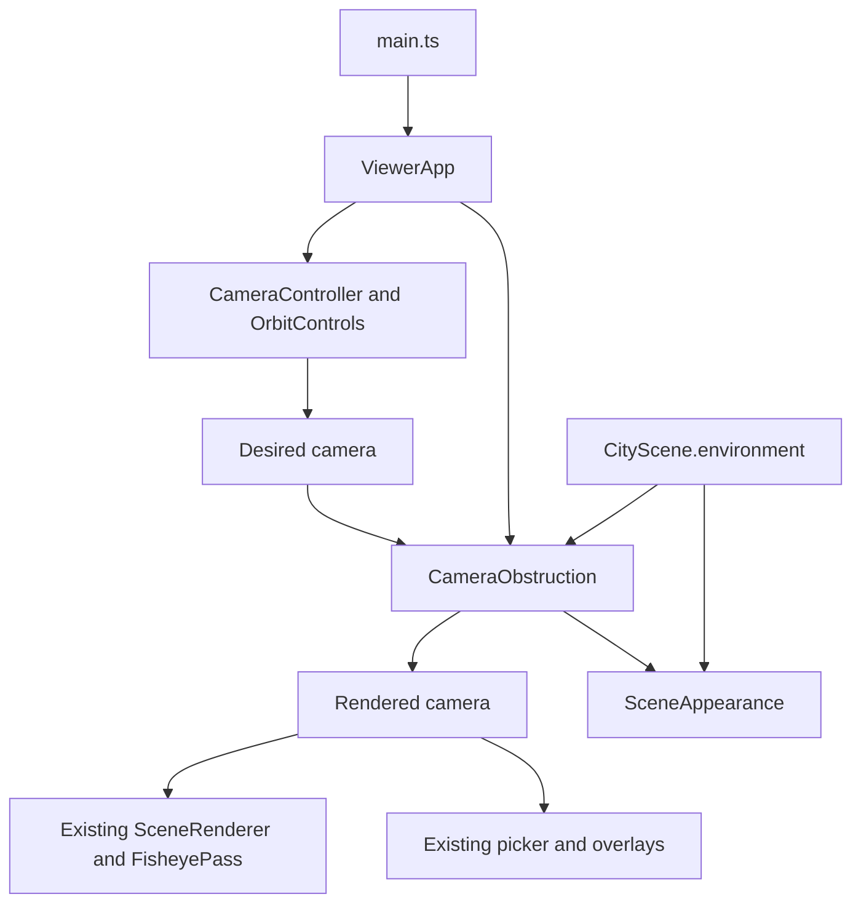

# Technical Design

## Overview
提供 zoom／transparent／wireframe 三種 Camera objects block mode。既有 CameraController 產生 desired 構圖，CameraObstruction 將它投射成渲染相機，SceneAppearance 管理環境外觀。使用現有 Three.js，不新增套件、資產或 GPU pass。

### Goals / Non-Goals
完成平滑縮距回復、75%透明及線框與可靠還原；不改角色資產、運動、導航、First person 眼位或 NPC。

## Boundary Commitments
### This Spec Owns
遮擋模式狀態、顯示鏡頭偏移、環境材質覆寫及其生命週期、Camera UI 接線。
### Out of Boundary
CharacterController／資產系統／SceneRenderer投影與魚眼shader／點地導航維持原權威。M6／SCENE-05實機驗收保持待辦；不新增NPC。
### Allowed Dependencies
Three.js、既有 CameraSubject／FollowCamera安全探測與 CityScene.environment。UI只調用 ViewerApp，不操作Three objects。SceneAppearance不依相機、DOM或角色。
### Revalidation Triggers
CameraController 從壓縮構圖改為 desired 構圖，需重驗 camera-modes／Front；ViewerApp 渲染與picker皆使用 rendered camera，需重驗魚眼／表情／點地導航／Orbit／First person；CityScene 增加環境容器需重驗既有射線與資源釋放。

## Architecture

所有操作與Follow作用於desired相機，從不回讀縮距後rendered位置。ViewerApp先同步resize aspect到desired，再update構圖，再套遮擋到rendered，最後定位overlay與render；初始化亦同步一次。

## File Structure Plan
| 檔案 | 責任 |
|---|---|
| src/camera/CameraObstruction.ts（新） | 模式、身體射線、zoom平滑、輸出渲染相機、委派外觀 |
| src/scene/SceneAppearance.ts（新） | 單一環境範圍的材質clone、還原與dispose |
| src/scene/CityScene.ts | environment容器與邏輯物件分組，原geometry／material所有權不變 |
| src/camera/CameraController.ts | desired構圖，zoom才使用Front候選角度；不在finishFrame壓縮 |
| src/engine/ViewerApp.ts | desired／rendered組裝、模式API與狀態、更新及dispose順序 |
| src/main.ts | Camera選單、提示、初始化禁用／狀態同步 |
| tests/camera-obstruction.test.mjs（新） | 射線／平滑回復／控制與投影／模式整合 |
| tests/scene-appearance.test.mjs（新） | 材質隔離／分組／multi-material／釋放 |
| tests/front-obstruction.test.mjs | Front實際輸出需經遮擋模組驗證 |
| README.md、docs/development-plan.md、.kiro/steering/roadmap.md、相關spec validation | 行為及驗證證據同步，保留歷史與人工待辦 |

## Components and Interfaces
### CameraController
新增 setObstructionAvoidance(enabled:boolean)，只決定Front候選選角；finishFrame只lookAt。預設true，ViewerApp依模式zoom設定。非zoom不縮距、不改Front角度。原select／Follow／Orbit、鏡頭轉場及lens介面不變。

### CameraObstruction
`ObstructionMode = 'zoom' | 'transparent' | 'wireframe'`；建構 `(environment:Group)`；`mode`唯讀預設zoom、`setMode(mode)`、`update(desired,rendered,target,subject,delta,immediate,external=true)`、`dispose()`。
- 先copy desired到rendered，保留所有lens／projection（含resize、First person與魚眼）；只修改rendered的position及lookAt。
- 身體焦點subject.height*0.65；zoom以既有FollowCamera.constrain計算焦點到desired的安全比例，保留0.25m安全距離及0.4m最低距離。比例以1-exp(-8*dt)平滑入／出，與desired運動分離。rendered沿焦點→desired線段位置；lookAt目標隨壓縮程度由原target朝身體焦點靠近。
- transparent沿身體腳／胸／頭與左右肩取樣到目前渲染位置，蒐集所有可見環境交點的environment直屬物件，包含多層遮擋。隱藏節點與祖先排除；wireframe不需遮擋射線。
- First person直接copy且ratio=1，清除透明效果；wireframe仍保持。模式切換先還原舊材質，再套新模式，縮距平滑釋放；重複setMode不重建材質。

### SceneAppearance
`apply(mode:'normal'|'transparent'|'wireframe', blockers?:ReadonlySet<Object3D>)`、`dispose()`。
每個受影響Mesh保留原material（含array）引用及克隆；transparent clone固定opacity0.25／transparent=true／depthWrite=false；wireframe clone設wireframe=true（現有MeshStandardMaterial皆支援）。還原使用原引用並dispose所有獨有clone一次，不dispose貼圖、geometry或原材質；離開範圍／不再受影響物件也還原。只改environment，主角不在範圍。

### CityScene / ViewerApp / UI
environment為Group加入scene；靜態建物、樹、長椅、路燈各分組，地面可為獨立mesh。主角仍直接加入scene。ViewerApp新增 `setObstructionMode`，CharacterStatus新增obstructionMode；選單在Camera區，label／hint描述三模式，初始化錯誤沿既有controls禁用流程。dispose先還原appearance，再釋放CityScene材質。模式保留跨鏡頭／Follow／角色及Reset。

## Requirements Traceability
| Requirements | Components／驗證 |
|---|---|
| 1.1, 1.2 | ViewerApp狀態／main選單與production操作 |
| 2.1, 2.2, 2.3 | desired分離、CameraObstruction比例平滑；實際OrbitControls、長時間遮擋後回復及reduced-motion測試 |
| 3.1, 3.2 | 身體多射線／SceneAppearance；分組、多層、同色材質隔離與還原測試 |
| 3.3 | environment線框、主角在範圍外；切換及browser |
| 4.1, 4.2 | ViewerApp單一loop整合／所有既有tests／browser |
| 4.3, 4.4 | clone dispose與冪等測試、全套tests／build／production smoke |

## Testing Strategy
按上述驗收測試實際幾何射線、相機位置時間序列、長時間遮擋解除、使用者更改desired後回復、不同角色高度、材質原引用與dispose次數。整合使用真正OrbitControls及CityScene；production browser操作三模式、Follow切換、First person、魚眼、Orbit、點地Run及resize，檢查console與載入狀態。不以字串測試冒充GPU驗證。

## Risks / Rollback
平滑拉近遇突發障礙可短暫遮住主角；有限射線及封閉空間不保證完整全身、透明多層有排序限制。三角線框顯示所有三角邊。回復只撤回本次差異並重建／release，不重設使用者修改，不刪Release陌生或舊hashed資產；沒有先前dist備份時不承諾自動回復舊產物。外部Release寫入遵守宿主sandbox。

## 自動審閱
Design Review Gate inline PASS：12條件均映射、邊界及檔案明確，無孤立元件／新依賴；desired/rendered的投影與resize接線、First person例外及材質所有權可驗證。依使用者本階段授權自動審閱。
