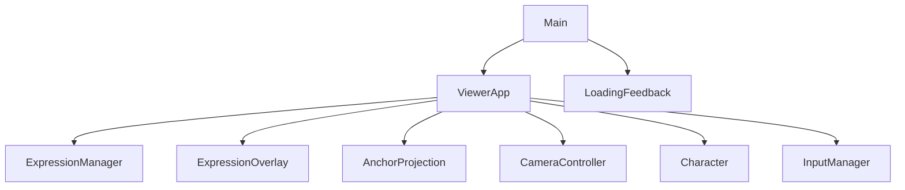
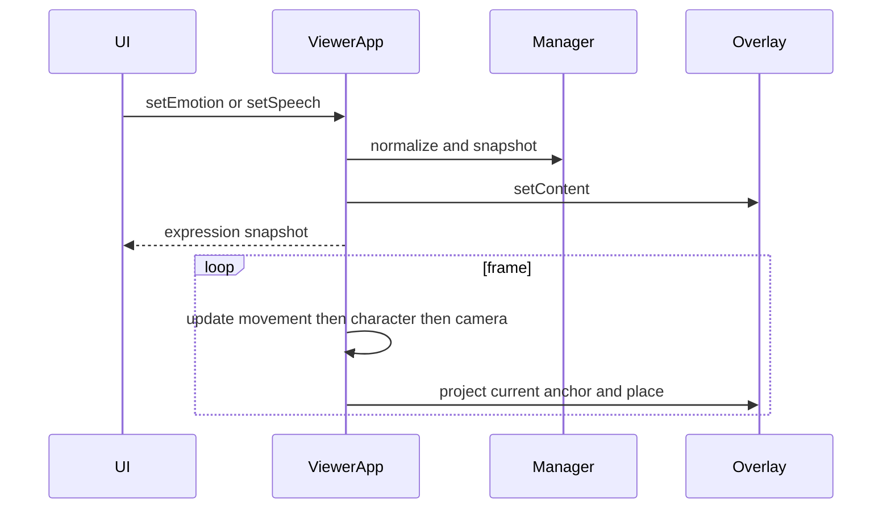

# Design Document

## Overview
在既有 TypeScript／Three.js／原生 DOM 架構擴充表達功能。採 integration-focused light discovery，無新依賴。UI 仍透過 ViewerApp，不讀寫相機或人物物件。

### Goals
純文字對話、五種情緒、正確投影、編輯隔離、明確載入呈現與無障礙。
### Non-Goals
GLB loader、臉部動畫、資料儲存、建築遮擋、多人、外部服務。

## Boundary Commitments
- ExpressionManager 僅管理情緒／對話狀態，ExpressionOverlay 僅管理其 DOM 及位置。
- AnchorProjection 將 world point 映射為 canvas CSS pixels，不改變相機。CameraController 仍為 view／Follow 權威。
- ViewerApp 組裝 anchor、有效鏡頭模式、更新時序與 overlay，main 組裝可見控制。
- LoadingFeedback 僅消費 discriminated loading／ready／error 資料，不產生 loader 或模擬進度。
### Out of Boundary
不改移動物理、鏡頭構圖／shader 外觀，不提前整合資產；不聲稱實機／跨 GPU 完成。
### Allowed Dependencies
ExpressionManager、loadingFeedback 為純 TypeScript；AnchorProjection 僅依 Three.js；ExpressionOverlay 依 DOM 與 expression types；ViewerApp 依上述模組；main 只透過 ViewerApp 與 loading presentation。
### Revalidation Triggers
相機 shader、FOV、capture aspect、角色高度或 loader event contract 改變時，重驗投影與載入呈現。里程碑 6 必須以真實 loader 取代契約測試的端到端證據。

## Architecture

依賴方向為 types／pure state → projection／DOM presentation → ViewerApp → main；無下層反向匯入上層。

### Existing Architecture Analysis
ViewerApp 已在每幀更新 movement、character、camera、render。overlay 在 camera 更新後讀最終相機，與 render 同幀。角色高度由 Character 提供；位置由 MotionSnapshot 提供。InputManager 已忽略表單按鍵，但既有 latch 需在進入編輯時清除。
### Technology Stack
| Layer | Choice / Version | Role | Notes |
|---|---|---|---|
| UI | 原生 DOM / TypeScript ^7.0.2 | 控制、文字與 ARIA | 無框架新增 |
| Projection | Three.js ^0.186.1 | world-to-view transform | 使用現有版本 |
| Validation | Node 原生 test、Vite ^8.3.4 | 行為及 production build | 沿用 scripts |

## File Structure Plan
### New Files
- src/expression/ExpressionManager.ts：emotion 定義、immutable snapshot、160 code-point normalization。
- src/expression/ExpressionOverlay.ts：overlay DOM、純文字與位置、dispose。
- src/camera/AnchorProjection.ts：普通／魚眼 world anchor 投影與 visibility。
- src/ui/SpeechEditor.ts：組合輸入／input／change／blur提交時序與AbortSignal清理。
- src/ui/LoadingFeedback.ts：載入狀態格式化及 accessible presentation。
- tests/expressions.test.mjs、tests/anchor-projection.test.mjs、tests/loading-feedback.test.mjs、tests/expression-overlay.test.mjs、tests/speech-editor.test.mjs：核心行為測試。
### Modified Files
- src/engine/ViewerApp.ts：組裝、public expression API、update／dispose。
- src/input/InputManager.ts：編輯 focus 清除既有意圖及組合按鍵隔離。
- src/main.ts：expression 控制、IME、狀態播報及載入呈現連接。
- src/style.css：overlay、文字欄位、focus／responsive；tests/input.test.mjs 補回歸。
- README.md、docs/development-plan.md、.kiro/steering/roadmap.md 與必要 steering：最新狀態與驗證連結，不刪歷史。

## System Flows

編輯採 input 即時更新，compositionstart 至 compositionend 暫緩正規化與播報；160 上限由 model 強制，計數採 Array.from。播報在 change 或明確情緒／清除動作，位置不屬 live region。

## Requirements Traceability
| Requirement | Summary | Components | Interfaces | Flows |
|---|---|---|---|---|
| 1.1, 1.2, 1.3 | 情緒與會話保留 | Manager、ViewerApp、main | setEmotion/getExpression | content |
| 2.1, 2.2, 2.3 | 純文字、長度與清除 | Manager、Overlay、main | setSpeech | input |
| 2.4 | 編輯隔離 | InputManager、main | stop、focusin | focus |
| 3.1, 3.2, 3.3 | 正確位置與裁切 | AnchorProjection、ViewerApp | projectAnchor | frame |
| 3.4, 3.5 | 第一人稱與不攔截 | Overlay、ViewerApp、CSS | place | frame |
| 4.1, 4.2, 4.3 | 載入／錯誤呈現 | LoadingFeedback、main | presentLoading | status |
| 5.1, 5.2 | labels／播報 | main、LoadingFeedback | native controls | content |
| 5.3, 5.4 | responsive／reduced motion | CSS、Overlay | place | frame |
| 5.5 | 回歸／清理 | ViewerApp、InputManager、Overlay | dispose | lifecycle |

## Components and Interfaces
### ExpressionManager
Inbound ViewerApp (P0)；無 outbound。Contracts: Service、State。
Emotion = 'none' | 'happy' | 'sad' | 'angry' | 'surprised'，label 與 emoji 為固定可信對照表。
`setEmotion(emotion: Emotion): void; setSpeech(text: string): void; get snapshot(): Readonly<ExpressionState>`。
ExpressionState = { emotion: Emotion; speech: string }。未知 emotion 拒絕並保持舊值；speech 以 Array.from 截至160、不 trim 儲存，顯示以 trim 判斷空白。預設 none／空字串。snapshot 複製以防外部寫入。無 persistence。

### AnchorProjection
Inbound ViewerApp (P0)，External Three.js (P0)。Contracts: Service。
`projectAnchor(point: Vector3, camera: PerspectiveCamera, width: number, height: number, fisheye: boolean): {x: number; y: number} | null`。
輸出 CSS pixels，以容器左上為原點。更新 camera matrixWorld 後將 point 轉 camera space；深度 <= near 或 >= far／非有限尺寸一律 null。
普通鏡頭用實際 projectionMatrix，拒絕 NDC x/y 超出 [-1,1]。
魚眼必須匹配 FisheyePass：halfFov=80°，theta=atan2(hypot(x,y),-z)，r=theta/halfFov。r>1 隱藏；radius=min(width,height)/2，pixel=center+normalized camera XY*r*radius，y 符號反轉。中心避免除零。不可使用普通 camera.project 當魚眼位置。

### ExpressionOverlay
Inbound ViewerApp (P0)，DOM (P0)。Contracts: Service。
`constructor(container: HTMLElement); setContent(state: Readonly<ExpressionState>, icon: string): void; place(point: ScreenPoint | null): void; dispose(): void`。
建立 aria-hidden、pointer-events:none 容器，emoji 與文字皆用 textContent；側欄提供可讀等價內容。place 拒絕 null 隱藏，內容空白也隱藏。泡泡文字寬度最多240px且不超出容器，最大高度受可用上方／下方空間約束且裁切；優先位於 anchor 上方，靠近頂部時向下排，水平 clamp 不移動 anchor marker。尺寸以 layout 元素測量，不依 DPR。無 CSS transition；remove 是 idempotent。

### LoadingFeedback
Inbound main／未來 loader (P0)；無 loader dependency。Contracts: Service、State。
`LoadingState = {phase:'loading';message:string} | {phase:'ready';message:string} | {phase:'error';message:string;recovery:string}`。
`describeLoading(state): {text:string;busy:boolean;error:boolean}; presentLoading(element: HTMLElement,state:LoadingState): void`。
一個 role=status、aria-live=polite、aria-atomic=true 區塊搭配 viewport aria-busy。error 以 role=alert 提示及復原文字；以 textContent 寫入且重複資料不重建。renderer status 保持獨立，不將 WebGL ready 誤當 GLB ready。

### ViewerApp and main
ViewerApp 建構 overlay 並接收 content API；anchor=(motion.x,motion.y+character.height+0.25,motion.z)。first-person 或 context lost 時隱藏。setCharacter 更新 anchor 由每幀處理，不重置 expression。
SpeechEditor(input, update, signal) 封裝 compositionstart/end、input、change／blur；update(text, announce) 只於非組合輸入提交，AbortSignal集中清理。
main 原生 select 五種情緒、textarea、字數與 Clear speech 按鈕，aria-describedby 提示。進入文字區停止舊意圖，focusin 防 latch。input 更新泡泡；change／compositionend 播報完整內容。錯誤時控制 disable selector 加入 textarea。所有事件使用既有 AbortController。

## Data Models
僅頁面記憶體 expression snapshot 與 LoadingState union；沒有網路、儲存與 migration。使用者文字不得插入 HTML、URL、CSS 或 console。

## Error Handling
無效情緒保留舊值；過長文字正規化並同步顯示截短結果／字數。失敗仍顯示既有場景復原建議。context lost 隱藏 overlay，恢復後下一幀定位。

## Testing Strategy
- Manager：預設、情緒、未知值、snapshot 隔離、160 Unicode、空白／多行／HTML literal (1.1–2.3)。
- Projection：普通中心／背面／near／far／NDC、魚眼中心／離軸與 shader inverse roundtrip、不同 aspect、80°邊界 (3.1–3.3)。
- Overlay：textContent、empty、first-person null、clamp／dispose 以 DOM double，真實 layout 由 browser 補足 (2.3,3.4,3.5,5.3)。
- Input：focusin 停止鍵盤／pointer latch、IME key 不 preventDefault、blur／dispose 回歸 (2.4,5.5)。
- Loading：三種 union、busy／error semantics、literal error text (4.1–4.3,5.2)。
- Production browser：桌面及390×844，情緒／清除／多行／長文字／IME流程，Front／俯視／低角度／魚眼／First person，Follow暫停、角色切換、跑跳、光影、Tab焦點。完整 Node suite + ./scripts/project.ps1 build。

## Performance and Rollback
單一 overlay，每幀只更新位置，不更新 live region 或重建文字；無額外 renderer／loop。每幀 layout read 限制為必要尺寸；不新增魚眼 RT。無跨平台 FPS 承諾。Rollback 逐段移除本次新增連接與檔案，保留既有未提交差異，不 reset checkout。
