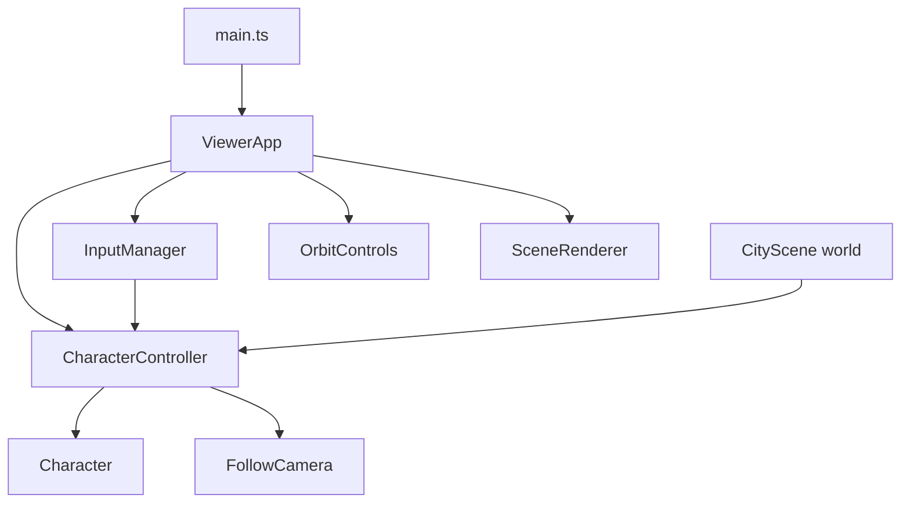
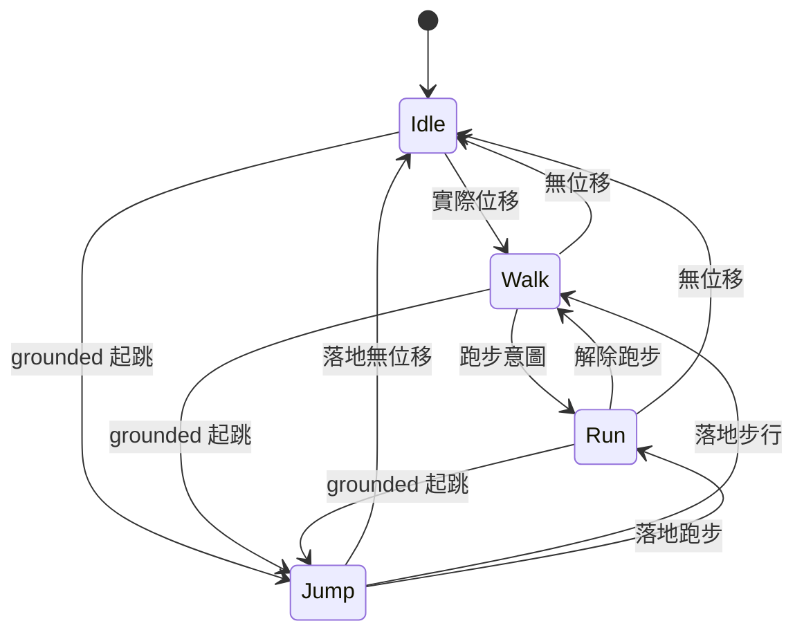

# Technical Design

## Overview
由 ViewerApp 單一 loop 組合人物、純運動控制、輸入及 Follow；維持既有 Three.js／TypeScript／Vite，無新依賴。Goals：可操作的原型垂直功能與可靠驗證。Non-Goals：GLB、骨架 clip、NavMesh、魚眼與表情。

## Boundary Commitments
### This Spec Owns
人物 transform、外觀與 pose、意圖、移動／跳躍、場景靜態碰撞、基本 Follow、UI 與生命週期整合。
### Out of Boundary
不重構 renderer、不重做城市；最終資產與動畫、延伸鏡頭、表情分別屬後續 spec。
### Allowed Dependencies
Character／Follow 使用已安裝 three；controller 只依 motion 型別。CityScene 提供地面與障礙資料、不匯入控制器。main 只用 ViewerApp 公開介面。
### Revalidation Triggers
角色 transform／高度、motion snapshot、Follow 或場景碰撞契約變動須重驗下游 camera-modes、character-expressions-ui、rigged-character-assets；新增設施須同步碰撞資料。

## Architecture
保留既有 ViewerApp／CityScene／SceneRenderer／OrbitControls，新增單一角色；不建立通用 ECS 或相機 registry。

依賴方向：motion 型別 → 獨立功能模組 → ViewerApp → main；CityScene 只依共享型別。技術沿用 package.json 及鎖檔，Node 22.12+ 的原生 test runner 配合 experimental-transform-types，不新增依賴、不改 TS 編譯設定。

## File Structure Plan
| 檔案 | 新增／修改 | 責任 |
|---|---|---|
| src/character/motion.ts | 新增 | 意圖、動作、快照與 world 型別 |
| src/character/CharacterController.ts | 新增 | 純運動、碰撞、動作狀態 |
| src/character/Character.ts | 新增 | 外觀、關節 pose、dispose |
| src/input/InputManager.ts | 新增 | 鍵盤、指標、失焦與 jump pulse |
| src/camera/FollowCamera.ts | 新增 | 目標及鏡頭追蹤 |
| src/scene/CityScene.ts | 修改 | 自己設施的碰撞資料與地面高度 |
| src/engine/ViewerApp.ts | 修改 | 組裝、loop、公開介面、dispose |
| src/main.ts、src/style.css | 修改 | 可見控制、狀態、響應式樣式 |
| tests/character-movement.test.mjs | 新增 | 原生 Node 行為測試 |
| package.json | 修改 | test 命令，依賴與鎖檔不變 |
README、steering、roadmap 僅同步實作及驗證狀態。共用檔案依序修改。

## Components & Interfaces
### 1. CharacterController 與資料
Service／State：`MovementIntent { x,z,run,jump }` → `update(delta,intent): Readonly<MotionSnapshot>`；snapshot 為 `{ x,y,z,heading,speed,grounded,action }`，action 為 idle／walk／run／jump。world 為 `{ bounds, obstacles, groundHeight(x,z) }`，障礙為 XZ AABB；無 DOM／Three 依賴。

walk=1.8 m/s、run=4 m/s、重力=18 m/s²、起跳速度=6 m/s；水平半徑=0.28m，各變體共用安全包絡。delta 限 0–0.05 秒，再切不大於 1/120 秒子步，逐軸碰撞以允許滑動；障礙膨脹人物半徑，不允許跳過設施。可走範圍 x=±8.3、z=±26.5，中心再縮半徑；建物在外側。CityScene 在建立樹槽、長椅、路燈及中央設施時記錄 AABB，不讓控制器重抄座標。

道路腳底高=0.075、人行道=0.32（abs(x)≥4.5）；此原型允許直接踏上路緣，不做 stair solver。grounded 貼地，空中落地鉗至當地地面。jump 只接受上升緣且 grounded，持續 true 不連跳；state 依實際位移及 grounded 決定。Stop 不取消空中重力。

### 2. Character
Service／State：公開 `root: Group`、`height`、`setVariant('man'|'woman'|'child')`、`update(snapshot,delta)`、`setShadows(enabled)`、`dispose()`。局部 +Z 為正面、腳底 y=0；身高約 1.8／1.68／1.15m。共享 box／sphere geometry 與有限材質；以比例、衣服色與髮型區分，切換不重建 geometry 或 root。實際速度推進步態 phase，jump 收腿，idle 回中立。資源只釋放一次並移除 parent。

### 3. InputManager
Service：`sample()` 消耗 jump pulse；`setRun`、`jump`、`stop`、`bindDirection(button,direction)`、`dispose`。Window／Document 可注入以測試。WASD／箭頭、Shift、Space；忽略 input／textarea／select／button／contenteditable，僅真正接收的遊戲鍵 preventDefault。

每個 pointerId 獨立追蹤，capture 接收離開後放開；up／cancel／lostcapture 清除對應方向。鍵盤 activate（click detail=0）設定方向 latch，Stop 停止；滑鼠 click 不鎖定。blur／hidden 清 keyboard、pointer、latch、Run toggle 與 jump。AbortController 移除全部事件。UI 讀取 running 狀態保持同步。

### 4. FollowCamera
Service：`update(camera,target,snapshot,height,delta,immediate)`；胸口目標、朝向後方約 6m、上方約 3m，指數插值。啟用／reduced-motion 使用 immediate；Follow 禁用 Orbit，退出或 preset 恢復 Orbit。

瀏覽器審閱修正：FollowCamera 建構時接收靜態城市 objects 的獨立陣列（角色加入 scene 前複製，不含角色）。以 Raycaster 檢查目標至插值後相機的線段，遇到設施則縮短距離，保留 0.25m 間隔，避免轉身時進入樹冠或建物遮擋人物；此為 5.1 的視線修正，不包含延伸鏡頭策略。

### 5. ViewerApp／UI 整合
loop：sample → controller → Character → Follow 或 Orbit → render。公開 setCharacter、setFollowing、setRunning、jump、stop、bindDirection、getCharacterStatus；main 不碰 scene objects。初始 man／Idle／Orbit／overview；角色切換保持動作與位置。狀態變動才更新 DOM，避免 live region 每幀重複。方向固定世界座標，help 說明；Run toggle、Jump／Stop 按鈕與四方向控制皆具 accessible name。

## System Flows

## Requirements Traceability
| Requirement | Summary | Components | Interfaces | Flows |
|---|---|---|---|---|
| 1.1, 1.2, 1.3 | 原型切換與 pose | Character、UI | setVariant/update | 外觀／狀態 |
| 2.1, 2.2, 2.3, 2.4, 2.5, 2.6 | 移動、跑跳與時間限制 | Controller、Input | update/sample | 動作狀態 |
| 3.1, 3.2, 3.3 | 碰撞／地面／滑動 | Controller、CityScene | world | 子步解算 |
| 4.1, 4.2, 4.3, 4.4 | 安全輸入 | Input、UI | bindDirection/stop | cancel／blur／hidden |
| 5.1, 5.2, 5.3 | Follow／Orbit | Follow、ViewerApp | update/setFollowing | 模式切換 |
| 6.1, 6.2, 6.3 | 回歸、釋放、驗證 | 全部 | dispose、test/build | 啟動／釋放 |

## Testing Strategy
- Node：斜向等速、Run／Stop、jump 邊緣與落地、delta cap、邊界／障礙／滑動、地面高度與實際動作。
- Three 無 GPU：三種高度、transform 保留、pose、dispose；Follow 平滑與 immediate。
- EventTarget：按鍵 repeat／編輯隔離、blur／hidden、pointer cancel／lostcapture、多來源及 dispose。
- Browser production preview：首次可用、人物選擇、走跑跳停、Follow／Orbit／preset、失焦、可見控制、光影與 resize／窄螢幕、console；無 runtime 證據不得宣稱 GO。

## Error Handling / Performance / Rollback
保持既有初始化錯誤提示。子步 cap 限 CPU 與穿透；hot loop 不建 geometry／material。陰影切換刷新人物材質；dispose 先 input／人物再既有場景與 renderer。只撤回本次新增檔與整合 diff，不用 destructive Git reset。

## 自動審閱
2026-10-24 inline PASS：22 條 traceability、責任界線、型別、檔案、碰撞來源、輸入取消與 Follow 互斥皆明確；依使用者授權，非人工逐份核准。

