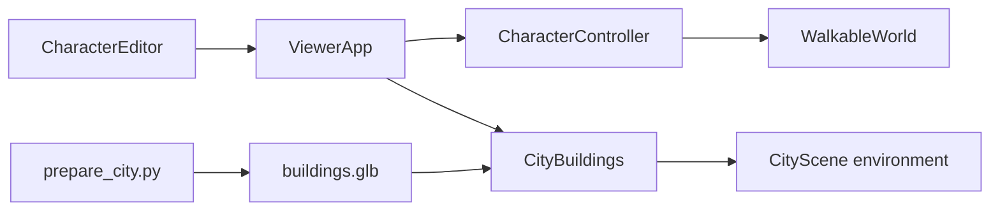
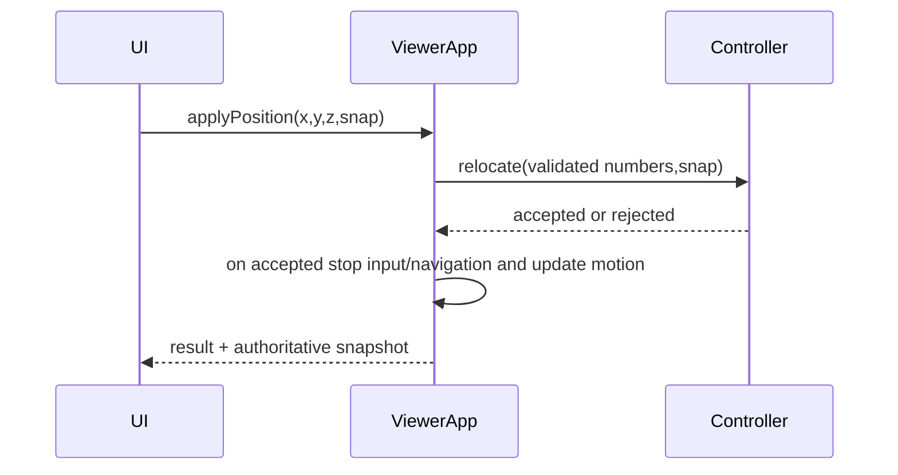

# Design Document
## Overview
LATER-02混合街區資產與主角編輯。保留既有互動，以原創本機資產完成歷史Blender建築方向；編輯器只操作主角。
### Goals
八棟可重建資產／失敗回復、權威XYZ與速度、可驗證控制權。
### Non-Goals
任意GLB匯入、任意物件transform、場景切換、動態碰撞及保存編輯。
## Boundary Commitments
### This Spec Owns
CityBuildings的GLB載入生命週期、程序建築可見性；CharacterController的原子位置提交與walk速度；UI草稿與狀態接線。
### Out of Boundary
道路／碰撞／NavMesh／巡迴／相機策略保持原契約。Inspector只因場景樹更新自然包含新節點。
### Allowed Dependencies
UI→ViewerApp→CharacterController及CityBuildings；CityBuildings→Three GLTFLoader／資源釋放；Controller→motion types，禁止controller依賴navigation或UI。
### Revalidation Triggers
位置提交後相機／動畫／粒子錨點；導航速度不受walk設定影響；新增建築之透明／wireframe／Xray及陰影、dispose晚到結果。
## Architecture
### Existing Architecture Analysis
CityScene程序建築八個Group、world解析高度與障礙。ViewerApp每幀controller更新motion，角色／動畫／相機共同消費motion。
### Architecture Pattern & Boundary Map

### Technology Stack
現有Blender5.2.2離線匯出、Three0.186.1／TypeScript，無新套件。
## File Structure Plan
### Directory Structure
- tools/assets/prepare_city.py：原創八棟生成、合併、匯出及manifest。
- blender/city-block.blend：可編輯生成來源成品，不進dist。
- public/assets/city/：GLB、manifest、ATTRIBUTION。
- src/scene/CityBuildings.ts：載入／採納／錯誤／重試／dispose。
- src/ui/CharacterEditor.ts：HTML、XYZ草稿、速度及讀數更新。
- tests/city-assets-editor.test.mjs：實際GLB及控制器／loader回歸。
### Modified Files
- src/scene/CityScene.ts：記錄原建築groups供替換。
- src/character/CharacterController.ts：relocate(position,snap)、walkSpeed、update可傳入導航速度。
- src/engine/ViewerApp.ts：資產狀態、位置公開API、手動與導航速度隔離。
- src/ui/controlPanelContent.ts／src/main.ts：主角編輯區及事件生命週期。
- README、docs/asset-pipeline、development-plan、roadmap、checkpoint：操作／來源／證據。
## System Flows

Y取目的地groundHeight，snap時忽略Y但XYZ仍需有限。非snap Y在[ground,ground+10]，地表以上grounded=false，velocityY=0自然落下。拒絕不修改motion，UI focus本身依既有輸入政策停止導航。
## Requirements Traceability
| IDs | Component／驗證 |
|---|---|
|1.1,1.2|prepare_city、CityBuildings、CityScene；實際GLB／loader失敗及browser|
|1.3|腳本、manifest、attribution、asset-pipeline|
|2.1|CharacterEditor狀態與草稿分離；browser|
|2.2,2.3,2.4|controller.relocate及ViewerApp；controller真world測試|
|2.5|ViewerApp生命週期guard；browser context|
|3.1,3.2|controller.setWalkSpeed與update第三參數；巡迴／點地回歸|
|3.3|InputManager既有focus隔離、Editor事件；browser|
## Components and Interfaces
### CharacterController
relocate({x,y,z},snap=true): boolean，原子驗證bounds／radius障礙／height後更新state，速度0、jumpHeld=false、垂直速度0；snapshot getter複製狀態。setWalkSpeed(number): boolean，get walkSpeed。update(delta,intent,speedOverride?)：預設walkSpeed或Run4；自動導航由App傳入原有intent.run ? 4 : 1.8，巡迴維持原有intent倍率。action依run或速度>1.8決定。
### CityBuildings
constructor(environment,fallbacks,report,load?)，load注入Promise<Group>供無DOM測試；load(): Promise<void>只容許一個pending；status loading/ready/error；成功驗證八棟named roots且範圍對應後一次掛入並隱藏fallback。失敗保留fallback且retry可用。dispose釋放採納及晚到root，無重複載入。每棟root獨立加入environment。
### CharacterEditor
getMotion／getWalkSpeed／setWalkSpeed／applyPosition從ViewerApp呼叫；定期讀數不寫草稿。Read current按鈕填XYZ；Apply顯示結果。snap預設true。UI事件由main AbortSignal管理，不建第二迴圈。
## Data Models
MotionSnapshot沿用；CharacterStatus追加motion及walkSpeed。CityAssetState={phase:loading|ready|error,message:string}。設定僅本頁記憶。
## Error Handling
非法位置／速度返回false且保持原值。載入錯誤顯示fallback／retry；dispose後忽略callback，釋放結果。無背景下載與本機服務。
## Testing Strategy
先RED再實作：controller非法／障礙／snap／落地／速度隔離；真GLB八棟bounds／hash／無外部URI；loader成功／失敗重試／pending／dispose晚到。完整project test／release，production瀏覽器XYZ、速度、導航接管、模型來源、相機及響應式畫面，零JS errors。以既有正式Release為驗證來源。
## Performance & Scalability
每棟按材質合併、GLB<1MB；不新增每幀raycast地表，不新增動畫loop。
