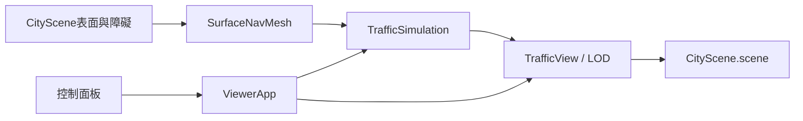
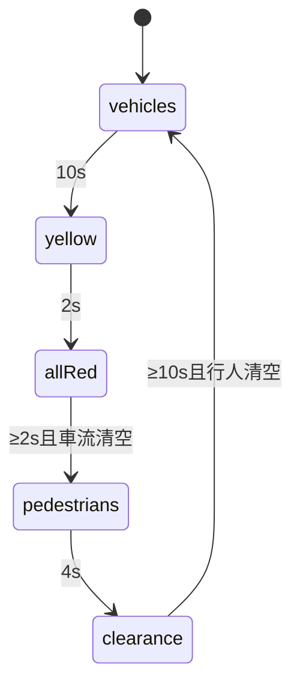

# Design Document

## Overview
目的為在現有街道加入有界、可重現的行人與車流。用一個協調器持有時間與路權，視覺層只讀取狀態。完成導航／交通／控制／LOD與測試；非真實交通工程或物理碰撞系統。

## Boundary Commitments
### This Spec Owns
凸NavMesh、人行道／斑馬線表面契約、NPC路徑與狀態、雙向車流與號誌、數量控制、模擬模型LOD與釋放。
### Out of Boundary
不變更主角DestinationNavigation、粒子Target、主角GLB、鏡頭權威、陰影自動偵測或人工驗收裁定；不增加依賴／外部資產。
### Allowed Dependencies
既有WalkableWorld靜態障礙／高度、Character與Three.js；UI只經ViewerApp API。無服務、模型下載、資料庫或migration。
### Revalidation Triggers
街道尺寸／障礙、角色半徑、Target位置／體積、鏡頭渲染生命週期、模擬設定契約變更需重驗導航與交通整合。

## Architecture
現有ViewerApp持有CityScene與各actor。新增模擬為scene sibling，不放進靜態environment，以免相機誤把移動角色當固定障礙。

技術：既有TypeScript strict、Three.js 0.186.1、Vite、Node runner；不新增runtime。

## File Structure Plan
|檔案|操作／責任|
|src/navigation/SurfaceNavMesh.ts|新增：凸矩形切分、共享portal、連通搜尋|
|src/simulation/streetLayout.ts|新增：人行表面、路段與斑馬線常數|
|src/simulation/TrafficSimulation.ts|新增：純狀態號誌／NPC／車流／設定|
|src/simulation/TrafficView.ts|新增：程序模型、號誌、LOD、資源所有權|
|src/engine/ViewerApp.ts|修改：組裝、delta、避讓主角Target、API、釋放|
|src/ui/controlPanelContent.ts、src/main.ts|修改：控制與狀態顯示|
|tests/traffic-simulation.test.mjs|新增：路徑、安全、設定、LOD生命週期|
|README.md、docs/development-plan.md、.kiro/steering/roadmap.md|追加授權／操作／限制，保留歷史|

## System Flows

更新次序：主角移動→以主角及Target平面位置更新模擬→號誌／NPC／車輛→相機→LOD顯示→render。隱藏、lost context不累積追趕時間；單次dt上限0.05s。

## Requirements Traceability
|需求|元件／契約／測試|
|1.1, 1.2|SurfaceNavMesh／polygon+portal／障礙、無路徑、路徑區段|
|2.1, 2.2, 2.3|TrafficSimulation行人狀態／等待與分流／長時間停等與過街測試|
|3.1, 3.2, 3.3|TrafficSimulation號誌車流＋TrafficView燈與停止線／互斥、清空、車距|
|4.1, 4.2, 4.3|configure、reset、snapshot、dispose／ViewerApp與UI接線／非法原子拒絕、暫停與釋放|
|5.1, 5.2|TrafficView原生LOD／有界數量／近遠draw與geometry、長時間上限測試|

## Components and Interfaces
### SurfaceNavMesh
輸入readonly矩形表面與AABB障礙、半徑；對表面外界內縮的結果保留斑馬線連接（先以人物中心可走區域定義表面，障礙單獨擴張）。公開polygons含矩形／中心／鄰接portal；findPath(start,end): PointXZ[] | null。非法點不投影至合法點。相鄰共享邊正長度才連通，禁止僅角落相接。路徑依中心→入口→中心，不跨出凸區。

### TrafficSimulation
configure(patch: Partial<TrafficSettings>): boolean；驗證所有欄位且原子套用，未知欄位拒絕。enabled=false、paused=false、npcCount=6、vehicleCount=4、lod=true。數量變動重置以保持可重現；其他設定不重置。
reset(): void；update(delta, blockers): void；snapshot為複製值。NPC狀態idle／walking／waiting-signal／yielding；目的地循環且起點分散。不用隨機外部狀態。行人路徑依NavMesh，跨越車道前在x±4.9等候；獲准後持有crossing直至抵達對側人行道。
車輛lane±1、中心x±2.2、heading沿z，長3.2m；停止線z±4，同向中心距≥4.5，端點重生需位置空閒；阻擋者在車道前方則停。全紅期等車清空；行人清空期等所有crossing及路口行人離開。主角／Target阻擋可能無限等待，安全優先，不操縱使用者。

### TrafficView
擁有root與固定數量模型，按數量變動重建且釋放舊物件。NPC近距Character，遠距單box；車輛近距車身／座艙／輪子，遠距單box；使用原生LOD 24m、hysteresis=.15、autoUpdate=false，鏡頭更新後update。LOD off強制近距；邏輯不受LOD影響。遠距不更新步態，回近時使用當前位置／action。
號誌僅材質emissive無新增PointLight，紅黃綠及行人燈按同一權威phase顯示。NavMesh可視化非必要產品控制，測試檢查polygons契約。

## Data Models
PointXZ／NavPolygon／Portal是純值；Npc含id、variant、motion、state、path、waypoint、crossing、目的地序號；Vehicle含id、lane、z、speed。Snapshot複製且不暴露mutable路徑；無持久化或網路。

## Error Handling
非法設定與NaN／Infinity dt拒絕或忽略；無路徑者idle停留重試；無合法spawn則不生成，不穿障礙。釋放可重入。飽和停等不硬闖綠；UI顯示當前phase／waiting數量。

## Testing Strategy
- 路徑：凸分割共享邊、中心／portal區段全在表面內、半徑障礙排除、非法／不連通端點。
- 交通：多個週期行人／車互斥、黃燈不進入、進入者清空、同向頭距、Target阻擋、端點重生。
- 控制：0／上限／非法設定、copy snapshot、pause／disable凍結、reset可重現、巨幅dt有界。
- 視覺整合：LOD近遠實際可見mesh減少、遲滯、off恢復近距、dispose無重複釋放；主角／Target既有測試回歸。
- 完整tests、typecheck／build／release；可用瀏覽器檢查控制／畫面，若環境受阻記錄而不冒稱人工通過。不把本次測試當作ACCEPT-01裝置FPS驗收。

## Performance & Scalability
最多24行人8車，固定dt與線性路徑跟隨；NavMesh只在建構產生，路徑在目的地改變時產生。初版A*可用線性open list，圖規模受靜態街景約束。碰撞避讓O(N²)在上限內；不宣稱大量人群支援。

## 實作審閱後收斂
局部密集交會測試後，過街資格採ID輪序一次一人；其餘角色在出生／抵達地點附近活動，避免全部擠在同一入口。過街reservation由入口x±5.8至對側x±5.8持有；道路邊界仍為x±4.8。避讓導致原路段失去視線時，以同一NavMesh重新接回下一waypoint。路徑簡化採精確segment區間覆蓋，只有整段位於多邊形聯集才縮短。此為保守有界NPC AI，不宣稱人群全局無死鎖。
