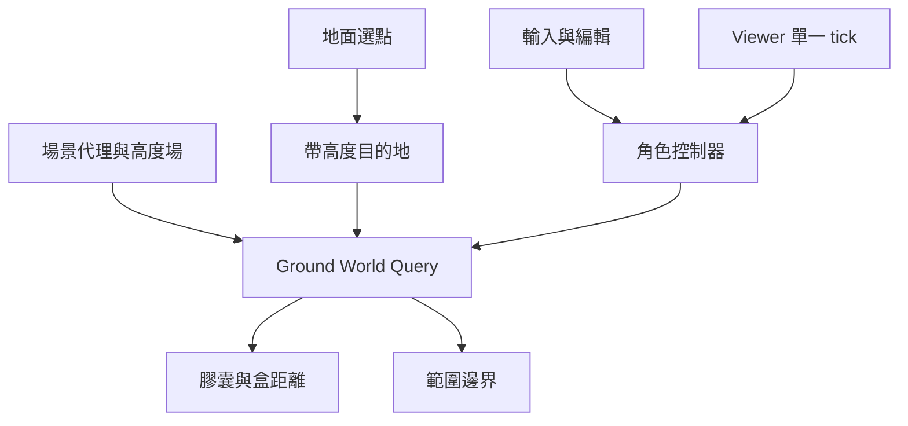

# 地面三維查詢設計

## Overview
擴充既有 WorldQuery；城市維持 planar adapter，地表／洞穴改用 ground-volume adapter。有限 AABB 岩體使用真正直立膠囊的連續距離交會；接地為明列高度場／盒頂支撐政策，非任意三角網格膠囊 solver。

## Boundary Commitments
### This Spec Owns
- 有限三維盒代理、膠囊掃掠／overlap、地表 normal／同源射線、上下層 surface 選擇。
- 地面移動的接觸滑動、步高／坡角／頭部驗證，角色高度原子切換。
- 保留高度的目的地與地面路段驗證，場景接線及小型洞穴岩台驗證幾何。
### Out of Boundary
任意凸體／旋轉膠囊／任意網格剛體、NavMesh跨樓層規劃、動態平台、region union／portal、固定模擬時鐘、飛行／水域／太空、相機演算法及Profiles schema。
### Allowed Dependencies
WorldQuery 型別 → CapsuleBox 幾何／RangePolicy → GroundWorldQuery → CharacterController／navigation → Viewer／scenes。HeightField 為現有純 CPU 資料；query 不依賴 DOM、GPU、Viewer 或資產載入器。無新增套件、服務或資產。
### Revalidation Triggers
capability／surface／角色尺寸改動重驗城市、navigation、tour、XYZ及picker；場景幾何改動重驗可見代理、相機、地表品質與生命週期；Viewer接線重驗兩runtime和Profiles。

## Architecture

城市分支保留原先 X→Z 與重力行為；ground-volume 分支使用有界地面子步驟、最多四次接觸滑動及垂直掃掠。兩者同屬控制器單一權威，不新增第二個更新入口。

## File Structure Plan
| 路徑 | 責任 |
|---|---|
| src/world/WorldQuery.ts | capability union、可選 normal／surface 查詢選項 |
| src/world/CapsuleBox.ts | 純幾何直立膠囊與盒的 overlap／連續 sweep |
| src/world/GroundWorldQuery.ts | 有限盒、支撐表面、範圍、raycast及地面路段驗證 |
| src/scene/HeightField.ts | 同格網法線與有限線段射線，沿用量化資料 |
| src/character/CharacterController.ts | 地面三維策略、四接觸滑動／步高／洞頂、原子尺寸更新 |
| src/character/motion.ts | 共用角色尺寸常數 |
| src/scene/CaveScene.ts | 同源盒／岩台／階梯與穩定表面 ID、有限活動高度 |
| src/scene/TerrainScene.ts | 高度場與有限樹幹代理接線 |
| src/navigation/DestinationNavigation.ts | optional y、逐段ground path、尺寸參數 |
| src/navigation/GroundPicker.ts | 回傳命中高度，維持原穿透／blocker策略 |
| src/main.ts | 既有角色選單拒絕時還原選項並顯示淨空訊息 |
| src/engine/ViewerApp.ts | 尺寸切換、導航尺寸與scene bind；移除被真實淨空取代的固定Y上限 |
| tests/ground-volume.test.mjs | 幾何／地面／多層／控制器／導航與場景整合 |
| 本spec、docs/development-plan.md、roadmap、scene-runtime-collision-mask-spec.md | 授權、流程與實際能力／限制 |

## Components and Interfaces
WorldQuery.geometry 增加 ground-volume，surfaceSample(position, options?) 回傳 height／surfaceId／optional normal。options.maxRise 為有限非負值，預設 .25m；多層選最高且不高於 feet.y+maxRise 的支撐面，單值高度場可供貼地編輯取得上方表面。找不到支撐回 unavailable。Ground query 額外 groundSegment(start,end,capsule) 回 QueryResult<boolean>，planar 不提供且沿用原水平 sweep。

CapsuleBox 使用腳底、radius與height定義的垂直線段加球。距離函數對各軸為分段線性，按盒面交越時刻切段求二次式最早接觸；嚴格進入才阻擋，切向／離開合法。容差1e-8m，不以擴張盒拐角冒充圓弧。以 swept AABB 作廉價寬相位，無必要建立外部空間索引。回傳 fraction、法線及穩定 solid id。adapter僅對同源可行走盒頂附加stepSurface（height／id），供controller核對整個台階高度，避免圓弧法線累積抬升繞過步高上限。

GroundWorldQuery 的活動區為有界XYZ盒，完整半徑／高度必須在內；實體亦影響region判定。surface資料為單值高度場或有限平坦盒頂；洞穴 floor、gallery、stair各有id。raycast 為有限三維線段，查有限盒與同源地表。高度場僅負責 feet support，完整任意三角面側向膠囊碰撞不在capability之內。

控制器參數初始 maxStep=.25m／maxSlope=45°／slideIterations=4。不直接套用.02m skin作永久空隙；維持數值接觸容差，避免地表腳底浮起違反1.1。每個子步驟地面候選比較同源normal／高差，嘗試上移→水平→落地且每段掃掠，頭頂失敗即不爬。下降超過步高進入fall；空中surface取樣maxRise接近零，垂直掃掠接觸洞頂清除向上速度，落地才grounded。非地形水平滑動僅投影XZ法線，不從圓弧接觸累積抬升；只有stepSurface在.25m內才可抬腳。滑動扣除朝內位移、上限四次，末端overlap驗證；失敗保留最後有效狀態。

尺寸半徑沿用.28m，高度man1.8／woman1.68／child1.15。控制器setCapsule先檢查當前淨空，成功才提交。Viewer先尺寸驗證再改外觀／非同步載入，scene bind使用目前variant高度；導航亦取得目前capsule。模型資產高度與fallback對照實測。

PointXZ向後相容加入optional y；picker回傳命中y。多層navigation先投影端點到選定表面，按不超過.1m地面段檢查坡度、步高、淨空及lift/horizontal/down掃掠，不接受直接水平穿平台；無法在既有障礙拐角圖求出合法路線就blocked，不自動傳送到樓上。只可走城市的PathTour保持既有入口；無高度點預設由底層y=0解析。

洞穴保留天井開口、地面、光源與柱；由box helper同時產生可見幾何與有限collision，鐘乳石採涵蓋實體的保守盒。新增x7..9.5的14階.2m階梯及2.8m高gallery（厚.3m，z-9..-5.6），同XZ上下層；地面到gallery底淨空2.5m。另在x-9..-7／z-10..-7建立1.4m淨空低通道驗證角色尺寸拒絕，安全出生點不變。活動高度上限8m，天井中可跳但不可無界編輯。

## Requirements Traceability
| 條件 | 元件與證據 |
|---|---|
| 1.1, 1.2 | HeightField／GroundWorldQuery：原byte與三角分割、normal、射線、surface id |
| 1.3 | query validation／controller原子拒絕／尺寸 |
| 2.1, 2.2 | CapsuleBox／Controller：大位移、圓弧、洞頂、滑動、stairs／坡度／落下 |
| 2.3 | motion尺寸、Controller、Viewer：切換與低淨空 |
| 3.1, 3.2 | navigation／picker／controller：多層目標、邊界一致、tour回歸 |
| 3.3 | 場景、Viewer：兩runtime往返、Profiles／相機既有回歸 |
| 4.1, 4.2 | tests／production smoke、Release／validation與人工限制 |

## Testing Strategy
TDD先測幾何有限Y／圓弧拐角／切線／高速／無效值，再接controller低洞頂、stairs、低幀率、坡面、不同尺寸與multi-layer。真實場景測geometry對應、raycast、量化高度、navigation與picker。完整Node suite→tsc／Vite→production兩runtime操作／截圖→release（重測／build／sync）→hash與本機preview→增量索引status。保存忽略的腳本與log；手機／真GPU／正式效能不外推。

## Rollout and Rollback
原始repo修改，保留所有交接dirty。無migration或外部依賴；回復僅撤本批差異後重release，禁止reset與刪外部舊資產；無commit／push。缺必要驗證不宣稱GO。

## Review
Design gate inline PASS：11/11條件映射、邊界與路徑明確。修正草案將地表foot support與任意三角面膠囊分開，將XZ目的地遺失高度列為必要接線，未假造完整物理；依使用者授權自動審閱。
