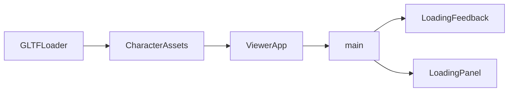

# Technical Design

## Overview / Goals / Non-Goals
擴充既有載入事件與DOM呈現，提供真實階段、檔案下載比例及CSS立體文字。無新依賴，不改鏡頭、運動、資產或里程碑驗收。

## Boundary Commitments
- LoadingFeedback 擁有載入資料型別、進度有效性判定及既有 live status；LoadingPanel 擁有進度DOM及顯示生命週期。
- CharacterAssets 擁有請求版本隔離、載入／準備／完成／錯誤事件；不依DOM。
- ViewerApp 將既有GLTFLoader真實事件轉接；main擁有模組啟動、恢復按鈕及頁面組裝。
### Out of Boundary
不改CharacterController、CameraController、RiggedCharacter或GLB；不新增renderer或動畫迴圈；不製造整體初始化百分比。
### Allowed Dependencies
既有Three.js 0.186.1、TypeScript、原生DOM與CSS。CharacterAssets只type-import載入契約，LoadingPanel不匯入ViewerApp。
### Revalidation Triggers
LoadingState僅新增選填stage與download欄位，舊loading呼叫仍有效。AssetServices.load新增進度回呼參數，舊單參數注入仍可用。重驗rigged-assets競態、Retry及expressions載入呈現。

## Architecture

main先組裝DOM，再動態匯入ViewerApp，使引擎下載期間已有初始化提示；import前讓瀏覽器有一次繪製機會，無固定等待或最短動畫時長。引擎準備前控制disabled，避免選取變更被遺漏；scene建構成功後恢復，角色下載期間仍可切換。pagehide/HMR中止後不建立晚到的ViewerApp。ViewerApp建構前顯示scene階段；角色select在loader準備時顯示loader階段，下載回呼顯示download，loadAsync解析完成後顯示prepare，create與swap完成才ready。

## File Structure Plan
| Path | Responsibility |
|---|---|
| src/ui/LoadingFeedback.ts | 擴充LoadingState、純進度描述及既有狀態呈現 |
| src/ui/LoadingPanel.ts | 新增DOM呈現、下載progress與完成隱藏 |
| src/character/CharacterAssets.ts | 真實進度轉發及版本／settled隔離 |
| src/engine/ViewerApp.ts | 接GLTFLoader progress事件 |
| src/main.ts | 非同步啟動、panel整合與Retry／reload |
| src/style.css | 立體文字層、perspective旋轉、responsive與reduced-motion |
| tests/loading-feedback.test.mjs | 驗證未知／無效總量與下載數值 |
| tests/loading-panel.test.mjs | DOM狀態、錯誤／重試／完成與公告隔離 |
| tests/character-assets.test.mjs | 真實事件順序及舊請求／完成後事件隔離 |
| tsconfig.json | noEmit基線下允許明確.ts匯入，使原生Node測試與Vite共用LoadingFeedback |

## Components & Interfaces
### LoadingFeedback (State contract)
`LoadingStage = 'engine' | 'scene' | 'loader' | 'download' | 'prepare'`。
loading state增加選填`stage`、`download: { loaded: number; total?: number }`。ready／error不攜帶進度，錯誤使用既有message／recovery。
`describeDownload(state)`回傳有效整數percentage或null；需loaded有限且非負、total有限且正、loaded<=total。百分比只代表下載，100%不代表ready。
`describeLoading`與`presentLoading`不把byte數寫進live文字；只在stage/message改變時更新，error仍alert。progress本身由原生progress提供range語意，未知時移除value。

### CharacterAssets (Service/Event contract)
`load(url: string, report: (progress: { loaded: number; total?: number }) => void): Promise<GLTF>`。
select立即發布loader狀態；report只在版本仍最新、未disposed且尚未settled時有效。load完成標記settled並發布prepare；create/swap完成發布ready。throw沿既有release/error路徑，不修改latest-wins語意。
GLTFLoader.loadAsync(url,onProgress)的event只有lengthComputable且total有效時傳total；讀取實際FileLoader已確認由Content-Length取得總量。模組匯入不使用假下載數字。

### LoadingPanel (Presentation)
建構注入root（已存在的markup節點），查詢progress、phase、percentage、狀態及旋轉視覺。`update(state): void`：loading顯示；error停止動畫、隱藏progress；ready隱藏。第一個ready後記住compact，後續切換不再覆蓋中央畫面。未產生timer／listener，不需dispose。
visual使用多層同字樣沿Z軸堆疊，父層preserve-3d及perspective並rotateY；所有重複文字aria-hidden。狀態文字仍由footer單一live region公告，panel純文字為視覺補充。

### main (Integration)
動態import失敗與scene建構失敗共同進入fatal路徑；panel的既有Retry按鈕改為Reload page，綁定在try之外，fatal時仍可操作。角色error時呼叫retryCharacter。viewport aria-busy與狀態一致，panel置viewport，live status留viewport之外。

## Requirements Traceability
| Requirement | Components / Verification |
|---|---|
| 1.1, 1.2 | main、LoadingPanel、CSS；production慢速載入與視覺 |
| 1.3, 1.4 | describeDownload、原生progress；有效／未知／無效測試 |
| 1.5 | CharacterAssets prepare/ready；事件時序測試 |
| 2.1, 2.2 | main、panel及CharacterAssets；失敗／Retry／reload |
| 2.3 | CharacterAssets token及settled；競態／dispose測試 |
| 2.4 | panel compact；角色切換與舊tests回歸 |
| 3.1 | CSS reduced-motion；browser emulate或本機設定檢查 |
| 3.2 | live status及progress；DOM與browser semantics |
| 3.3 | CSS及Retry；390px viewport與鍵盤 |
| 3.4 | 僅CSS／本機loader；lockfile與network檢查 |

## Testing Strategy / Risks
全套node tests、project.ps1 build、production browser。慢速初始化以瀏覽器網路攔截／限速能力（若工具提供）或暫時本機串流測試伺服器供應真實build及GLB，不新增套件或production測試開關。未知總量以省略Content-Length驗證；缺檔再恢復Retry。GPU／實體讀屏跨平台驗收保持未驗。
scene與GLB parse為同步工作，主執行緒忙時CSS可能短暫停頓；不為動畫引入worker或假延遲。高速cache可能很快隱藏，不強制停留。

## Rollback / Review
只回退本次新增panel與事件擴充，恢復29bc5b4載入介面；不reset checkout或刪除本機設定。inline設計審閱PASS：13條對應完整、依賴與恢復邊界明確；依本需求授權自動審閱，無獨立reviewer。
