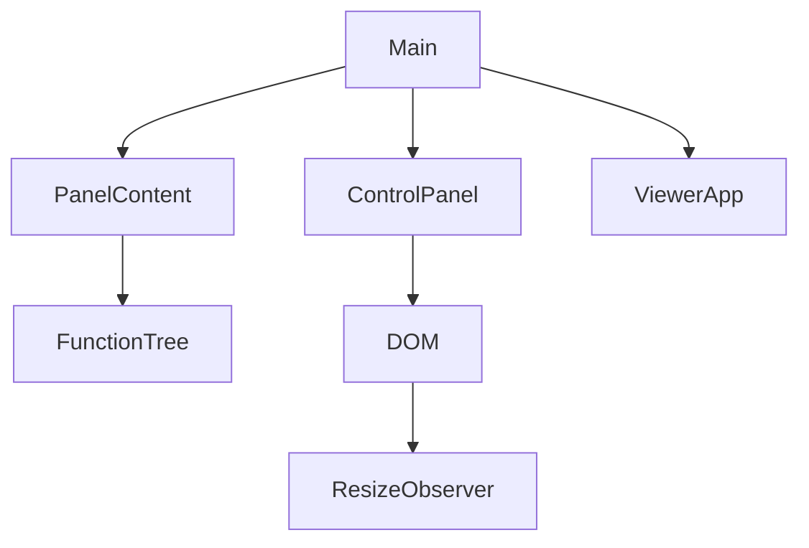

# Design Document

## Overview
以資料驅動的原生disclosure取代直列section；獨立ControlPanel管理版面、寬度與pointer生命週期。既有表單DOM只在初始化建立一次，不在收合／resize時重建。

### Goals / Non-Goals
完整涵蓋14條件；不改ViewerApp公開契約、場景行為、第三方依賴或跨頁偏好儲存。

## Boundary Commitments
### This Spec Owns
功能樹定義與呈現、面板collapsed狀態、桌面寬度、pointer／鍵盤resize及UI生命週期。
### Out of Boundary
角色、粒子、相機、輸入及renderer策略；既有人工驗收和待辦保持原狀。
### Allowed Dependencies
main組裝UI；content只引用既有emotions／speechLimit並由main提供遮擋提示文字。ControlPanel只依賴DOM與CSS；SceneRenderer既有ResizeObserver依容器變化resize。
### Revalidation Triggers
控制ID或事件位置改變須重驗全部UI；responsive breakpoint改變須同步CSS／matchMedia；面板DOM lifecycle變更須重驗焦點及輸入保存。

## Architecture

既有表單事件與狀態ID保留。場景初始化的disabled清單排除panel layout控制，載入失敗仍可收合面板。dispose同時中止UI事件並釋放pointer capture、observer及拖曳樣式。

### Technology Stack
沿用strict TypeScript、原生details/summary、Pointer Events／pointer capture、ResizeObserver／matchMedia；無新套件或資產。

## File Structure Plan
| 檔案 | 動作／責任 |
|---|---|
| src/ui/FunctionTree.ts | 新增，型別化節點與遞迴HTML renderer；節點id唯一、標題escape；content為開發者可信模板 |
| src/ui/controlPanelContent.ts | 新增，五大功能與子群組資料及既有表單模板 |
| src/ui/ControlPanel.ts | 新增，寬度、collapsed、pointer／鍵盤／responsive及dispose |
| src/main.ts | 替換aside模板並組裝ControlPanel；保留表單事件及下方控制 |
| src/style.css | 面板shell、節點縮排、把手、焦點及responsive樣式 |
| tests/control-panel.test.mjs | 新增，節點與範圍規則、事件／取消／dispose驗證 |
| README.md、docs/development-plan.md、.kiro/steering/roadmap.md | 操作說明及對應spec，不新增里程碑 |

## Requirements Traceability / Components
| 元件 | Requirements | 契約 |
|---|---|---|
| FunctionTree／PanelContent | 1.1, 1.2, 1.3, 4.1 | renderFunctionTree(nodes): string；原生summary鍵盤語意，獨立open，無互斥name |
| ControlPanel | 2.1, 2.2, 2.3, 3.1, 3.2, 3.3, 3.4 | constructor(root: HTMLElement)；dispose(): void |
| main／CSS／既有ResizeObserver | 4.2, 4.3, 4.4 | 保留控制ID、表單事件與renderer契約 |

## Components and Interfaces
### FunctionTree
FunctionNode = { id: string; label: string; open?: boolean; content?: string; children?: readonly FunctionNode[] }。renderFunctionTree輸出details/summary，節點id加固定前綴；拒絕重複id避免歧義，僅在開發者定義錯誤拋Error。label和id escape；content只允許靜態模板，不接使用者文字。

### ControlPanel State Contract
只持有本頁preferredWidth（初始320px）、collapsed（初始false）及activePointer。桌面最小260px，最大min(520px, main可用寬度−360px)，確保360px場景空間。視窗縮小只clamp有效寬度，不丟失preferredWidth；返回桌面恢復偏好。收合52px。

Pointerdown僅接受primary左鍵、展開桌面；記錄pointerId／起點、setPointerCapture，move以clientX差額更新preferredWidth。up／cancel／lostcapture／切換responsive／collapse／dispose均結束drag並移除user-select抑制。捕獲失敗則不進入drag。

把手role=separator、aria-orientation=vertical、aria-controls=control-panel-content、aria-valuemin/max/now及label；tabindex=0。Left／Right每次16px，Shift為32px，Home最小／End最大；其餘鍵不攔截。collapsed／窄版把手hidden且不在Tab順序。

toggle為button搭配aria-expanded／aria-controls；面板內容hidden，收合前若焦點在內容或把手則移回toggle。原生details關閉時如焦點在其內容，移回對應summary。版面調整不修改表單值。所有listeners用AbortController，main.dispose呼叫panel.dispose。

## System Flows
面板初始顯示五大分類（角色預設開啟，其餘收合）；子群組預設開啟，較長的資產／動作說明預設收合，讓分類容易被看見。切換面板只改hidden與grid寬度，不移除DOM。CSS與JS共用(max-width:850px), (pointer:coarse)條件：窄版column-reverse仍保留場景優先，面板全寬，把手隱藏，收合成橫向標頭。面板內容及separator的keydown停止冒泡，避免原生summary的Space或resize箭頭觸發全域角色移動；不更動InputManager。

## Error Handling
非primary及不屬於activePointer的事件忽略；非有限數值回到初始寬度。pointer capture中斷、媒體變化、dispose均有清理路徑。UI按鈕在場景初始化失敗時仍可操作。

## Testing Strategy
- 1.1／4.1：樹狀模板嵌套、唯一id、標題escaping；production以Tab／Enter／Space實測。
- 2.1–2.3／1.2–1.3：production保留speech草稿、mood、粒子數值與節點open，收合／展開及焦點回復。
- 3.1–3.4：測寬度clamp與無效值；事件測primary、拖出邊界、cancel／capture loss、Home／End、abort清理；實際pointer拖曳與viewport resize。
- 4.2–4.4：桌面／390×844及橫向窄版、canvas尺寸同步、載入就緒／錯誤控制、角色／表情／粒子／鏡頭／光照／陰影回歸。
- canonical test／build通過，再release及4174實際操作；不宣稱LAN／真機／screen reader驗收。

## Review
inline PASS：14/14條件有對應元件、檔案與驗證；無新增依賴或runtime前提。資料／呈現與版面生命週期責任分離；僅main整合跨邊界。依使用者範圍授權自動審閱。
