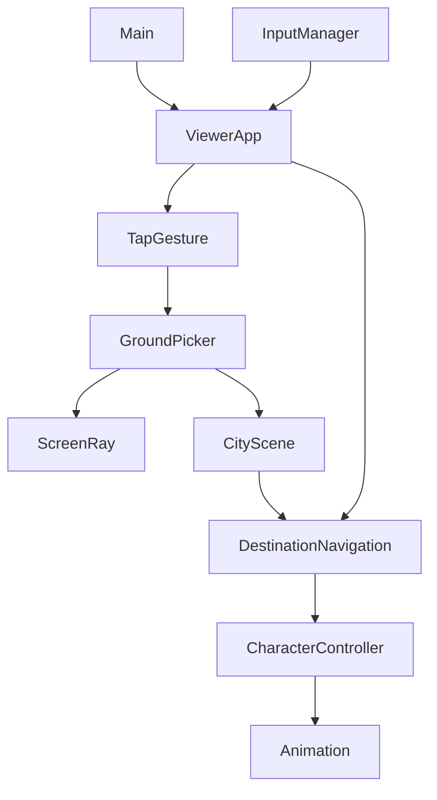
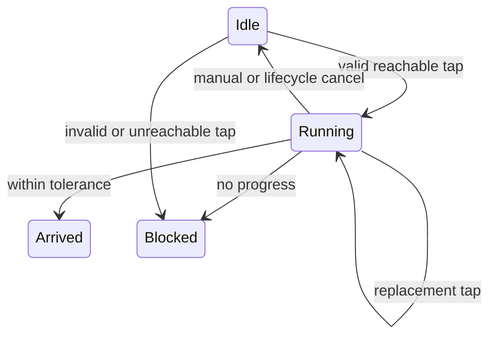

# Design Document

## Overview
為既有 ViewerApp 加入單點跑步導航及場景下方操作列。Goals：同屏控制、可靠拾取、靜態繞行與立即取消。Non-Goals：巡迴、NPC、NavMesh、資產／shader／鏡頭構圖改造。

## Boundary Commitments
- 本 spec 擁有 TapGesture、GroundPicker、DestinationNavigation、目的地 DOM 標記與操作列整合。
- CharacterController 保持移動／碰撞／跳躍權威；CityScene 保持地面及障礙權威；CameraController／FisheyePass 保持鏡頭／畫面權威。
### Out of Boundary
不改 GLB／clip／來源資產、不修既有 Front 構圖、不加巡迴或外部服務；不宣告里程碑6或其他環境人工驗收完成。
### Allowed Dependencies
motion types → pure navigation；Three → ScreenRay／GroundPicker；DOM → TapGesture；ViewerApp 組合以上與現有 input／motion／camera；main只用ViewerApp公開契約。無 upward imports、無新 package。
### Revalidation Triggers
共享半徑、輸入取消通知、DOM layout／CharacterStatus 擴充觸發 movement／camera／expression／rigged／loading 回歸；魚眼畫面改變需重驗 ray及anchor roundtrip。

## Architecture

## File Structure Plan
| Path | Change／責任 |
|---|---|
| src/navigation/DestinationNavigation.ts | 新增，AABB可視路徑／意圖與狀態 |
| src/camera/ScreenRay.ts | 新增，普通／魚眼screen→world ray |
| src/input/TapGesture.ts | 新增，單指tap判定與事件清理 |
| src/navigation/GroundPicker.ts | 新增，最前景地面raycast與world有效性 |
| src/scene/CityScene.ts | 既有地面mesh標記，不更動幾何 |
| src/character/motion.ts、CharacterController.ts | 共用既有半徑，不改運動公式 |
| src/input/InputManager.ts | 可選onManual callback，通知輸入／stop及生命週期 |
| src/engine/ViewerApp.ts | 顯式整合：手勢→拾取→導航→原movement，狀態與marker |
| src/main.ts、src/style.css、index.html | 單一操作列、workspace、安全區／短高布局及狀態 |
| tests/navigation.test.mjs、screen-ray.test.mjs、tap-gesture.test.mjs、ground-picker.test.mjs、input.test.mjs | 行為及整合回歸 |
| README.md、docs/development-plan.md、.kiro/steering/roadmap.md | 本需求與驗證連結，保留原六里程碑 |

## Components & Interfaces
### DestinationNavigation
Pure state，Outbound WalkableWorld (P0)，Inbound ViewerApp (P0)。Service／State契約：
`constructor(world: WalkableWorld); select(start: PointXZ,target: PointXZ): boolean; reject(): void; cancel(): void; sample(position: PointXZ,delta: number): MovementIntent; get status(): NavigationStatus; get target(): Readonly<PointXZ>|undefined`。
`NavigationStatus='idle'|'running'|'arrived'|'blocked'`。所有x/z finite且在bounds扣radius內；膨脹障礙內點拒絕。visibility graph含start／target及膨脹矩形外側0.02m四角，過界或落入其他障礙的corner排除；每條edge不得穿障礙內部。最短路選擇只在select執行。無路徑時blocked並清空target。
sample優先判定終點0.08m，逐waypoint以0.015m切換，速度幅度min(1,distance/(4×clampedDelta))，保持run=true。比較位置進展，1.5s卡住則blocked；不寫人物transform。cancel與reject清路徑及marker，沒有復原續跑。

### ScreenRay / GroundPicker
External Three.js (P0)，Outbound WalkableWorld (P0)，Inbound ViewerApp (P0)。Service契約：
`screenRay(point: ScreenPoint,camera: PerspectiveCamera,width:number,height:number,fisheye:boolean): Ray|null`。
普通：CSS像素轉NDC，Raycaster.setFromCamera。魚眼：短邊radius，r≤1，θ=r×80°，local=(sinθ×unitX,sinθ×unitY,-cosθ)，world=applyQuaternion(camera world rotation)。ray起點相機world position，near／far由picker按camera-space深度檢查。拒絕非有限尺寸／點、圓外與viewport外。
`pickGround(point,camera,width,height,fisheye,objects,world): PointXZ|null`：raycast CityScene靜態children（排除人物／marker），只接受第一個intersection的walkable=true且朝上的表面，bounds及膨脹obstacle驗證。遮擋建築／樹／椅不穿透點選。raycast更新矩陣，不依賴上一幀殘留。

### TapGesture
Inbound canvas (P0)；callback `{x,y}` 為client CSS pixels；DOM事件契約，不依導航。
`constructor(canvas:HTMLElement,onTap:(point:ScreenPoint)=>void); cancel():void; dispose():void`。
主鍵、單指、≤350ms且總位移≤8px才在pointerup提交；多指直到全數釋放前皆無效；pointercancel／lostcapture／離界／blur／hidden／resize取消。canvas listener capture=true先記錄pointerup，避免OrbitControls同步release capture搶先丟失候選；不preventDefault／stopPropagation、不另建相機手勢。無候選時pointerup不提交；dispose abort events。

### InputManager / ViewerApp integration
InputManager建構第三參數為可選`()=>void`，在接受的manual game key、方向pointer／keyboard activation、jump及stop時通知；既有失焦／hidden／editor呼叫stop因而通知。既有sample量化不變。
ViewerApp持有navigation、tap及DOM marker；每幀input.sample後，僅當navigation.running使用導航意圖，經原movement.update。Run toggle切為手動時取消導航（透過setRun通知）。選點先input.stop清除舊held／run，再select；若仍有手動held input以取消為優先。context lost／setCharacter／dispose皆stop。CharacterStatus增加navigation；running含自動跑步，UI只在狀態變化時播報，marker在camera.update後以projectAnchor定位。

### UI / Layout
main保留aside，新增.scene-workspace包住.viewport及.movement-controls；把現有唯一方向／動作DOM移入下方。desktop workspace grid rows=minmax(0,1fr) auto；手機<=850px或coarse pointer使用主區column-reverse，workspace高度100svh-header，viewport無380px min，toolbar方向pad兩列44px並與actions／navigation-status並排。短高header48px，scene飾字縮小；safe-area以env安全邊距，index viewport-fit=cover。controls之外可正常捲動設定，canvas沿用touch-action:none，buttons touch-action:manipulation。狀態文案說明tap／drag／pinch及Stop，aria-live只播報狀態變化。marker pointer-events:none／aria-hidden。

## Requirements Traceability
| Requirement | Components／介面／驗證 |
|---|---|
| 1.1, 1.2, 1.3 | workspace／toolbar；portrait／landscape／short viewport與唯一controls焦點檢查 |
| 2.1, 2.2 | TapGesture／ViewerApp；primary、drag戻、long press、multi、cancel、dispose tests |
| 2.3, 2.4 | GroundPicker／ScreenRay；前景遮擋、top surface、圓邊及透視／魚眼roundtrip |
| 3.1, 3.2, 3.3, 3.4, 3.5 | DestinationNavigation＋真實CharacterController；run動畫意圖、繞障、無路、到達／卡住／替換 |
| 4.1, 4.2 | InputManager通知＋ViewerApp；手動、Stop、editor、blur／hidden、context、角色 |
| 4.3, 4.4 | 狀態／marker／dispose及既有回歸 |
| 5.1, 5.2 | 完整suite／build／production browser，實機結果另列 |

## Testing Strategy
沿用pnpm test及scripts/project.ps1 build；無安裝前置。TDD每task先見RED再實作，inline review＋verify後勾選。單元測試涵蓋screen ray逆投影、手勢完整序列、真實CityScene拾取遮擋、真實CharacterController繞行及到達、不可能路徑和停滯。Browser檢查390×844、844×390、375×667及短高，實際canvas pointer與keyboard／Stop、魚眼、Follow、角色、loading及expression。iPhone三瀏覽器與OS工具列／safe-area人工驗收保留SCENE-05，未執行不勾通過。

## Error Handling / Performance / Rollback
無效點／無路／卡住進blocked，停止且提示。投影為null時隱藏marker。只在tap計算路徑、不增加renderer loop／GPU資源。無FPS承諾。只回復此feature差異，不reset／不覆蓋原有修改，不commit／push。

## Design Review
2026-10-26 inline PASS：18條ID完整映射、boundary與file plan一致、所有components具契約／failure path，無新依賴與未解設計阻擋。依使用者授權自動審閱通過，非人工逐份核准。
