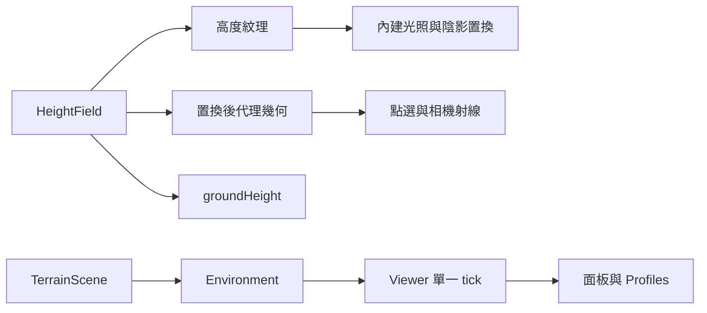

# 自然地表設計

## Overview
延伸現有多場景基礎，新增 32×32m、64×64 cell 靜態丘陵與程序草木驗證區。Three.js／Needle 及現有 renderer 均不換版。

## Boundary Commitments
本 spec 擁有高度格網、地表資源、terrain 能力與面板／Profiles 整合。Viewer 保持角色、相機、設定與 tick 權威；場景持有並釋放所有地表資源。

### Out of Boundary
不處理破壞、地震、飛行、水下、太空、城市重構或新增模型下載。

### Allowed Dependencies
既有 Three.js、Environment、WalkableWorld、SceneControlPolicy、GroundPicker、ViewerSettings。無新增套件或外部資產。

### Revalidation Triggers
改高度、拓撲、GPU displacement、raycast、品質影響幾何或 Profiles schema 時重驗 CPU／GPU 一致性及多場景回歸。

## Architecture

## File Structure Plan
- 新增 `src/scene/HeightField.ts`：量化格網、同源三角面高度、範圍。
- 新增 `src/scene/TerrainScene.ts`：置換材質與代理幾何、程序植栽、光照、品質、風動、dispose。
- 修改 `src/scene/SceneSwitch.ts`：terrain id 與可選 terrain 控制契約。
- 修改 `src/engine/ViewerApp.ts`：場景載入與能力方法、設定捕獲／套用。
- 修改 `src/engine/CharacterXrayPass.ts` 與 `tests/character-xray.test.mjs`：遮擋深度複製位移參數，保持地表可見形狀一致。
- 修改 `src/main.ts`、`src/ui/controlPanelContent.ts`：場景選單、標題、地表品質／風動。
- 修改 `src/style.css`：地表標題底色，避免草木背景降低對比。
- 修改 `src/settings/ViewerSettings.ts`、`validateViewerSettings.ts`、`PanelProfiles.ts`：向後相容的場景設定與名稱。
- 新增 `tests/terrain.test.mjs`：高度、射線、角色、品質、資源與切換；既有 Profiles 測試追加 terrain roundtrip。
- 規格目錄與 `docs/development-plan.md`、`.kiro/steering/roadmap.md`、`README.md` 記錄授權、操作與驗證。

## Components and Interfaces
HeightField 提供固定 bounds、segments、byte samples、vertexHeight、heightAt。越界或非有限座標回 NaN；cell 對角線固定從右上到左下。高度振幅量化至 2m／255，CPU 取相同量化頂點後 barycentric 插值，GPU vertex 位移以相同紋理 nearest 取樣，容許 float 誤差 <1mm。

TerrainScene 基底頂點 y=0、normal=(0,1,0)，displacementMap scale=2、bias=0。normal 不採斜面頂點法線，避免水平偏移；flatShading 讓 fragment 根據實際變形面計算光照。深度及距離陰影沿用 Three 自動 displacement 複製。geometry bounds 採 proxy bounds，Mesh.raycast 以 proxy geometry 和當前 matrixWorld 求交。材質 clone 會保留內建置換參數。

Environment 可選 terrain：getSettings()、configure(patch)；設定為 quality standard/low、wind boolean，非法 patch 整批拒絕。標準 384 叢草，低 96；固定 5 棵樹，樹幹障礙與視覺半徑加角色半徑保持一致。風動只作用裝飾草尖，固定容量單一 mesh；主材質與 customDepthMaterial 共用時間及變形公式，reduced-motion 凍結時間。地表高度與品質無關。

## System Flows
選單 → Viewer.selectEnvironment → dynamic import → SceneSwitch 單一提交點 → 重綁移動、射線、相機 → 釋放舊資源。既有 latest-request 規則與錯誤保留沿用。地表設定 optional 儲存於 SceneSettings，舊 city/cave Profiles 不需遷移；terrain Profile 名稱 terrain00 起，保留既有 10 個上限。

## Requirements Traceability
| 需求 | 元件／驗證 |
|---|---|
| 1.1, 1.2, 1.3 | TerrainScene、SceneSwitch、Viewer、選單；往返／失敗／競爭 |
| 2.1, 2.2 | HeightField、proxy、GroundPicker、CharacterController；格網與隨機內點射線比較 |
| 2.3 | bounds、樹幹障礙；移動／導航回歸 |
| 3.1 | flatShading、內建 displacementMap／shadow；瀏覽器光影／截圖 |
| 3.2, 3.3 | terrain settings、drawRange／風動時間；高度不變與凍結測試 |
| 4.1 | TerrainScene dispose；重複切換及資源事件 |
| 4.2 | ViewerSettings、ProfileHistory、validator；新舊 JSON roundtrip |
| 4.3 | Needle／legacy production smoke、魚眼／X-ray／城市水景／洞穴回歸 |

## Error Handling
未知 quality 或非布林 wind 拒絕並保留設定。載入失敗保有前場景。dispose 具冪等性，清除 scene 與釋放 texture／全部 geometry／materials。shader 編譯錯誤視為驗證失敗，不以 build 取代 GPU 檢查。

## Testing Strategy
單元先驗證共享三角面／邊界／有限值、CPU 代理高度與 GPU byte samples、材質 clone 與 shadow displacement 來源、碰撞與落地。整合驗證品質／風動不變通行與 dispose 事件、過期切換資源、Profiles 新舊資料。production Chrome 兩管線測地表、魚眼、四遮擋、草木品質、重複切換及行動尺寸；記錄 console／WebGL 錯誤與截圖。完整 test → build → Release 依序，最後增量索引。硬體效能及真機保留限制。

## Rollback
只撤本次新增模組與接線差異，保留既有 dirty，再依 release 流程重建。不 reset、不刪外部既有 hashed 資產。
