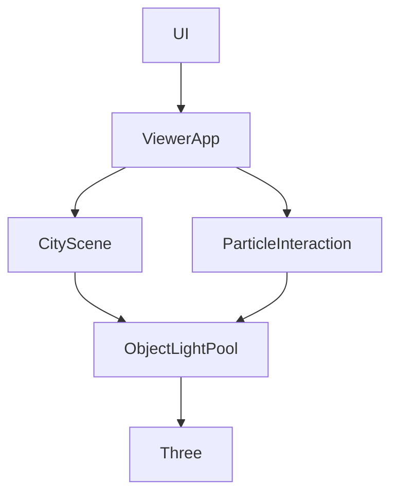
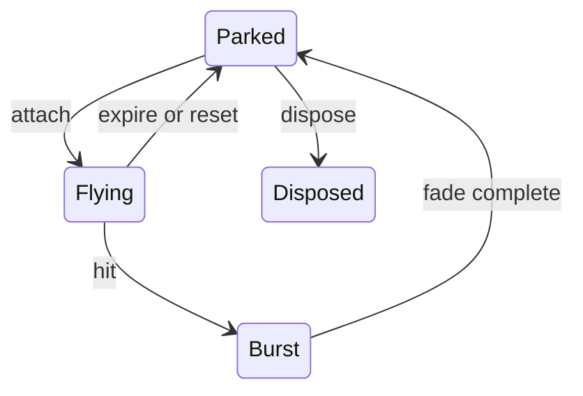

# Design Document
## Overview
在既有WebGL2街道加入Night與有界物件光源；不改動角色、相機與水景所有權。採Three.js PointLight及Object3D組合，沒有新依賴或外部素材。
### Goals
日夜同步、六盞路燈、粒子群組照明、設定與公開API可驗證。
### Non-Goals
泛光、點光陰影、動態遮光、NPC、水Shader重寫、跨GPU驗收。
## Boundary Commitments
### This Spec Owns
ObjectLightPool契約與設定驗證、時段狀態、路燈和Flight光源生命週期、UI對應。
### Out of Boundary
水景Shader／濕鏡頭、角色動畫、相機權威與遮擋演算法、導航與M6人工待辦。
### Allowed Dependencies
ObjectLightPool只依賴Three；CityScene與ParticleInteraction向下依賴pool；ViewerApp組合、main連接UI。不得反向匯入。
### Revalidation Triggers
ParticleSettings及TimeOfDay契約需重驗main/UI；group子節點與材質變化需重驗particle／四遮擋模式；renderer光數或陰影變動需重驗GPU與水景合成。
## Architecture

既有setEvening保留相容包裝，新增setTimeOfDay(day|evening|night)拒絕非法值。背景與霧同色，夜間sun冷色低強度、hemisphere保持可讀性；白天／黃昏恢復原值並重設所有顏色。
## File Structure Plan
| 檔案 | 動作／責任 |
|---|---|
| src/lighting/ObjectLightPool.ts | 新增公開設定型別、預建有限池、opaque handle掛載管理 |
| src/scene/CityScene.ts | 新增TimeOfDay、六路燈池及獨立emissive材質 |
| src/interaction/ParticleInteraction.ts | 增加平面light設定、Flight租用／淡出／補槽及回收 |
| src/engine/ViewerApp.ts | 時段公開委派 |
| src/ui/controlPanelContent.ts、src/main.ts | Night與光源欄位、原子設定及狀態說明 |
| tests/object-lighting.test.mjs、tests/particle-lighting.test.mjs、tests/night-lighting.test.mjs | 公開契約、回收、日夜與整合回歸 |
| docs/lighting-api.md、README.md、docs/development-plan.md、.kiro/steering/roadmap.md | 使用與授權對應；保留現有內容 |
## Components and Interfaces
### ObjectLightPool
`PointLightSettings { enabled:boolean; color:string; intensity:number; radius:number; decay:number }`；`ObjectLightHandle`不可自行建構有效租用。
- constructor(capacity:整數1–32)，固定root含capacity預建且無陰影PointLight。
- attach(parent:Object3D, settings, offset?:Vector3):handle|null；非法設定、非法offset、dispose後或滿額回null，無部分更動。
- update(handle, patch:Partial<PointLightSettings>):boolean；先合併再驗證，失效／跨池handle回false。
- remove(handle):boolean；歸還零強度燈至root，清除租用映射。dispose冪等、使所有handle失效並釋放PointLight。activeCount觀察租用、capacity觀察上限。
- enabled必須boolean，color為#RRGGBB，intensity 0–200、radius .1–30、decay0–4，皆finite。offset為有限局部座標，複製不保留呼叫者可變參照。
### CityScene
六路燈的point位置在燈具下方且不繼承燈具縮放；獨立燈具材質共享於六盞但不與一般box共享。Night=120cd/12m/2、emissive夜間1.5，day/evening=0。dispose釋放pool與材質。
### ParticleInteraction
ParticleSettings新增lightEnabled/lightColor/lightIntensity/lightRadius/lightDecay；舊欄位保留，getter回傳快照。燈池8槽root加入particle root且命名，Flight自身存handle|null。
每Shot快照設定，滿槽回退純視覺，update結束補上空槽。burst只移動Mesh，clear前暫存Light子節點、重建Mesh後掛回（保持租用，以免搶槽）；光強=快照強度乘剩餘burst比例。remove/clear/dispose歸還租用，縮容量同既有移除最舊。預設lightEnabled=true。公開lightRoot指向停放root，由ViewerApp加入scene作為Flight root的sibling，保持root只包含效果群組的既有語意。
### UI integration
Number欄位與API同範圍，intensity標cd、radius標m，衰減0–4、獨立color及checkbox。Apply維持新shot快照與非法時保留原設定；既有panel阻擋導航／輸入保留。
## System Flows

## Requirements Traceability
| 條件 | 元件／驗證 |
|---|---|
| 1.1, 1.2, 1.3 | CityScene、night tests、GPU |
| 2.1, 2.2, 2.3, 2.4 | ObjectLightPool、object tests、API範例 |
| 3.1, 3.2, 3.3, 3.4 | ParticleInteraction、particle lighting tests、GPU |
| 3.5, 3.6 | ParticleSettings、UI/main、實際面板互動 |
| 4.1, 4.2 | 池、全tests/build、production GPU及回歸 |
## Error Handling
非法API輸入回false/null，不throw或部分套用；非法capacity建構throw RangeError。UI顯示既有允許範圍錯誤，滿燈不阻擋發射。
## Testing Strategy
- Node：有限值與boolean／hex、原子拒絕、offset快照、父層旋轉縮放隨動、跨池／失效handle、重用及dispose事件。
- Node：128連發／8燈上限、多輪hit與expire／shrink／clear、fade後補槽、Mesh子節點不誤動Light、快照不變。
- Node：三時段往返恢復及非法時段、六獨立燈材質及dispose。
- production：真GLB載入、夜晚角色／地面readPixels有差、光顏色／半徑／強度效果、四遮擋／魚眼／水景、鍵盤與窄版控制、短效能樣本；真機與跨GPU標未驗。
## Performance & Scalability
固定6路燈＋8動態槽；停放零強度但仍列入shader，代價是白天也有固定計算成本，收益為避免連發新增shader變體。測量揭露而不保證所有GPU FPS。
## Migration / Rollback
additive時段API與本頁設定無持久化migration；只撤本次diff，保留瀑布dirty。tests→build→sync依既有release腳本，失敗停止；不刪舊資產。
