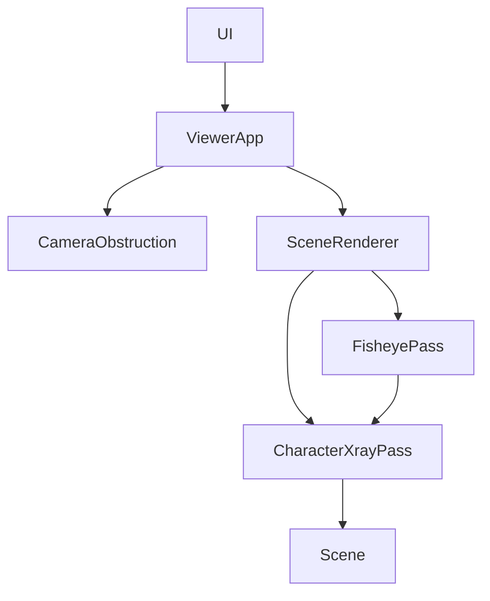

# Design Document

## Overview
新增X-ray character模式：以原環境顏色的反相加高對比色差，50%混合到被遮住的角色像素。可見角色與環境不修改材質。複雜度COMPLEX，高能力／高推理建議，模型未切換。

## Boundary Commitments
### This Spec Owns
操作主角與不透明環境的深度遮罩、合成、模式接線與資源生命週期。
### Out of Boundary
角色動畫權威、導航、NPC／Target顯示、前三模式語義、水與粒子shader、M6／SCENE-05真機驗收。
### Allowed Dependencies
僅使用既有Three.js及ViewerApp當前角色／CityScene.environment；不新增依賴、下載素材或服務。水景chat已完成交付，共用檔案依序修改。
### Revalidation Triggers
渲染目標／色彩管理、魚眼捕捉相機、材質透明判定、GLB換模、environment結構變動時重驗。

## Architecture

資料權威為角色／相機→ViewerApp→SceneRenderer→效果pass；pass不回寫相機與動畫。普通投影直接執行pass；魚眼透過捕捉回呼，在同一160°正方形投影內合成後再映射。沿用單一loop。

## Components and Contracts / File Structure Plan
| 檔案 | 責任 |
|---|---|
| src/engine/CharacterXrayPass.ts（新增） | 自有base／環境depth／角色depth targets，篩選材質及合成，resize／dispose |
| src/engine/SceneRenderer.ts | 按需建立pass，傳遞subject／environment，釋放 |
| src/engine/FisheyePass.ts | 可選捕捉render回呼，保持既有預設路徑 |
| src/engine/ViewerApp.ts | 傳遞當前主角，First person不啟用 |
| src/camera/CameraObstruction.ts | 增加xray union，其餘策略保持 |
| src/main.ts、src/ui/controlPanelContent.ts | 第4選項及排除說明 |
| tests/character-xray.test.mjs（新增） | 篩選、多材質、暫態還原／例外、資源與相機模式回歸 |

`CharacterXrayPass.render(renderer,scene,camera,subject,environment)`輸出到呼叫者目前target。以實際target或drawingBuffer尺寸配置，depth使用RGBA packed depth及NearestFilter。環境mask僅遍歷environment、排除祖先cameraObstruction=false與透明／opacity<1材質；粒子在environment外，非Mesh一律排除。進入xray前SceneAppearance先恢復normal，因此判定以原始材質為準。按material array區段套depth material；保留side、map／alphaMap／alphaTest、骨架及morph，角色depth只收最前層，避免自遮擋。原有透明角色部分以其本身輪廓為準。

base捕捉保留全場景。環境depth與角色depth各清白底，較近環境與有效角色深度形成mask，加入小depth bias抑制接觸邊界雜點。合成反相採display色彩空間計算並轉回linear，與色差低的背景改用高對比青／暗色，避免中灰反相不易辨認；alpha固定0.5。最後僅輸出端tone mapping／colorspace，魚眼中間target不重複轉換。

材質override及visibility、background、overrideMaterial、clearColor／alpha、autoClear、shadow autoUpdate、target皆用try/finally還原；depth pass不更新陰影。材質cache以原始material為key，結束render移除不再用的cache並dispose；不持有角色root，不dispose原始資源。離開xray釋放pass；dispose冪等。

## Requirements Traceability / Testing Strategy
| 條件 | 設計與驗證 |
|---|---|
| 1.1, 1.2 | 雙depth + composite；GPU部分／完全／無遮擋與背景像素比較 |
| 1.3 | 角色最前depth；實際GLB三角色動畫及fallback |
| 2.1 | 環境範圍及逐材質filter；水／粒子／透明／池岸fixtures與GPU對照 |
| 2.2 | capture callback／First person門控；魚眼、Follow、角色切換及resize |
| 2.3 | 全套既有tests及production操作回歸 |
| 3.1 | UI第四選項、預設／說明與First person提示 |
| 3.2 | try/finally／cache pruning／dispose；例外及連續切換資源測試 |
| 3.3 | 全套tests／build／GPU影像與效能證據，Release及索引收尾 |

## Risks / Rollback
額外兩個depth pass與全螢幕合成增加GPU成本；魚眼既有1536–2048捕捉放大成本，須實測。mask邊緣無MSAA可能鋸齒，透明物不遮擋屬需求語義，alphaTest仍保留孔洞。只撤回本次差異後重建發佈，不reset共用checkout，不刪Release舊hashed檔；本機不是手機LAN驗收。

## Review
Design inline PASS：9條件有具體元件／測試，色彩與魚眼輸出邊界、原始材質還原及所有權明確；依使用者授權自動審閱。
