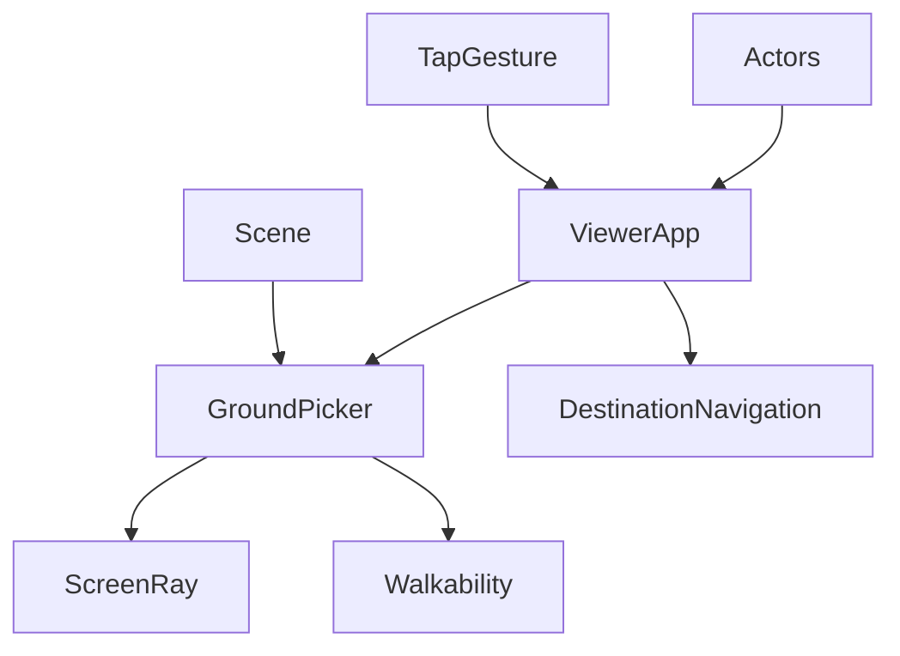
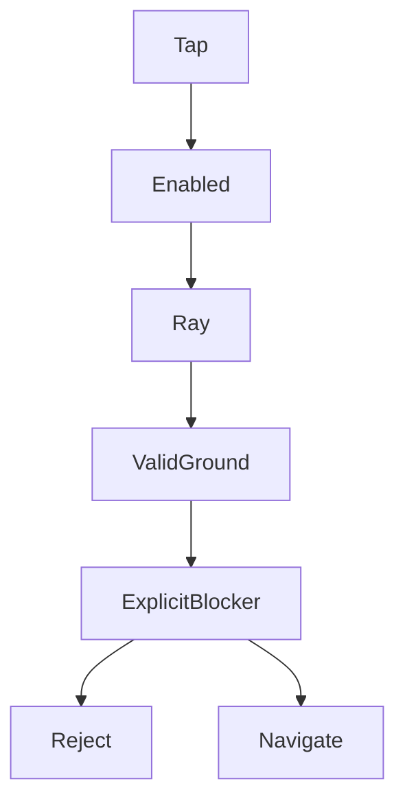

# 技術設計

## Overview
以可走候選選取取代環境遮擋選取；沿用 ScreenRay、DestinationNavigation 及既有輸入入口。採原 Three.js／TypeScript，不新增依賴。

### Goals／Non-Goals
允許城市與洞穴穿透環境點地，同時攔截明確物件。未包含機關建立、多層導航、角色穿牆或相機遮擋模式修改。

## Boundary Commitments
### This Spec Owns
GroundPicker 的候選集合、有限盒頂宣告、混合求交與 blocker 先後規則，以及 Viewer 接線。
### Out of Boundary
導航／碰撞權威、相機與輸入手勢狀態機、NPC AI、動畫與資產生命周期。
### Allowed Dependencies
Three.js、ScreenRay、isWalkable；Viewer 可依賴 GroundPicker，反向不可。場景只宣告表面能力；TrafficView 只公開 NPC roots。
### Revalidation Triggers
地面形狀／動態更換、角色 visible 或 LOD、切場景與 ScreenRay 變更時，重驗選取及導航／相機輸入相關測試。

## Architecture

依賴方向為 Three／motion → ScreenRay／導航 → GroundPicker → Viewer。場景可使用 GroundPicker 的宣告 helper，但選取模組不匯入具體場景。

## File Structure Plan
| 檔案 | 行為 |
|---|---|
| src/navigation/GroundPicker.ts | GroundPicker、declareGroundBox、原 pickGround 相容 wrapper |
| src/scene/CityScene.ts、CaveScene.ts | 盒頂地面顯式宣告 |
| src/simulation/TrafficView.ts | 只讀 npcPickBlockers getter |
| src/engine/ViewerApp.ts | 建構／切場景時重建 picker，注入角色 roots |
| tests/ground-picker.test.mjs | 原測試更新環境遮擋預期 |
| tests/ground-picking-through.test.mjs | 遮擋、攔截、幾何與策略等價 |
| docs/development-plan.md、.kiro/steering/roadmap.md | 本次授權與規格連結 |

## Components and Interfaces
### GroundPicker
**Contract: Service**
```typescript
declareGroundBox(mesh: Mesh): void;
class GroundPicker {
  constructor(objects: readonly Object3D[], strategy?: 'auto' | 'raycast');
  pick(point: ScreenPoint, camera: PerspectiveCamera, width: number,
    height: number, fisheye: boolean, world: WalkableWorld,
    blockers?: readonly Object3D[], penetrateEnvironment?: boolean): PointXZ | null;
}
```
P0 inbound：Viewer；P0 outbound：ScreenRay、isWalkable；external：現有 Three。
建構遍歷靜態樹，收集 walkable===true 的 Mesh 及 groundPickBlocker===true roots。宣告 helper 在 WeakSet 記錄可信 BoxGeometry 的有限頂面，保留既有 walkable flag。auto 對已宣告且適用的盒頂解析；其餘 Mesh 使用 raycast。raycast 策略作為等價測試基準，不提供新 UI。

候選數>=16 或合計三角形>=2048 時預算非解析靜態地面的 local boundingBox，使用內建 raycast 篩選。無空間索引、無每幀選取計算。場景切換以新實例取代舊實例，不持有跨場景快取。

### 求交與攔截契約
- 使用原 ScreenRay，求最近「合法」表面：正面朝上 normal.y>=.9、camera near<depth<far、isWalkable 通過；跳過其他命中，非第一個物件決定結果。
- 解析盒頂在 local space 求有限 x/z 範圍，轉回世界，以 normal matrix 轉換法線；退化 transform 拒絕。無宣告或非支援幾何／材質回退 raycast。
- 一般環境永不加入遮擋測試。只有明確 blocker 與注入角色可攔截。
- blocker 遍歷完整祖先可見性，只對可見 Mesh raycast；沿同射線，在 camera 可見裁切範圍且距離<=地面距離+1e-6 時拒絕。SkinnedMesh 更新世界矩陣，沿用 Three raycast。
- 主角使用當下 assets.current.root 或程序 fallback；Target 使用自身 root，NPC getter 回傳當前 NPC LOD roots。隱藏城市的交通物件由祖先 visible／實際場景選擇排除。

## System Flows

無效射線／地面回 null；Viewer 沿用 reject，成功則 beginDestination→navigation.select，原 stop／takeover 邏輯不變。

## Requirements Traceability
| Requirement | Components／驗證 |
|---|---|
| 1.1, 1.2, 1.3 | GroundPicker、ScreenRay；牆頂、空集合、裁切、法線、魚眼 |
| 2.1, 2.2, 2.3 | 可見 Mesh blockers、Viewer、NPC getter；前後、隱藏、外觀／LOD／切場景 |
| 3.1, 3.2, 3.3 | auto／raycast、複雜度分支、場景重建；結果與查詢次數 |
| 4.1, 4.2, 4.3 | 原 DestinationNavigation、TapGesture、CameraModeManager；整合與既有回歸 |
| 5.1, 5.2, 5.3 | GroundPicker首命中回退、Viewer設定與main／面板同步；開關往返及跨場景／重載 |

## Error Handling
無射線、無合法地面、無效矩陣與裁切失敗回 null；不建立虛構無限地面。沒有持久化／migration。

## Testing Strategy
### 2026-11-09 開關追加設計
5.1–5.3：Camera > Objects block mode 下放置原生checkbox（id=ground-penetration），label為「點擊穿透環境」，預設checked。ViewerApp持有groundPenetration布林，CharacterStatus回報同名狀態，main更新狀態key／checkbox並接change→setGroundPenetration。狀態只在頁面記憶體，不持久化；換場景不重設，不取消既有導航。
GroundPicker.pick在blockers之後增加可選penetrateEnvironment=true參數；保留建構時的環境roots。false分支依原intersectObjects首命中規則，通過既有合法性檢查後仍走共用明確blocker判定；true保留既有混合求交。範圍追加main.ts、controlPanelContent.ts，其他邊界不變。驗證一般／魚眼開關往返、環境遮擋／合法地面／明確角色、面板預設與production切換及跨場景保留。

單元測試驗證普通／魚眼、牆頂穿透、blocker 前後／隱藏祖先、斜面／多高度／無地面／近平行、near/far、混合策略等價。真城市／洞穴 fixtures 驗證切換及候選隔離；導航測試確保繞障。既有 tap／drag／多指及第一人稱政策測試回歸。
完整 test／typecheck／build，專用 Chrome headless 從 production boot 觀察桌面／手機尺寸點擊與拖曳，區分合成事件、真實觸控及實機驗收。依序 release→預覽→增量索引，不宣稱舊人工待驗全部通過。
