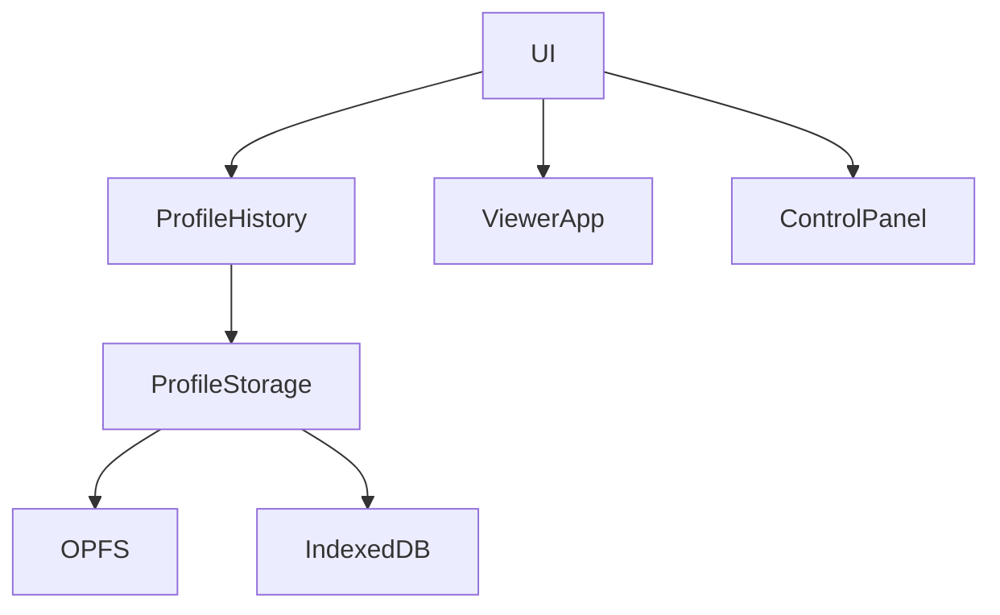

# Technical Design

## Overview
使用既有 TypeScript 與原生 API，無新增依賴。runtime 權威快照加明確 UI 草稿／layout，避免僅序列化 DOM。

## Boundary Commitments
擁有 Profile 歷史／temp、JSON、儲存及 UI 整合；控制演算法屬 auto-run-camera-controls。排除 live transform、按鍵、模擬進度及鎖定。新增面板值須更新契約與測試。

## Architecture

ViewerApp 保留 city／cave 設定：離開前擷取，進入時套用，新場景預設先於覆寫取得。Reset 清除覆寫。UI 操作序列化，套用期間抑制 autosave。

## File Structure Plan
- src/settings/PanelProfiles.ts：純歷史與版本驗證。
- src/settings/ProfileStorage.ts：OPFS／IndexedDB async 讀寫。
- src/ui/PanelProfiles.ts：runtime＋草稿＋layout 整合。
- src/engine/ViewerApp.ts：getPanelSettings／applyPanelSettings、跨場景快取。
- src/inspector/SceneObjectInspector.ts：依穩定 path 保存標籤與篩選。
- src/ui/ControlPanel.ts、src/main.ts、src/style.css：layout 契約、工具列、生命週期。
- tests：歷史／儲存／契約；.local：Chrome browser harness。

## Components and Interfaces
|Component|Requirements|Contract|
|---|---|---|
|ProfileHistory|2.1–2.4|capture/select/save/reset|
|ProfileStorage|3.1–3.4|read/write 同一 JSON，成功才回報 saved|
|ViewerApp|1.1–1.3|getPanelSettings/applyPanelSettings|
|UI adapter|1.1,1.2,2.1–2.4,3.2,3.3|capture/apply 草稿及 layout|

## Data Models
JSON {version:1,temp:Block|null,profiles:Block[],next:Record<scene,number>}；Block {name,createdAt,settings}。最多11 blocks，next 每場景循環；timestamp 單調增加。入口驗證版本、型別、上限、唯一名稱、有限數值與設定範圍。深複製避免引用共享。
設定含 runtime、明確列舉 drafts、layout；runtime 含各場景設定。套用先 stop，再場景、一般設定、鏡頭、UI；不執行 JSON 文字。

## System Flows
初始化 read→validate→temp 優先→apply→enable。修改→temp→串行 write。選擇前只有非乾淨 profile 才寫 temp。Save／Reset 為明確重試。多分頁最後完成寫入勝出，不提供合併保證。

## Error Handling
OPFS 非安全／不支援／拒絕時 fallback IndexedDB；選定後保持同一 backend。OPFS close、IDB transaction complete 才算成功。損壞讀取禁止 autosave 至明確 Save／Reset；錯誤保留原設定並顯示模式。未知版本拒絕。不同 origin 與清除網站資料限制明示。

## Testing Strategy
2.2十筆淘汰／99循環、2.3乾淨 dirty/temp、3.2損壞／拒寫、1.1完整 runtime及草稿、1.3跨場景、2.4reload／Reset、3.3連續操作。fresh tests/build/browser，分開合成與原生 Pointer Lock，不代替手機驗收。

## Review
2026-11-09 requirements、design、tasks 依完整授權自動 inline 審閱通過；已查覆蓋、邊界、順序、錯誤與暫態排除，無獨立 reviewer。依序不委派、不 commit。

### 儲存與互動審閱補充
讀取時探查OPFS及IDB，以最新block時間選擇有效已保存backend（同時存在優先較新；相同優先OPFS），讓OPFS拒寫後fallback在reload可恢復。損壞非空原檔仍呈現錯誤並保護，OPFS首次失敗留下的零長度檔視為空。自動保存不鎖住輸入焦點；明確切換／Reset才暫時inert並序列化。物件path只保存使用者覆寫，避免新增資產誤判dirty；數字篩選仍是該次頁面的數字語意。
