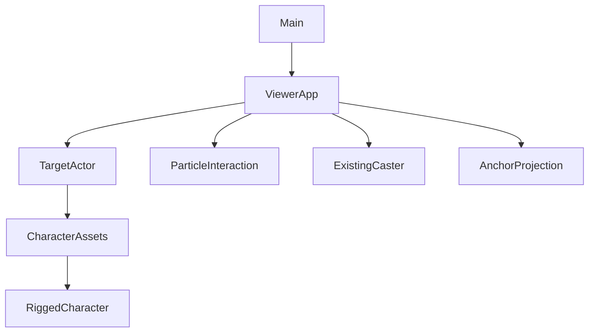
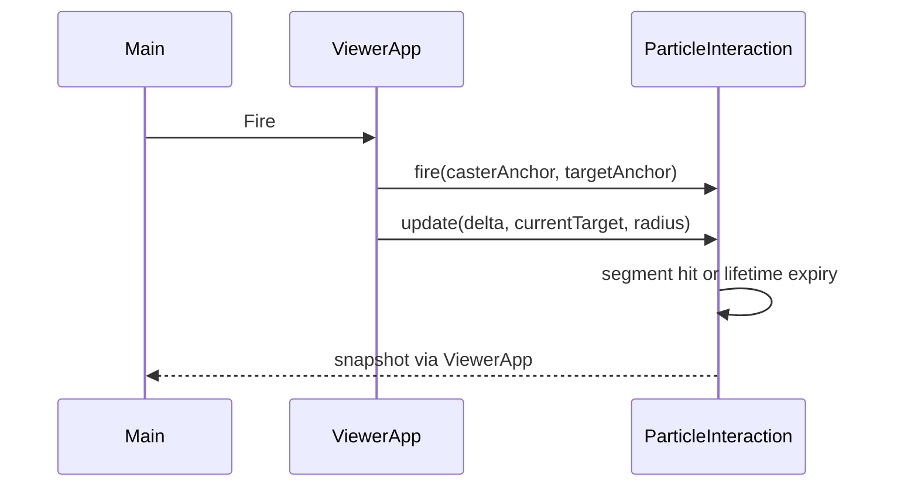

# Design Document

## Overview
在既有 Three.js 0.186.1／TypeScript／Vite 中追加單一能量粒子效果與獨立 Target；無新依賴或資產。
### Goals / Non-Goals
提供雙角色、定向發射、單次命中、逾時與可調參數；無傷害、AI、NavMesh、持久化或相機策略更動。

## Boundary Commitments
本 spec 擁有 TargetActor、ParticleInteraction、角色標示與 UI 接線；Caster motion、導航、鏡頭與環境維持原權威。Target 使用獨立 GLTFLoader 載入結果、獨立 mixer／fallback／CharacterAssets；不共用可釋放 GPU 資源。每次 loadAsync 解析獨立場景，避免 SkeletonUtils clone 的共享 geometry disposal 問題。
### Out of Boundary
不更動 CharacterController、資產產製、鏡頭／魚眼投影、既有 M6／SCENE-05 驗收；僅追加一名 Target。
### Allowed Dependencies
Three/types/catalog → TargetActor、ParticleInteraction → ViewerApp → main。TargetActor 可組合既有 CharacterAssets、Character、RiggedCharacter；粒子模組不依 DOM、角色類別或 UI。
### Revalidation Triggers
整合 ViewerApp 每幀、setShadows、dispose 後須重驗角色切換、First person、魚眼、導航、遮擋。Target 不加入 environment，因此不受環境 wireframe／透明覆寫。

## Architecture

## File Structure Plan
| 檔案 | 責任 |
|---|---|
| src/character/TargetActor.ts（新） | 固定站立 Target、獨立載入／狀態／retry、位置重設與資源 |
| src/interaction/ParticleInteraction.ts（新） | 設定驗證、飛行快照、線段球碰撞、短暫粒子回饋及上限 |
| src/engine/ViewerApp.ts | 組裝、錨點／角色標示投影、發射／重設 API、迴圈與 disposal |
| src/main.ts、src/style.css | 可存取粒子控制、狀態、樣式；不直接操作 Three 物件 |
| tests/particle-interaction.test.mjs、tests/target-actor.test.mjs（新） | 碰撞／逾時／上限／快照、真實 GLB 隔離與生命週期 |
| docs/development-plan.md、.kiro/steering/roadmap.md、README.md、spec 文件 | 追加授權與證據，不改人工驗收 |

## Components and Interfaces
### TargetActor
`constructor(world:WalkableWorld, onState:(state:LoadingState)=>void)`；`root:Group; anchor:Vector3; height:number; update(delta):void; reset():void; retry():void; setShadows(boolean):void; dispose():void`。
預設 woman，位置 (0,groundHeight(0,-1),-1)，與 Caster (0,5) 相距6m，位於既有街道可走軸。站立 MotionSnapshot 不接受玩家輸入。接收錨點為高度 0.6；標籤在頭頂。初始／錯誤顯示明確 fallback，可 retry；main 使用獨立狀態不覆寫 Caster loading panel。

### ParticleInteraction
`ParticleSettings={color:string,speed:number,size:number,lifetime:number,maxCount:number}`；預設 #66ddff、8m/s、0.14m、3s、32；合法速度0.5–30、大小0.03–0.5、生命週期0.1–10、數量1–128整數、色彩#rrggbb。`configure(settings):boolean` 原子拒絕非法值，現有效果保留發射設定快照；降低上限清除最舊效果至符合上限。
`fire(origin:Vector3, aim:Vector3):boolean` 複製位置與方向，滿額拒絕新發射；`update(delta:number,target:Vector3,radius:number):void`、`clear():void`、`dispose():void`、`snapshot` 提供 active／hits／expired／lastEvent。
飛行每步以線段最近點判定球體，避免高速穿越；每次命中移除飛行狀態、hits++，同一 slot 轉為0.25秒放射短粒子，之後清除。未命中飛至生命週期，expired++。delta 取有限非負值；生命週期最後一段只走剩餘時間，不計逾時後碰撞。共用一份球 geometry，逐效果獨立 material，每個 slot 固定少量粒子，總數最多128 slots，不為每幀建立幾何。dispose 冪等，釋放自身資源。

### ViewerApp / UI
Caster 胸前發射錨點與 Target 胸口錨點以小球標示；DOM 標籤沿用 projectAnchor 支援魚眼及裁切。First person 保留既有 Caster 隱藏政策（含其標籤／錨點），Target 仍正常顯示。
`fireParticle():void; resetTarget():void; retryTarget():void; configureParticles(settings):boolean`；新增最後一個 callback 傳遞粒子狀態。按鈕一次 click 一次發射，可連續點擊，無新增快捷鍵／長按 timer，避免輸入衝突。UI 五個設定、Apply、Fire、Reset target、Retry target 與低頻變更狀態。context lost 拒絕發射並清除效果，恢復可重發。reset Target 清效果與統計。

## System Flows

## Requirements Traceability
| Requirement | Components | Validation |
|---|---|---|
| 1.1, 1.2, 1.3, 1.4 | TargetActor／ViewerApp／main | 真實資產隔離、retry、reset、production |
| 2.1, 2.2, 2.3, 2.4 | ParticleInteraction | 方向快照、掃掠命中、逾時、上限 |
| 3.1, 3.3 | ParticleInteraction／main | 非法設定、鍵盤與點擊操作 |
| 3.2, 3.4 | ViewerApp／TargetActor／ParticleInteraction | 全測試、production、dispose |

## Error Handling
設定非法不變更既有設定；滿額顯示 capacity，dispose 後發射拒絕。Target loader 失敗不阻止 Caster 或 fallback 發射。無未處理 promise rejection。

## Testing Strategy
先寫行為測試確認 RED，再實作 GREEN。測線段高速命中、一次命中、移動 Target 未追蹤、逾時、設定快照／上限、重設／dispose；真實 GLB 與 Target async retry／late result。每項 canonical tests，整合後 typecheck/build 與 production browser 操作雙角色、連續發射、參數、移動／切換、相機及重設。

## Performance & Rollback
上限128、每命中固定8粒子，無無界背景 timer／場景累積。實際 FPS 僅本機樣本。回復保留修改後切回原分支；外部 Release 需重新發佈已知版本，不承諾自動回復。

## Design Review Gate
inline PASS：12條件全覆蓋；修正共享 clone 資源風險為獨立解析，限定輸入與上下限、cleanup、First person與魚眼邊界。依使用者授權自動審閱，無獨立代理。
