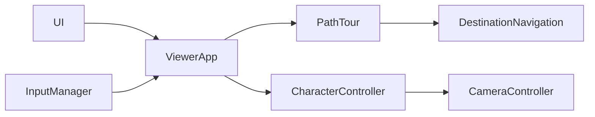

# Design Document

## Overview
以獨立 PathTour 組合 DestinationNavigation，讓巡迴只決定下一個目標與速度；CharacterController 仍是位置及碰撞權威。無新增套件、服務或外部API。

## Boundary Commitments
### This Spec Owns
route、index、loop、speed、播放狀態、驗證及 Viewer/UI 接線。
### Out of Boundary
交通AI、NavMesh契約、相機構圖、物理與場景資產。
### Allowed Dependencies
DestinationNavigation 的 select/sample/cancel/status、MovementIntent 與 WalkableWorld；ViewerApp 集中選擇意圖。
### Revalidation Triggers
導航抵達容差／速度公式、InputManager onManual、CharacterController run速度或主場景 walkableWorld 改變時重驗巡迴。

## Architecture

沿用既有 TS OOP、頁面記憶體狀態與集中 animation loop。PathTour 使用專屬導航，避免點地目標互相覆蓋。ViewerApp 決定巡迴、點地或手動意圖優先順序，manual callback 同時取消兩者。

## File Structure Plan
- 新增 src/navigation/PathTour.ts：路線解析、狀態機與導航組合。
- 修改 src/navigation/DestinationNavigation.ts：sample 可選速度，預設4，與 CharacterController 實際速度一致以防 waypoint 越過。
- 修改 src/engine/ViewerApp.ts：控制權、巡迴API、每幀狀態回報與既有marker整合。
- 新增 src/ui/TourControls.ts：純DOM內容及經公開API綁定；AbortSignal管理事件。
- 修改 src/ui/controlPanelContent.ts、src/main.ts：Character分支掛載與狀態顯示。
- 新增 tests/path-tour.test.mjs：真控制器移動、速度／loop／pause／錯誤驗證。

## Components and Interfaces
PathTour(world) 擁有專屬 DestinationNavigation；start(position, route, loop, speed):boolean，pause()，resume(position):boolean，cancel()，configure(loop,speed):boolean，sample(position,delta):MovementIntent；snapshot 回傳 status/index/count/speed/loop，target 返回防修改copy。
狀態 idle → running → completed，running → paused → running；無路徑／卡住為 blocked，手動接管為 idle。start先取消舊巡迴，再驗證全部座標可走；每腿select在需要時執行。到達後每幀至多切換一腿，同點循環不形成無限迴圈。pause取消專屬導航但保存index；resume重新select，清除stalled計時。
速度用 run=true 的4m/s基底乘以 speed/4，速度≤1.8時改用walk基底；DestinationNavigation用speed*dt限制意圖，避免轉角切角或超過目標。速度／座標非有限值、route超限均拒絕。

## Requirements Traceability
| IDs | 實現 |
|---|---|
|1.1, 1.2, 1.3|PathTour解析、isWalkable、專屬導航；TourControls預設未啟動|
|2.1, 2.2, 2.3|PathTour狀態／index、sample速度、DestinationNavigation|
|2.4|TourControls、ViewerApp狀態回報|
|3.1, 3.2|InputManager onManual、點地input.stop、Stop/context/blur/visibility原接線|
|3.3|既有motion更新下游相機與角色，無修改權威|

## Error Handling
無效route顯示blocked；無法到下一點停止不跳點。UI保留輸入讓使用者修正；resume僅paused有效，無背景自動恢復。

## Testing Strategy
真CharacterController繞障抵達全部目標；0.5/1.8/4速度與低幀率不越過；暫停位置不變／恢復完成；loop重返第一點、同點bounded；無效有限值／障礙／超限／卡住停止。整合檢查manual、Stop、編輯、context接管，鏡頭及marker依既有motion。全套tests、typecheck、Release與可用browser smoke。

## Review
requirements全部數字ID有映射；責任／檔案／資料與控制權明確，無新runtime前置。inline design review PASS，依使用者授權自動核准。
