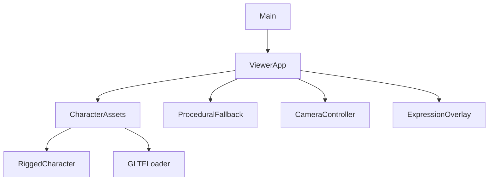
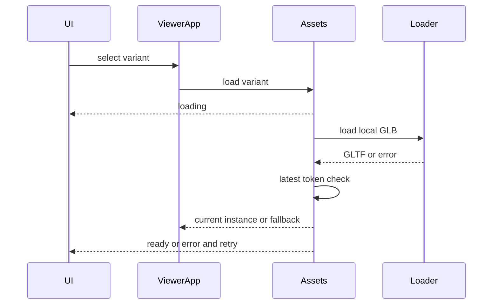

# Design Document

## Overview
沿用Three.js GLTFLoader／AnimationMixer及原生UI。無新npm dependency，Blender5.2.2僅離線生成已授權的衍生資產。
### Goals / Non-Goals
三個skinned GLB、四動作、非同步競態／釋放、真實UI載入呈現及可重建。無新renderer／loop／movement／相機策略，不修Front遮擋。

## Boundary Commitments
- AssetCatalog持有三個URL、目標height、eye及clip mapping；RiggedCharacter持有一份載入後的skinned模型與AnimationMixer。
- CharacterAssets協調非同步載入，token辨識過時結果，不取消新請求；主ViewerApp持有當前fallback與rigged instance。
- Animation狀態只消費MotionSnapshot action；世界root只套motion x/y/z/heading。
- main透過ViewerApp接收LoadingState與asset資訊、呼叫retry，不能直接讀Three物件。
### Out of Boundary
無資產runtime下載／retarget；Blender衍生不冒稱原作者原版；不改上游碰撞及相機控制。
### Allowed Dependencies
catalog/types→RiggedCharacter／CharacterAssets→ViewerApp→main。純狀態不依DOM；GLTFLoader來自現有three addon。LoadingState type-only依賴ui呈現契約。
### Revalidation Triggers
資產／animation mapping／normalization改變需重驗三種身高eye／First person／泡泡。MotionSnapshot或魚眼shader改變需重驗上游。

## Architecture

## File Structure Plan
- public/assets/characters/{man,woman,child}.glb：衍生自已下載CC0，僅Idle/Walk/Run/Jump四clip。
- public/assets/characters/ATTRIBUTION.md、asset-manifest.json：授權／修改／SHA256。
- tools/assets/prepare_characters.py：Blenderimport、bind/rest正規化、小孩mesh+rest bone比例、Jump與export。
- src/character/assetCatalog.ts：typed metadata／clip names。
- src/character/RiggedCharacter.ts：模型正規化／skinning／AnimationMixer／dispose。
- src/character/CharacterAssets.ts：loader adapter／token、swap／error／retry生命週期。
- src/engine/ViewerApp.ts、src/main.ts、src/style.css：整合；既有Character保留fallback與測試。
- src/engine/SceneRenderer.ts：每幀重設info並累計魚眼雙pass，提供只讀RenderStats；ViewerApp每秒傳主程式顯示。
- tests/rigged-character.test.mjs、tests/character-assets.test.mjs：真實GLB及可控promise競態。
- README、docs/asset-pipeline.md、spec validation／steering：交付證據及重建。

## System Flows

## Components and Interfaces
### Catalog / RiggedCharacter
`AssetDefinition={url,height,eyeHeight,eyeForward,label,derived,clips:Record<CharacterAction,string>}`；高度1.8／1.68／1.15，eye比例沿用既有contract但依視覺檢查調整。
`new RiggedCharacter(gltf,definition)`需SkinnedMesh與四clip否則throw。root為新Group；scene掛model子節點，Box3取Idle第一幀腳底／高度，uniform scale／offset正規化，heading外層不變。原模型朝向以實際browser核對，必要使用固定π修正寫catalog。
`update(snapshot,delta)`設定root transform，mixer.update dt≤.05。動畫時間跨動作交叉淡化0.18s；同動作不reset。Jump LoopOnce clamp，播放速度對齊既有physics約0.8s，落地再crossfade。舊action淡出後在mix完成主動stop，避免持續排程累積。
`height／eyeHeight／eyeForward`提供相機／overlay；`setShadows`遍歷Mesh；`dispose`idempotent，stopAllAction／uncacheRoot，unique geometry/material/texture釋放並detach。效能stats只讀renderer.info，不暴露可修改renderer。

### CharacterAssets
`constructor(services: {load, create, release, onState, onSwap})`；`select(definition:AssetDefinition):Promise<void>; retry():Promise<void>; get current; dispose():void`。create由ViewerApp注入RiggedCharacter factory；release注入disposeModel，避免協調層runtime依賴具體類別。current每幀由ViewerApp更新。
select時token++並清除舊instance，onSwap(null)啟用fallback；保存selected definition，發loading。resolve建立並驗證model；token過時或disposed立刻dispose，不發ready／swap。reject只有最新token發error與recovery。重試相同variant重新載入。所有非同步錯誤在此消化，不留unhandled rejection。
同時可能存在pending解碼結果，但只掛一個已選模型；不cache三個模型，以限制記憶體。loader不擁有UI或相機。

### ViewerApp integration
constructor最後建立assets，default man啟動load；setCharacter先切fallback外觀與variant，再load。相機subject讀current rigged或fallback高度；每幀更新fallback與current，current存在則fallback hidden，First person兩者皆hidden。所有root transform相同motion權威。
載入state透過新增callback options傳main。main更新角色來源tag／hint、LoadingFeedback、aria-busy、retry hidden。錯誤允許fallback原操作，retry不重載整個page。busy不禁用角色選取，供快速切換。

## Asset Pipeline / Data Models
來源man-casual與women-animated-b，本次下載隔離於.local/asset-audit/milestone-6。CC0授權允許修改；衍生child不僅縮小：短腿、較大頭、軀幹與肢體比例調整，mesh與armature rest同步變形。保留walk/run骨架動作並檢查變形。若剪裁／bone長度不合理回退重新生成，不以原型代驗。
專用2019 Jump骨架僅31 joints，目標62且rest axes不同；不能直接綁track。優先資產研究完成後採專案製作目標骨架Jump，記錄不是retarget原clip。Blender以現有Idle姿勢為基底、膝彎／手臂抬起／回落keyframes，root position固定，世界高度仍physics。
匯出四action明確名Idle／Walk／Run／Jump，保留skinning與CC0來源extras。輸出≤2MiB，不納入其它武器／死亡等動作。執行--factory-startup --disable-autoexec --background，僅importGLB資料，不執行資產腳本。保留來源GLB（選中兩檔）於tools/assets/source/供可重建，無機密。

## Requirements Traceability
| Requirement | Component / Evidence |
|---|---|
| 1.1, 1.2, 1.3 | asset pipeline／manifest／catalog／UI labels |
| 2.1, 2.2, 2.3, 2.4 | CharacterAssets／LoadingFeedback／retry／disposal tests |
| 3.1, 3.2, 3.3, 3.4 | four clips／RiggedCharacter／physics authority／mixer tests |
| 4.1, 4.2, 4.3, 4.4 | normalization／ViewerApp／camera+expression regression／responsive |
| 5.1, 5.2, 5.3, 5.4 | script／source／real GLB tests／production browser stats／build |

## Error Handling / Security
缺clip或skin拒絕並dispose部分資源，fallback明示錯誤。過時success需釋放。throw duringvalidation也要釋放gltf原始場景。重試不保留舊error或錯誤busy。所有資產local URL，無使用者上傳或第三方script。

## Testing Strategy
- 真實GLB.parseAsync（已安裝Three.js）：skinning／四clip／三高度／無root位移，採樣Idle／Walk／Run／Jump檢查骨架與bounding值有限且不同姿勢；crossfade不reset／有限active actions、dispose exactly once。
- 可控loader promise：最新先完成／舊的後完成、最新error／retry、dispose pending、無效clip與skin，確保state順序與unique資源釋放。
- 全套node test＋production build，browser逐一三角色與四動作、文字保留、First person／魚眼、錯誤注入採既有測試adapter而非假成功；production實際404以臨時檔名移動測試後還原，不改下載來源。
- 記錄renderer stats、資產大小、本機FPS樣本與限制；無跨GPU門檻承諾。原500kB advisory可透過loader dynamic import評估，但不做無關拆包。

## Rollback
逐項移除新增assets／loader連接回既有fallback，保留所有既有未提交差異；不reset／不stage／不commit。
