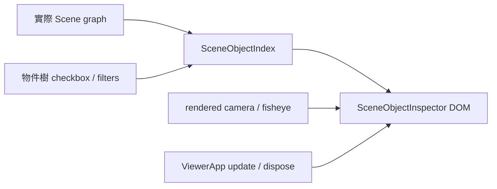

# 場景物件檢視器設計

## 1. Overview / Boundary Commitments
Inspector 擁有本頁編號、label checkbox、篩選、物件樹與DOM編號標籤。只讀取實際 Scene graph，獨立於場景、角色及水景所有權。

Out of Boundary：不改 visible／材質／動畫／燈／相機權威、不作物件編輯或跨頁ID持久化，不關閉M6人工待驗。
Allowed Dependencies：Three Object3D／PerspectiveCamera／Vector3、既有 projectAnchor、DOM；ViewerApp集中組合，main只綁定公開 inspector mount 方法。
Revalidation Triggers：ViewerApp更新／dispose／context loss、main控制掛載、AnchorProjection使用；須重跑完整tests、build及production街道／魚眼／角色替換／水夜景 smoke。

## 2. 契約與資料
SceneObjectIndex 用WeakMap保存物件→正整數ID與checkbox；active rows只持有本次遍歷節點。sync(root)讀取preorder、parentId、名稱、完整路徑；未命名以type顯示，重掛載保留ID，移除清出active rows。ID不重用。以row的ID/parent/path/checkbox/matched構造revision比對，無改變不重繪。
configure(pattern, ranges)先解析兩者，成功才原子替換；regex為JavaScript裸pattern、無flags、區分大小寫，上限160字元；範圍上限512字元，安全正整數且start<=end，保留區間不展開成巨大集合。空值unrestricted。錯誤返回訊息，前次結果維持。
匹配 name OR path，並與range取AND。樹列出matched及祖先；ancestor-only明示。checkbox只管自身，不串改子孫，master只遮label且不清checkbox。套用過濾時展開必要路徑，仍允許手動收合且跨結構同步保持；清除時恢復未過濾時手動展開狀態。DOM只用textContent。

## 3. UI／迴圈／生命週期
SceneObjectInspector建立label layer與panel原生details/summary/checkbox，所有操作可Tab／Space／Enter；可捲動，統計matched/total、錯誤role=status、欄位aria-invalid。提供Apply filters及Clear filters，避免輸入途中套用；錯誤不刷新樹。
ViewerApp每250ms sync結構；每幀只對master啟用、matched、checked、祖先visible的節點取世界原點，以既有projectAnchor投影到DOM，不加入Three Scene、不遮擋pointer。隱藏／視野外／context loss立即hide；標籤為diagnostic overlay，不做深度遮蔽或避免重疊。重複原點可能重疊，使用篩選／checkbox縮小觀察範圍。
DOM label僅為目前合格節點建立並重用；未合格移除，不每幀重建樹。樹節點按ID重用DOM以保存focus、checkbox及展開；移除釋放active強參照及DOM。dispose終止event、清DOM與active rows，不dispose場景資源。

## 4. File Structure Plan
| 檔案 | 行為 |
|---|---|
| src/inspector/SceneObjectIndex.ts（新增） | 穩定ID／sync／篩選／選擇與純資料列 |
| src/inspector/SceneObjectInspector.ts（新增） | 面板／label DOM、投影與回收 |
| src/engine/ViewerApp.ts（修改） | 建立、mount、更新、context及dispose接點 |
| src/main.ts（修改） | 掛載場景面板placeholder |
| src/ui/controlPanelContent.ts、src/style.css（修改） | Scene objects區塊及可捲動樣式 |
| tests/scene-object-inspector.test.mjs（新增） | ID、篩選、可見性、投影、移除契約 |

## 5. Traceability / Testing Strategy
| Requirements | 元件／驗證 |
|---|---|
| 1.1,1.2 | Index sync／唯一ID、未命名、reparent／remove／readd測試 |
| 1.3,2.1,2.2 | DOM與Index選擇；production鍵盤checkbox/master，visible/material不變 |
| 2.3 | projectAnchor整合；normal/fisheye/offscreen/祖先隱藏測試與各鏡頭production |
| 3.1,3.2,3.3,3.4 | parser交集、ancestor closure、原子錯誤、邊界測試與UI |
| 4.1,4.2 | 動態GLB／粒子同步、DOM回收、revision、整合及效能短樣本 |

## 6. 風險／rollback
原生regex在本機可信使用者輸入執行，長度限制不等於任意pattern時間上限；不承諾對抗惡意regex。所有節點完整可捲動，數量增加會有DOM成本；master預設off，結構節流且keyed重用，量測真場景。
不增加依賴／素材。rollback僅撤本次diff，保留既有dirty並重驗／release；不reset及不刪Release陌生或舊hash。

## 7. Design Review Gate
inline PASS：12條件全部映射，檔案／契約／錯誤／生命週期與相鄰責任界線完整，無新runtime prerequisite；已核准範圍內自動審閱通過。

