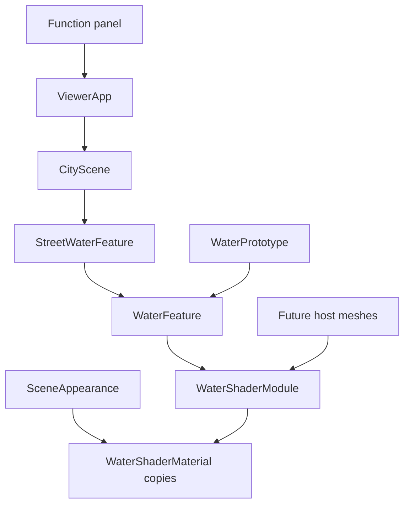

# Design Document

## Overview
街尾以程序水景替換植栽島，重用原型視覺，提供未來場景可直接匯入的水景 Shader API。
維持單一 renderer／loop，程序素材、既有陰影與 DPR；不更動角色物理模型或新增外部依賴。

## Boundary Commitments
### This Spec Owns
水景材質 API、街尾組裝與障礙、面板接線、shader 外觀覆寫相容、薄片遮擋過濾及整合測量證據。
### Out of Boundary
涉水／游泳、NPC／NavMesh、通用特效框架、即時反射、WebGPU、M6／SCENE-05 人工驗收；不修改原型正式歷史數據。
### Allowed Dependencies
Three.js；既有 motion／navigation world、相機／環境外觀、ViewerApp loop、SceneRenderer、功能樹及 WaterBenchmark。水景 API 不依賴街道／DOM／renderer。
### Revalidation Triggers
WaterShaderModule／WaterFeature 契約或 shaders 改動需重驗 water.html；FollowCamera hit filter 需重驗既有 obstruction；UI 新節點需重驗 panel／keyboard／narrow；world 障礙需重驗 navigation／manual collision。

## Architecture

既有 WebGL2／TypeScript／Three.js 不升版。材料複製行為由水景材質自己實作，外觀系統保持通用。相機對 marked mesh 過濾 hit，不影響 GroundPicker。

## File Structure Plan
| 檔案 | 責任 |
|---|---|
| src/water/WaterShaderModule.ts | 新增：ShaderMaterial subclass、狀態／時間、兩材質與釋放 |
| src/water/index.ts | 新增：公開 export 與 API 版本常數 |
| src/water/WaterFeature.ts | 修改：既定網格組裝、quality dispose，委派 ShaderModule |
| src/water/waterShaders.ts | 修改：opacity uniform 乘入輸出 alpha |
| src/scene/StreetWaterFeature.ts | 新增：池岸／石牆／底座、位置及障礙常數，水景所有權 |
| src/scene/CityScene.ts | 修改：替換島、附加環境與 world 障礙、更新／設定／釋放 |
| src/camera/FollowCamera.ts、src/camera/CameraObstruction.ts | 修改：忽略薄片相機 ray hit，保留透明 root |
| src/engine/ViewerApp.ts | 修改：水景更新／設定／背景時間及只讀狀態 API |
| src/main.ts、src/ui/controlPanelContent.ts | 修改：Scene display 水景控制及狀態 |
| tests/water-shader-api.test.mjs、tests/street-water.test.mjs | 新增：API／clone／world／導航／ray／dispose 行為 |
| tests/water-controls.test.mjs、tests/navigation.test.mjs | 水景表單 labels／範圍與更新後的可走終點 fixture |
| src/water/WaterPrototype.ts | 修改：從公開入口匯入，更新舊時點未整合提示 |
| docs/water-api.md | 新增：公開 API、範例、所有權及限制 |
| README.md、docs/development-plan.md、.kiro/steering/roadmap.md | 修改：本次指向與操作說明，保留歷史 |
| .kiro/specs/street-water-integration/ | 規格、測量、驗證及審閱證據 |

量測工具放在忽略的 .local/street-water-validation/，透過 localhost:4176 唯讀提供實際 Release hashed 模組。因 Vite 共用 helper 指向 root entry，驗證頁先讓 root 的 side-effect app 初始化並以正常 pagehide teardown 釋放，再建立唯一量測 ViewerApp。資源循環 fixture 只用於生命週期驗證，正式街道設定與 renderer 未分叉；採樣器由原 WaterBenchmark 以 Node 內建 stripTypeScriptTypes 轉換，無新依賴。

## Components and Interfaces
### WaterShaderModule
Contracts: API、State。公開 API v1，由 src/water/index.ts 匯入。
```typescript
type WaterQuality = 'low' | 'standard';
interface WaterSettings { enabled: boolean; paused: boolean; waveStrength: number; flowSpeed: number; quality: WaterQuality }
class WaterShaderModule {
  readonly surfaceMaterial: ShaderMaterial;
  readonly fallMaterial: ShaderMaterial;
  get settings(): WaterSettings;
  get elapsed(): number;
  configure(patch: Partial<WaterSettings>): boolean;
  update(deltaSeconds: number): void;
  dispose(): void;
}
```
每 instance 擁有自己的動畫 uniforms、材質與狀態，無 DOM／geometry／renderer。設定沿用 finite 與範圍原子驗證，paused/off 不前進，delta 最多 .1s。dispose 冪等；被外觀系統建立的 clones 由系統釋放。
WaterShaderMaterial.copy 呼叫 super.copy 後將動畫 uniforms 指向來源，uOpacity 獨立；onBeforeRender 讀自己的 opacity。因而 clone 相同 module 的動畫同步，透明／線框狀態獨立；新 module 間不共享 state。

### WaterFeature
公開介面保持 root/settings/elapsed/configure/update/dispose；ShaderModule 擁有材質，Feature 擁有網格與 geometry。quality 更新前驗證成功再替換 geometry、釋放舊物。mesh 標 cameraObstruction=false；非 walkable。

### StreetWaterFeature／CityScene
root.position=(0,0,-24.6)，池面 world y=.32，底座頂低於最低波面，外框 4.5×3.5、障礙 x ±2.25／z -26.35..-22.85；石牆／瀑布朝 +Z，完整占地阻擋走／跳。底座使用自有 shared box geometry／materials，水景 root 與固體放在單一 environment 子 root，便於 blocker 整組透明。
CityScene constructor 完成組裝後 ViewerApp 才 snapshot；world obstacles 加一個完整矩形，移除舊植栽島及其兩個重複障礙。CityScene.update(delta)、configureWater(patch)、waterSettings／waterElapsed 轉接，dispose 先由 CameraObstruction 還原 clones，再釋放 city owned 資源。

### 相機與選地
FollowCamera.constrain 取第一個 cameraObstruction!==false 的 hit；CameraObstruction visibleMeshes 同樣過濾，避免水面觸發推近或 blocker。池岸／石牆命中時依既有 root 邏輯包含水景透明。線框以材質 wireframe property 生效。First person 沿用 external=false 規則。GroundPicker 不過濾薄片，最近非 walkable hit 或 world obstacle 均拒絕。

### ViewerApp／UI
每幀 city.update 與既有 loop 共用 delta；document.hidden 時不更新水景，visibilitychange／context restore 將 lastTime 歸零，恢復首幀 water delta=0。公開 configureWater／getWaterSettings／getWaterElapsed 與既有 metrics 足供 UI／驗證，UI 不碰 private scene。
Scene display 新增 Water feature 子節點，原生 labels、checkbox、range／output、select；disabled 開關只控制效果，不移除碰撞；文字狀態不逐幀 aria-live。新增 water.html 連結供回看原型。低品質不呼叫 renderer.setPixelRatio，SceneRenderer 無修改。

## Requirements Traceability
| Requirement | Components／驗證 |
|---|---|
| 1.1 | StreetWaterFeature、CityScene／位置與 browser 視覺 |
| 1.2, 1.3 | world obstacle、GroundPicker／manual movement、navigation tests |
| 2.1, 2.2 | UI、ViewerApp、WaterShaderModule／操作與時間測試 |
| 2.3 | WaterShaderMaterial.copy／onBeforeRender、FollowCamera filter／clone test 與 GPU 三模式 |
| 2.4 | 既有 renderer／相機、UI／production 回歸 |
| 3.1, 3.2, 3.3 | index、WaterShaderModule、WaterFeature／API sample、獨立與 clone／資源 tests |
| 4.1 | 全套測試／production 視覺／資源循環紀錄 |
| 4.2 | WaterBenchmark 純採樣重用／Release 固定街道相機及取消條件 |
| 4.3 | 既有 project.ps1 release／incremental index／兩入口 smoke |

## Error Handling
無效設定返回 false 且 UI 顯示拒絕；初始化錯誤沿用 main 錯誤呈現。context lost 沿用停止角色／粒子與恢復訊息；水景不補時間。shader 編譯錯誤在驗證捕捉並阻止 GO。背景／resize／DPR 變動取消採樣，不補寫成功結果。

## Testing Strategy
1. API tests：多實例、configure 原子性、paused/off、clone 更新／opacity、冪等 dispose、quality buffer 釋放。
2. World tests：植栽島替換、完整矩形 bounds、手動走／跑／跳不穿、可走目標繞行、點池拒絕。
3. 相機 tests：water thin mesh 不推近、solid 仍推近；透明 clone 動畫同步、wireframe／restore 與 dispose。
4. 實際 Release：近／遠／斜角、所有 presets／First person／3 modes、日夜／陰影、窄版與面板 resize、Caster／Target／粒子／兩入口。
5. 標準與低各 6 段街道 A/B，固定 960×600 DPR1、PCF2048、角色站定、固定相機，5s warmup +60s sample。記錄 RAF 指標、資源數與環境，非 GPU timestamp，不承諾手機實機。

## Rollout／Rollback
先測試／build，依專案規則 release，保留既有 previews；只撤本次變更並恢復島，不 reset 共用 checkout、不刪目的地舊資產。完成後增量索引並查 status，commit 另核准。

## Design Review Gate
inline PASS：13/13 ID coverage、boundary／files／contracts／failure／API ownership 與 runtime prerequisites 完整；使用者新增 Shader API 已映射。依核准範圍自動審閱，非人工逐份核准。
