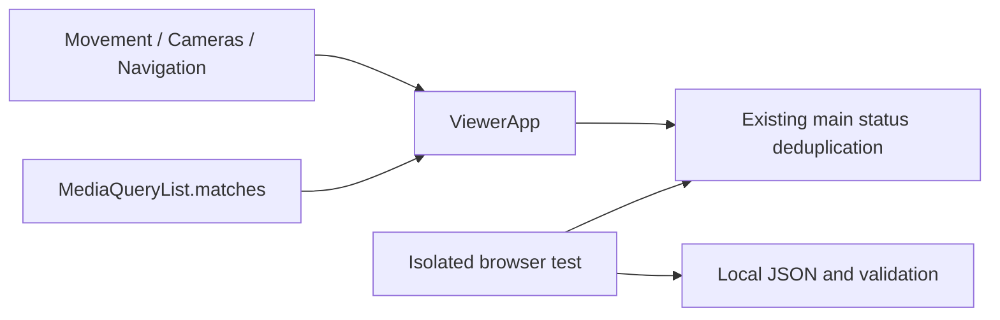

# Design Document

## Overview
本次以真main頁的量測結果決定局部優化。保持WebGL2、畫質及所有互動契約，確認既有狀態去重正常，量測並重用每幀偏好查詢，再比較幀間隔與CPU callback成本。Chrome主、Edge輔；手機矩陣與真機驗收分開。

### Goals / Non-Goals
提供可重跑的固定三輪基準、狀態轉換正確且無重複DOM重建、可稽核的支援界線。不是WebGPU／多GPU改造，不做未量得收益的DPR、陰影、粒子或inspector降級，不安裝或升級工具。

## Boundary Commitments
### This Spec Owns
既有reduced-motion查詢重用、效能測試腳本、相容性矩陣與驗證紀錄。ViewerApp仍為狀態權威，main維持既有狀態去重與呈現責任。
### Out of Boundary
Windows／瀏覽器設定、GPU分配、模型／動畫與鏡頭演算法、資產、WebGPU、其他LATER功能、M6／SCENE-05結案。
### Allowed Dependencies
既有Three.js／Vite、DOM／MediaQueryList、Node原生test、現有外部Playwright安裝（測試選用，透過PLAYWRIGHT_MODULE明確指定）。無新增runtime dependency或測試安裝需求。
### Revalidation Triggers
狀態契約涉及character-movement、camera-modes、mobile-touch-navigation與camera-obstruction-modes；對其測試與main真UI做回歸。SceneRenderer／水景／Xray未改，仍以四場景smoke與context恢復測整合。若需調整品質／API或新增依賴，先重新評估範圍。

## Architecture

依賴：既有狀態型別 → ViewerApp → main；測試不引入產品依賴，產品不引用測試。

## Requirements Traceability
| Requirement | Component / verification |
| --- | --- |
| 1.1, 1.2, 1.3 | viewer-benchmark：環境、四場景三輪RAF與CPU callback、renderer、draws／資源 |
| 2.1 | main既有狀態去重保持不變；相同狀態零操作說明重建，狀態轉換瀏覽器回歸 |
| 2.2 | 重用單一MediaQueryList，每次讀即時matches；執行中emulateMedia回歸，無新listener需釋放 |
| 2.3, 2.4 | 不改renderer畫質；四場景A/B；如無明確FPS改善明示波動 |
| 3.1, 3.2, 3.3 | docs/viewer-performance.md平台矩陣及真機／模擬區分 |
| 3.4 | tests、production build、Release、codebase_update/status依序，validation記錄失敗 |

## File Structure Plan
| File | Action / responsibility |
| --- | --- |
| src/engine/ViewerApp.ts | 修改：僅重用MediaQueryList，維持所有公開介面 |
| scripts/viewer-benchmark.mjs | 新增：對既有伺服器測真main，獨立profile、不改瀏覽器設定、結果存指定檔 |
| scripts/viewer-smoke.mjs | 新增：真main query重用與即時偏好、角色／鏡頭／狀態、resize及context故障注入 |
| docs/viewer-performance.md | 新增：執行方法、平台矩陣、畫質／DPR與實機流程 |
| .kiro/specs/viewer-performance/* | 規格、調查與inline審閱／驗證證據 |
| docs/development-plan.md、.kiro/steering/roadmap.md | 僅追加核准範圍與spec連結，不變更既有驗收勾選 |

## Components and Interfaces
### ViewerApp
維持getCharacterStatus公開同步查詢、CharacterStatus型別及所有既有回呼。main已有字串key去重，基準實測穩態無DOM重建，不新增替代機制。其餘每幀模擬／動畫／label定位不變。

reduced-motion建立一次MediaQueryList，原三個查詢點改讀其`.matches`；不將初始boolean永久快取，也不新增事件監聽。matches由瀏覽器維持即時值；dispose仍由既有events.abort釋放其他事件。

### Benchmark
讀取VIEWER_URL、BROWSER_CHANNEL（chrome／msedge）、SAMPLE_SECONDS（預設30，5–120）及PLAYWRIGHT_MODULE；資料存本機，不傳雲端。固定1280×800、DPR1，控制面板對應祖先展開，使用原UI切場景；每次暖機3秒、取樣15秒（本機實際設定）或預設30秒，三輪。RAF callback包裝含模擬／render submission／DOM，非GPU timestamp；nearest-rank median／P95。MutationObserver監測操作說明childList，不輸出其他使用者資料。pageerror與console error會失敗。測試結束finally關閉自己建立的browser。

## Error Handling
WebGL建立失敗沿用main錯誤提示；不把軟體renderer當硬體驗收。renderer資訊受限時顯示masked／unknown。工具、localhost或真機不可用時記錄具體阻擋，保留未勾任務；不更改防火牆或安全設定。

## Testing Strategy
- 2.1：真UI角色／動作／鏡頭／Follow／遮擋與導航切換仍可正確呈現，穩態DOM重建維持0。
- 1.1–1.3、2.1、2.4：真main headless Chrome前後四場景各三輪，reduced-motion query建立由每幀一次降至穩態0；記錄CPU與幀間隔波動，不預先承諾FPS增幅。
- 2.2、2.3：建置頁的角色／鏡頭／Follow／遮擋狀態UI、reduced-motion即時切換、窄螢幕resize、context loss／恢復。Edge同條件比較與smoke。
- 3.1–3.3：文件矩陣逐項覆蓋；iPhone／Android真機未知項保留，不由桌面模擬代替。
- 3.4：全套tests、production build、Release及本機preview-release smoke；之後索引，避免embedding干擾量測。

## Rollback
無資料遷移、無持久設定。發現回歸時僅撤回本spec的query重用，依舊流程重建增量Release；不使用git reset、刪除陌生Release檔案或覆寫使用者.codex/config.toml。
