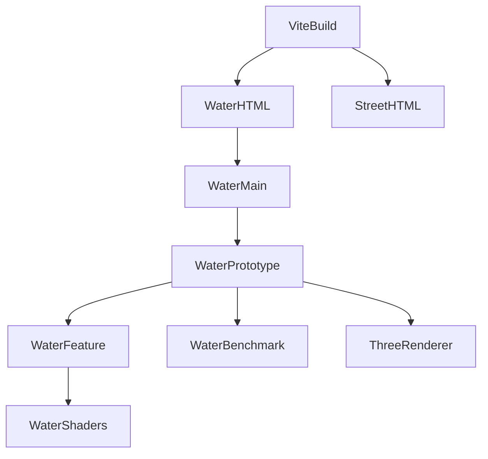

# Design Document

## Overview
water.html 提供青綠水池／白色泡沫瀑布的獨立測試場，讓使用者在街道整合前確認風格及成本。沿用 TypeScript、Three.js 0.186.1、Vite 8.3.4，不新增套件或外部素材。

### Goals / Non-Goals
交付約 4×3m 水面、2m 瀑布、品質與動畫控制及可重現 A/B。排除街道整合、人物水中互動、真流體、即時反射及 WebGPU。

## Boundary Commitments
### This Spec Owns
- WaterFeature 的程序化水面／瀑布與 owned geometry/material；實例僅產生 group，不開動畫 loop。
- WaterPrototype 的獨立 renderer、場景、Orbit、控制、benchmark 及全部 listener 生命週期。
- Benchmark 的統計／中止狀態及雙入口 build。
### Out of Boundary
ViewerApp／CityScene／src/main.ts／src/style.css 不修改。M6、SCENE-05 不勾完成；無主街道水景。
### Allowed Dependencies
Three.js 與 OrbitControls、瀏覽器 DOM/RAF、既有 project/release scripts；不依賴角色／街道 runtime。無第三方素材。
### Revalidation Triggers
build inputs／release 順序改動需重驗兩入口；未來 WaterFeature API 或街道整合須另核准並驗透明排序及效能。

## Architecture

依賴方向：shader／benchmark 純函式 → WaterFeature → WaterPrototype → water-main。現有街道入口只共用建置產物中的 Three.js，不共用應用狀態。

## File Structure Plan
| 檔案 | 狀態／責任 |
|---|---|
| water.html、src/water-main.ts、src/water.css | 新增，入口及獨立 UI |
| src/water/WaterFeature.ts | 新增，owned group／設定／update／dispose |
| src/water/waterShaders.ts | 新增，程序 GLSL 及色調／輸出色彩 chunks |
| src/water/WaterBenchmark.ts | 新增，採樣統計與有效性判定 |
| src/water/WaterPrototype.ts | 新增，場景／UI／生命週期與測量整合 |
| tests/water-effects.test.mjs | 新增，設定／時間／釋放／統計邊界測試 |
| vite.config.ts | 新增，兩個 HTML build input |
| scripts/release.ps1 | 修改，所有非 index HTML 在資產之後、index 最後 |
| docs/development-plan.md、.kiro/steering/roadmap.md | 僅前置本 spec 指向，保留歷史 |

## Requirements Traceability
| Requirement | Summary | Components | Interfaces | Flows |
|---|---|---|---|---|
| 1.1, 1.2, 1.3, 1.4 | 水景與角度 | WaterFeature／waterShaders／WaterPrototype | root、update | RAF→uniform→render |
| 2.1, 2.2, 2.3, 2.4 | 控制與釋放 | WaterFeature／WaterPrototype | configure、dispose | UI→設定→render |
| 3.1, 3.2 | 可比較量測 | WaterBenchmark／WaterPrototype | start、sample、cancel | 暖機→off/on→完成 |
| 3.3, 3.4 | 證據及雙入口 | WaterPrototype／build／release | DOM report、HTML | build→sync→preview |

## Components and Interfaces
### WaterFeature
Contracts: Service、State。Inbound WaterPrototype (P0)；External Three.js (P0)。不存 renderer 或 DOM。
```typescript
type WaterQuality = 'low' | 'standard';
interface WaterSettings { enabled: boolean; paused: boolean; waveStrength: number; flowSpeed: number; quality: WaterQuality }
class WaterFeature {
  readonly root: Group;
  get settings(): WaterSettings;
  get elapsed(): number;
  configure(patch: Partial<WaterSettings>): boolean;
  update(deltaSeconds: number): void;
  dispose(): void;
}
```
configure 原子驗證：波浪 0–2、流速 0–3、finite；非法／已釋放回 false。不把 NaN 傳至 shader。update 忽略非法 delta、每幀最多 0.1s；paused/off 不前進。dispose 冪等、移除 parent、owned geometry/material 各釋放一次，之後 update 無作用。
池面由平面旋轉 Y-up，shader 以 xz 產生三方向波與落點 radial 波，解析法線反光；edge 泡沫與落點泡沫直接合成。關閉效果時走靜態水色分支，略過波形及片段雜訊，瀑布隱藏；保留同品質網格以比較相同場景效果成本。瀑布單片平面使用向下 advection 的 value noise、寬度／邊緣變化；底部重疊池面，無獨立共面泡沫。
品質切換只替換 geometry 並 dispose 舊 geometry；shader low uniform 切換較少雜訊。無 texture／render target。

### WaterBenchmark
Contracts: State、Service。採 sample(now, stats)，內部 warmup/sample 階段；start 保存固定條件快照，cancel 丟棄當段，完整三輪才標為完成。每段 5s 暖機／60s 採樣；off/on 交錯三輪。FPS = frame count / sample elapsed；median／P95 用排序及 nearest rank，stats 報告期間 min/max，包含 geometry／texture／program。

### WaterPrototype
Contracts: Service、State。唯一 loop 與 renderer。公尺 Y-up、池面 y=0.32，瀑布底 y=0.32、頂 y=2.32；池面 x ±2、z ±1.5，落點 z=-1.1。程序石材底座／地台與兩盞燈；ACES exposure 1.3、PCF shadow 1024。
控制效果／暫停／wave／flow／quality、三種固定鏡頭與自由 Orbit、benchmark／取消、資源循環檢查。初始化錯誤或 context loss 顯示錯誤並取消測量；pagehide 釋放 controls、listener、observer、所有場景資源與 renderer。
benchmark 固定鏡頭、canvas CSS 960×600、DPR=1、陰影開，品質不變；尺寸受 viewport 限制，開始時不足則明示無法執行；期間禁用設定／Orbit，resize／DPR／visibility 改變取消。結束還原設定與正常 responsive 畫面。

## Error Handling
WebGL 初始化失敗在頁面顯示重整訊息；shader errors 記錄到可見狀態並停止正式 benchmark。context lost 不宣稱恢復成功，要求重新整理。無效設定不變更實例。背景頁不產生有效報告。

## Testing Strategy
- Node：設定原子性、pause/off/resume 無時間跳躍、quality 切換釋放、dispose 事件及停止 update；統計不隱藏慢幀與中止狀態。
- build：原 index 及 water.html 均在 dist，兩者 HTTP 與實際 production boot。
- WebGL：近遠斜角、波浪／flow／品質、console／shader errors；重複 10 次 create/render/dispose 後 memory 不持續成長。
- 效能：每品質正式三輪 off/on 各 60s，記錄固定條件及環境、完整數據；60／30 FPS 為目標，手機真機未驗則明列。
- release：既有 script tests→build→sync，檔案 hash readback 及 localhost:4174 production 視覺。

## Review Gate
inline PASS，依使用者授權自動審閱：12/12 criteria traceable；file plan 有實體路徑；無 orphan component；無新增外部依賴；build 與 release 的多 HTML 順序風險已納入。未作獨立代理審查。
