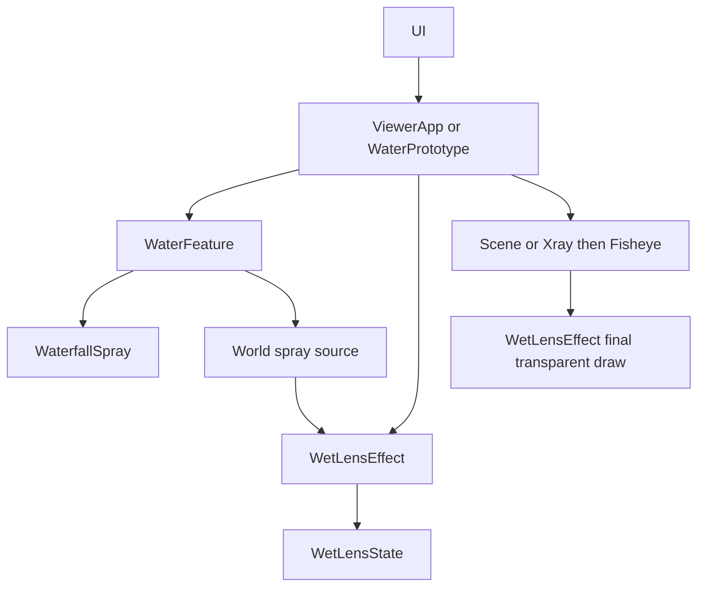
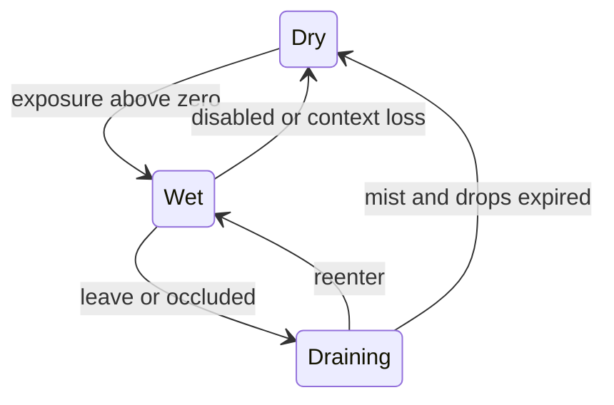

# Design Document

## Overview
在既有程序瀑布增加落水與落點飛濺，實際相機接近時感受到輕薄濕潤；街道與 water.html 使用同一模組，TypeScript／Three.js 版本不變。
目標是有界資源、平滑過渡及模式相容。非目標：真流體、場景折射／模糊、角色涉水、通用特效框架、新外部依賴。

## Boundary Commitments
### This Spec Owns
WaterfallSpray 的粒子、WaterFeature 的 world 噴濺源、WetLensState 的有界狀態及 WetLensEffect 的鏡頭層、兩入口接線與可存取開關、測試及交付證據。
### Out of Boundary
不改 Caster→Target ParticleInteraction、角色／導航、相機構圖權威、既有水體 shader 主體，不擴充六里程碑或關閉 M6／SCENE-05。
### Allowed Dependencies
既有 Three.js、WaterSettings、宿主相機／環境 Object3D、主迴圈、renderer、UI 與 project/release scripts。水景模組不得依賴 CityScene／ViewerApp／DOM。
### Revalidation Triggers
WaterFeature additive API 重驗原型與街道；renderer 最終合成重驗魚眼／Xray／resize；UI 重驗面板；粒子重驗遮擋過濾與資源釋放。

## Architecture

依賴方向：Three types → spray/source/state → WaterFeature／WetLensEffect → CityScene／SceneRenderer → ViewerApp／Prototype → UI。維持唯一 loop，不建新 renderer。

## File Structure Plan
| 路徑 | 責任 |
|---|---|
| src/water/WaterfallSpray.ts | 固定 buffer、GPU ballistic 粒子與資源 |
| src/water/SpraySource.ts | 世界座標 source、距離／方向／實體遮擋曝光計算 |
| src/water/WetLensState.ts | 薄霧過渡、固定鏡頭水滴池、可調設定 |
| src/water/WetLensEffect.ts | 最終透明合成，保留 renderer state／魚眼黑邊 |
| src/water/WaterFeature.ts、index.ts | 組合粒子、export、world source |
| src/scene/StreetWaterFeature.ts、CityScene.ts | 轉接 source，無硬編碼宿主位置 |
| src/engine/SceneRenderer.ts、ViewerApp.ts | 最終鏡頭層、實際 rendered camera、故障與時間接線 |
| src/water/WaterPrototype.ts | 共用效果及開關、資源循環、背景與 benchmark |
| src/main.ts、src/ui/controlPanelContent.ts | 鏡頭效果開關 |
| tests/waterfall-spray.test.mjs、wet-lens.test.mjs、water-controls.test.mjs | 語意、資源、合成與 UI 測試 |
| docs/water-api.md、README.md、docs/development-plan.md、.kiro/steering/roadmap.md | API／操作／授權範圍紀錄 |
| .kiro/specs/waterfall-spray/ | 規格與審閱／驗證證據 |

## Components and Interfaces
### WaterfallSpray
owns Points + BufferGeometry + ShaderMaterial；384 standard／128 low slots，落水及飛濺交錯；attributes 一次配置、quality 只改 drawRange，不逐粒建物件。update 接收 WaterSettings 及 elapsed，paused 凍結、off／flow=0 隱藏。depthWrite=false、depthTest=true、標 cameraObstruction=false、renderOrder=3。硬體 point-size 上限由 host render 前取得或保守 cap。dispose 冪等。

### SpraySource
WaterFeature.getSpraySource(target): boolean 回傳世界 matrix 與 local box（center 約 (0,1.1,-.85)、halfSize (.65,.9,.35)）；target 重用，無 renderer／UI 依賴。root 更新 matrixWorld，street／city 只轉接。
sprayExposure(camera,source,environment,near=1,far=3)：實際相機世界位置轉 local，取到 box 最近距離 smoothstep，背面 local z<-1.2 抑制、側面平滑；接近才射線檢查 source 前側到相機。忽略非 Mesh、hidden ancestors、水／粒子標記，實體 Mesh 即使透明外觀仍遮擋；不依賴角色距離或視線方向（面朝別處仍會沾濕）。

### WetLensState
Service／State：update(delta, exposure, {enabled,paused,quality,reducedMotion})；configure({nearDistance,farDistance,enterSeconds,exitSeconds}) 原子 finite 驗證；snapshot 只讀副本。near=1／far=3、enter=.8s／exit=2.5s。霧強度 bounded exponential smoothing；低於 .001 歸零。固定 24 個 slots、low 10，按曝光小量生成，life 2–4s；離開停止生成，既有滴向 UV -Y 滑動、漸入／淡出。無效 delta 忽略、上限 .1s，不補算背景。paused 完全凍結，disabled clear，reduced-motion 清除滴並保留不流動薄霧。

### WetLensEffect
owns state、fullscreen quad／orthographic camera／material；update(delta,camera,source,environment,waterSettings,reducedMotion)，enabled 獨立可關閉。render(renderer,fisheye) 在 scene／Xray／魚眼最終輸出後以 alpha blend，無額外 texture／render target；沒有可見霧／滴時不 draw。水滴 24 vec4 uniforms，以 aspect 修正避免拉伸；薄霧 alpha <= .12、水滴薄邊緣／高光，無全畫面折射。魚眼 mask radius=.5*min(width,height)，與 FisheyePass 黑邊一致。render 保存 autoClear／target，try/finally 還原；不改 toneMapping 全域狀態。dispose 冪等。

### Host integration
ViewerApp 在 updateObstruction 之後以 rendered camera 更新鏡頭層；waterDelta=0 的背景／首次幀不前進，context lost clear。SceneRenderer 兩分支最後都 render lens。setWaterLensEnabled/getWaterLensEnabled 提供 UI，不擴充 material-only WaterSettings。Prototype 同樣使用來源／相機與環境；品質／pause/off 直接讀 water.settings；pagehide 釋放，原型 context lost 仍依既有策略要求重整。

## System Flows

paused 凍結當前狀態；off 清空。品質下降清除超額 slots，恢復不復活。

## Requirements Traceability
| Requirements | Components / verification |
|---|---|
| 1.1, 1.2, 1.3 | WaterfallSpray／WaterFeature；buffer／pause／dispose tests、GPU |
| 2.1, 2.4 | SpraySource／WetLensState；world transform、方向／遮擋／設定測試 |
| 2.2, 2.3 | WetLensState；退場、重入、容量測試 |
| 3.1, 3.2 | hosts／state／UI；pause/off／reduced tests |
| 3.3, 3.4 | WetLensEffect／SceneRenderer／hosts；合成 state restoration、兩入口／背景／context／resize GPU |
| 4.1, 4.2, 4.3 | tests／production harness／validation；效能樣本、release／index |

## Error Handling
不合法設定回 false 且狀態不變；dispose 後不更新。GPU 錯誤沿用 host 訊息並記錄，不冒稱成功。容量滿則略過新滴，遠處不執行 raycast 或 lens draw。背景／context 復原不補時間。

## Testing Strategy
canonical：./scripts/project.ps1 test、typecheck、build；production 兩入口 boot／GPU。新增 Node tests 先 RED 再 GREEN，涵蓋 box world transform、側背／牆、滴消退、長時間容量、pause/off/reduced、quality、dispose／renderer 例外。GPU 近遠、First person／Orbit／魚眼／Xray／transparent／wireframe、resize／DPR、context／背景、10 次資源循環。固定 canvas／DPR／camera／品質，分別測新增效果 off/on，記錄 frame median／P95／FPS／資源，非 GPU timestamp 或跨機保證。
通過後依授權依序 release → preview-release → codebase_update → status；外部 Release 寫入遵守 sandbox。Rollback 僅本次範圍，無 reset／commit／push。

## Review Gate
PASS inline，依使用者整體授權自動審閱：14/14 條件可追溯、component/file 對齊、無新依賴、API 為 additive、狀態與合成順序明確。未獨立委派。
