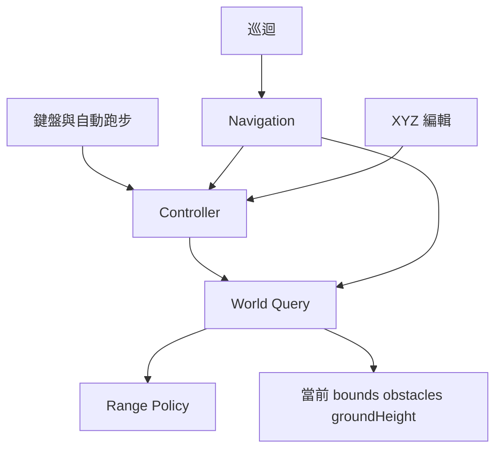

# Design Document
## Overview
建立 World Query 契約與 planar 城市適配，把四種控制流程的限制集中。沿用 TypeScript、Node 原生 tests、既有 Vite／Three.js，無新依賴。

## Boundary Commitments
### This Spec Owns
- 查詢結果、直立膠囊尺寸、能力及 planar 地面相容適配。
- 城市單一矩形允許區減矩形代理、邊界容差及最早線段接觸。
- controller／navigation／tour／XYZ 使用相同查詢的整合。
### Out of Boundary
完整三維膠囊 solver、洞頂、多層、動態剛體、區域聯集與模式轉換、debug UI、固定模擬時鐘、相機／交通政策、M6 手機驗收。
### Allowed Dependencies
WorldQuery 類型無執行時依賴；RangePolicy 僅依類型；LegacyWorldQuery 依 RangePolicy 與 WalkableWorld 型別；消費端依 adapter resolver。禁止 WorldQuery 反向依賴 Viewer、DOM、GPU。
### Revalidation Triggers
形狀／容差、代理語意或 query capability 改動須重驗所有消費端。未來替換三維 adapter 必須重新驗證導航路徑與模式能力，不得默默沿用 planar 結果。

## Architecture

呼叫端仍持有 WalkableWorld；新增 optional query 供城市提供共享 adapter，其他既有世界以 WeakMap resolver 取得相容 adapter。形狀以查詢參數傳入，沒有全域可變角色尺寸。都市障礙維持保守矩形 envelope，非精確圓弧膠囊接觸。

## File Structure Plan
| 路徑 | 責任 |
|---|---|
| src/world/WorldQuery.ts | Point3、Capsule、Result、capability／query 公開契約、預設尺寸 |
| src/world/RangePolicy.ts | planar 允許／禁入位置、連續 segment sweep、接觸容差 |
| src/world/LegacyWorldQuery.ts | 讀取既有 world、surface、overlap、sweep、水平 raycast、region 與 resolver |
| src/character/motion.ts | optional query 型別擴充 |
| src/character/CharacterController.ts | 查詢移動與原子 relocate，非法意圖不污染狀態 |
| src/navigation/DestinationNavigation.ts | 透過 query 檢查頂點／邊，保留現有尋路 |
| src/scene/CityScene.ts | 建立共享城市 query |
| tests/world-query.test.mjs | 查詢／範圍契約及整合回歸 |
| docs/development-plan.md、.kiro/steering/roadmap.md | 授權範圍與本 spec 連結 |
| docs/scene-runtime-collision-mask-spec.md | 記錄已確認方向與第一批實際交付界線 |

## Components and Interfaces
WorldQuery 的 sweep、overlap、raycast、surfaceSample、regionSample 皆回傳 QueryResult<T>：ok/value 或 error（invalid-input、unavailable、unsupported）。有效查詢的 no-hit 為 null，不混同錯誤。sweep 位移為完整 delta，不是速度，回傳 fraction 0..1、normal、layer、id；允許接觸，朝內穿越才阻擋。overlap=true 表示無法放置，不能混同 surface 高度查詢。

Capsule 用腳底座標加 radius>0、height>=2*radius，尺寸／座標必須有限。planar proxy 忽略 Y 作水平障礙但公開 capability 記載；surfaceSample 回傳有限 height 與 surface id，無法取樣回 unavailable。非水平 raycast 明確 unsupported；本批不假造地形 ray intersection。raycast 使用有限線段，不接受無限距離。

RangePolicy 的單一 allow bounds 缺失、倒置或非有限為 unavailable；denied 代理亦驗證。regionSample 回傳 allowed、regionId、reason，先檢查允許區再判斷禁入，缺省拒絕。最早碰撞採 slab interval 與向內法向；同時間以穩定輸入順序決定，bounds 固定優先。角色形狀完整 envelope 納入半徑；不實作不使用的多允許區 union。容差 1e-8m，只有嚴格進入內部才阻擋，拐角切線可通過。

Controller 保留先 X 後 Z 分步滑動與既有重力；每個候選先 sweep，再驗證取樣高度有效才提交，失敗保留先前有效狀態。relocate 可傳送但需 overlap／region／surface 全通過；拒絕不改 speed、heading、velocityY 或 jumpHeld。intent／speed 非有限直接拒絕該幀。初始 spawn 無效則明確拋出錯誤，不能生成 NaN 角色。

Navigation 以同一個 query 的 region/overlap/sweep 檢查 ground endpoints 與 path edges。PathTour 既有呼叫不需修改即可繼承；自動跑步與 XYZ 既有 controller 消費端亦繼承。實際執行仍由 controller 每步查詢，保留 stall timeout。無效或高度缺口目的地不能選取。

## Requirements Traceability
| 條件 | 元件／驗證 |
|---|---|
| 1.1, 1.2, 1.3 | WorldQuery／LegacyWorldQuery：結果／能力／非法與不支援查詢 |
| 2.1, 2.2, 2.3 | RangePolicy：連續 sweep、尺寸、缺省拒絕、切線容差 |
| 3.1, 3.2, 3.3 | controller／navigation／city：四流程整合、跳躍與速度、原子拒絕 |
| 4.1, 4.2 | tests/world-query.test.mjs、既有整套 tests／release、production smoke、validation |

## Testing Strategy
先以 Node 原生測試建立 query／RangePolicy RED，再實作；測有限／NaN／Infinity／負尺寸、缺失 allow、非法代理、高速跨障礙、切線、從邊界離開、不同 radius/height、region/surface/overlap/raycast 語意。整合測試覆蓋真實城市導航及巡迴／手動 controller／relocate 一致性、資料動態變更、無效高度保持最後狀態。既有183 tests維持；production smoke 含 legacy／Needle 啟動、城市往返與角色移動。手機、完整三維碰撞與 FPS 門檻不宣稱驗收。

## Rollout and Rollback
只在原始專案修改；無資料遷移、外部依賴或資產。tests/build 通過後依序 release 與本機增量索引。rollback 只還原本批檔案並重跑 release，保留 main 上 M6 commit，不跨分支整合。commit 另行核准，不 push。

## Review
Design gate PASS（inline）：11/11 條件映射完整、檔案邊界與依賴方向一致、無 orphan component、未增加隱藏 runtime 前置。以明列 capability 避免把 planar adapter 當完整 v0.1；後續場景能力延後且必須重驗。
