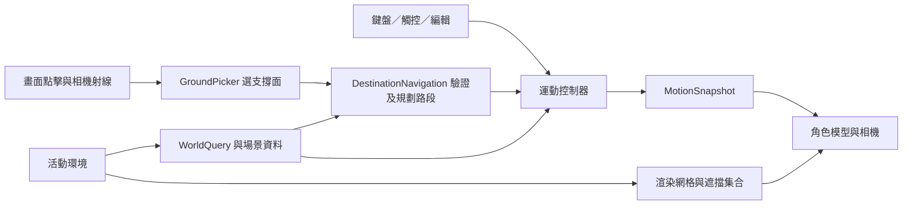

# 六個環境的運動、效果與設定

2026-11-22 工作樹專題。座標、渲染、骨架基礎及逐幀流程見 [3D 架構總指南](3d-knowledge-architecture.md)。[main](../src/main.ts) 綁定選單，[ViewerApp](../src/engine/ViewerApp.ts) 依 [EnvironmentId](../src/scene/EnvironmentId.ts) 準備場景並交接控制。

| ID | 入口 | 運動與查詢 |
| --- | --- | --- |
| `city` | [CityScene](../src/scene/CityScene.ts) | 地面控制、XZ 相容查詢 |
| `cave` | [CaveScene](../src/scene/CaveScene.ts) | 地面控制、有限高度障礙與支撐 |
| `terrain` | [TerrainScene](../src/scene/TerrainScene.ts) | 地面控制、地形高度與坡面 |
| `flight` | [FlightScene](../src/scene/FlightScene.ts) | 有界空域、合法起降與地面模式 |
| `room` | [ManorScene](../src/scene/ManorScene.ts) | 多層支撐、樓梯與分層點地導航 |
| `swim` | [SwimScene](../src/scene/SwimScene.ts) | Tidal Pool 平台、水體與池底 |

原 [FurnishedRoomScene](../src/scene/FurnishedRoomScene.ts) 和客廳 GLB 仍保留。太空屬候選規劃。

## 世界查詢與多樓層

[WorldQuery](../src/world/WorldQuery.ts) 統一輸入與回傳。直立膠囊以腳底為基準，半徑為 r、高度為 h，需滿足 `h ≥ 2r`。Swept collision（掃掠碰撞）沿 `p(t) = p₀ + t × displacement` 檢查整段，命中提供比例 t、法線及障礙／邊界 ID，避免只檢終點時跨過薄障礙。Overlap 檢查當前體積，surfaceSample 找支撐面，regionSample 判斷合法區域，raycast 有能力限制，groundSegment 由支援的場景用於可走性檢查。呼叫端須區分有效查詢沒有命中與 invalid-input、unavailable、unsupported。

[LegacyWorldQuery](../src/world/LegacyWorldQuery.ts) 和 [RangePolicy](../src/world/RangePolicy.ts) 保存城市相容行為。以 r 內縮可用外框、外擴障礙，角色中心仍可沿切線移動。城市的實體障礙以 XZ 投影延伸。[GroundWorldQuery](../src/world/GroundWorldQuery.ts) 搭配 [CapsuleBox](../src/world/CapsuleBox.ts) 則保留有限高度、支撐面和上下淨空。一個 XZ 位置可同時有地板、上層樓板和屋頂，查詢以參考高度與最大可上升量選支撐。自然地表讓地形外觀與支撐取樣共用地形資料，坡度可由單位法線和向上向量的內積判斷，`n · up = cos(坡角)`。洞穴另有牆、天花板和局部支撐，第三維會進入碰撞判定。[地形驗證](../.kiro/specs/natural-terrain-validation/validation.md)、[範圍政策驗證](../.kiro/specs/world-query-range-policy/validation.md)、[地面體積驗證](../.kiro/specs/ground-volume-world-query/validation.md)

[ScreenRay](../src/camera/ScreenRay.ts) 把一般或魚眼畫面反投影，[GroundPicker](../src/navigation/GroundPicker.ts) 對明確宣告的可走面選點。[DestinationNavigation](../src/navigation/DestinationNavigation.ts) 檢查連線支撐與淨空，[CharacterController](../src/character/CharacterController.ts) 逐步提交碰撞後結果。[CameraObstruction](../src/camera/CameraObstruction.ts) 處理鏡頭視線與外觀。點地射線略過一般牆面時，控制器仍會在實體牆前停下。

### 莊園的支撐面、樓梯與遮擋

Blender 生成腳本產出可編輯的 manor.blend 及瀏覽器用 manor.glb。ManorScene 以 GLB 節點 metadata 中的 `walkable` 取頂面、`solid` 取三維障礙盒，另讀取樓梯踏面、上下平台和 route waypoint。分層圖限制跨高度連線在實際樓梯通道，同層再搜尋可走線段，靜態連線可快取。驗證以實際 GLB 覆蓋 B1 至屋頂、五段樓梯雙向，以及從樓梯中段選點與續走。固定屋頂／後庭路徑樣本首次由 204–261 ms 降到 75–94 ms，重選約 15–17 ms，數值屬當時測例。[生成腳本](../tools/assets/prepare_manor.py)、[資產雜湊](../public/assets/environments/asset-manifest.json)、[分層尋路驗證](../.kiro/specs/manor-estate/validation.md#分層尋路驗證)

莊園的樓梯相關遮擋使用可獨立處理的網格，複合場景可按對應幾何處理遮擋。樓梯碰撞仍使用明確標記的體積和踏面。二樓床頭板回歸沿用相同 GLB 的角色助跑跳躍，以重新匯出的三個 `solid=true` 節點擋住角色。[屋頂樓梯交接](team-handoff.md)、[床頭板碰撞回歸](../.kiro/specs/manor-estate/validation.md#床頭板碰撞回歸)

## 有界飛行

[FlightController](../src/character/FlightController.ts) 以直立膠囊與受限加速度更新三軸平移。每個 1/60 秒子步掃掠，[FlightWorldQuery](../src/world/FlightWorldQuery.ts) 提供外界、實體盒與禁入盒的接觸。撞壁時去除剩餘位移與速度朝向壁內的分量，可沿牆滑行。姿態保留角色朝向，適用範圍是有限空域，無任意六自由度旋轉及太空動力學。

起飛須有合法膠囊位置，著陸從腳下候選支撐做向下掃掠，再驗證站立，成功才交回地面控制器。跨環境換用對應查詢與控制器，按目標環境出生與模式政策驗證後提交。當前飛行外觀沿用既有動作 fallback。[有界飛行驗證](../.kiro/specs/bounded-flight/validation.md)

## 潮汐水池

[WaterVolume](../src/water/WaterVolume.ts) 用 XZ 界線、池底及 `水位 + shader.surfaceOffset(x, z)` 描述水體。CPU 與水 shader 使用同一水波時間。角色軀幹及相機各有獨立的浸沒判定，以約 ±0.1 m 遲滯抑制水面閃切。場景更新水面和水下霧，相機在自己的位置取樣，物理位置由 [SwimController](../src/character/SwimController.ts) 提交。

- 從乾平台走入水中後接管移動，水中運動用固定子步與體積掃掠擋住池壁、池底及設備。鞋底在水中、軀幹近水面時仍依合法腳底體積選控制器。平台入口需要檢查站立淨空與移動路段。
- 放開輸入會停止並保持水下位置，即使開著水流設定。原地立游使用自己的腿部姿勢，觸底後可站立和移動。靠近水面並從合法方向到達金色平台入口可自動上岸，深水接近或從反向接近仍受入口條件限制。
- 第三人稱與魚眼支援 Y 切換自動移動，滑鼠俯仰可調整游向，I／O 切入向下／向上的螺旋路徑並可反向。抵界、路徑受阻、停止、失焦或切換相機依各自條件取消相應狀態。池底可用 Y 奔跑及 O 離底。乾平台可使用一般地面操作及第一人稱眼位。
- [SwimAppearance](../src/character/SwimAppearance.ts) 提供蛙式、一般潛水、水母漂浮，以及運動泳裝、潛水裝。[AquaticRig](../src/character/AquaticRig.ts) 搭配 [RiggedCharacter](../src/character/RiggedCharacter.ts) 驅動既有三角色骨架、掛載泳鏡、面罩或蛙鞋等配件，並處理腳骨與小腿末端的跟隨。離水回到地面動作，切離水域還原日常外觀。早期驗證段落中的 Jump fallback 記錄屬追加姿勢以前的版本。

1Y-20 的正式入口 Chrome SwiftShader 實測涵蓋 Needle 與 legacy 的深度路徑、停止、上岸與池底。三姿態兩服裝另有三個實際 GLB 與雙排程操作證據。手機 LAN、實體 GPU 和正式效能依目標環境另驗。[深度控制與自動移動](../.kiro/specs/bounded-swim/validation.md#1y-20-深度控制與自動移動)、[水域姿態與服裝驗證](../.kiro/specs/bounded-swim/appearance-validation.md)

## 環境掃描

[EnvironmentScan](../src/engine/EnvironmentScan.ts) 觸發時複製腳底世界座標為固定波源。球殼半徑前兩秒以 `r = 10t` 公尺推進至 20 m，尾帶長 3.4 m，停在末半徑後約 250 ms 淡出。shader 先用平方距離排除波帶外的片段，再計算亮刃、波前、青色餘光，於 tone mapping 前加色。接收位置來自動畫後的世界座標，含 instance 變換。這是材質視覺效果，提供表面輪廓提示，無測距資料。

環境、晚載 Target 及交通子樹註冊支援材質。每個材質實例只準備一次，掃描啟停主要更新 uniform。遮擋模式若複製／替換材質，由 [SceneAppearance](../src/scene/SceneAppearance.ts) 管理原材質與替代材質，掃描 hook 須套用到實際繪製的材質。掃描清除時將強度歸零，dispose 移除子樹監聽，mesh、材質及貼圖由各擁有者釋放。[PointLightShader](../src/engine/PointLightShader.ts) 為密集無陰影點光保留等價迴圈路徑，有點光陰影時維持原 shader 展開。

首次 shader 編譯曾造成約 0.8–0.9 秒幀間隔。提前註冊與 [SceneRenderer](../src/engine/SceneRenderer.ts) 的 `compileAsync` 將適用變體的編譯移到準備階段。後續 GTX 1060 樣本在首掃未觀察到新的 shader source 提交，首掃最大幀間隔 13.5–26.6 ms。該量測含瀏覽器排程，其他場景、GPU 或 shader 變體仍需個別觀察。[掃描與點光驗證](../.kiro/specs/environment-scan/validation.md)

## 面板設定與鏡頭還原

[Profiles 資料模型](../src/settings/PanelProfiles.ts) 驗證 v1 JSON、每場景編號、temp 與最多十份命名快照。[面板繫結](../src/ui/PanelProfiles.ts) 保存 runtime、欄位及面板寬度／折疊／展開狀態。載入先套用 [ViewerSettings](../src/settings/ViewerSettings.ts) 的實際值並同步 UI，再恢復指定輸入草稿，例如 XYZ、粒子、巡迴及物件篩選。草稿顯示恢復後，仍依原操作提交。場景切換與角色設定完成後，ViewerApp 還原相機模式、旋轉／縮放，以及 pose 的相機位置與目標，舊 v1 缺少新欄位時依相容預設處理。

[ProfileStorage](../src/settings/ProfileStorage.ts) 使用站點來源範圍內的 OPFS `panel-profiles.json` 或 IndexedDB 的同名資料項，後者也承接 OPFS 寫入失敗的回退。寫入有佇列，解析錯誤會保護損毀資料，顯式 Save 或 Panel.Reset 可取代。設定依瀏覽器、協定、網域和連接埠分隔，清除網站資料會移除。JSON 由瀏覽器管理，沒有本機檔案匯出或跨站同步入口。1Z-3 的 Release 操作驗證涵蓋 Save、修改、選載、Reload、v1、鏡頭姿態、實際值與表單草稿。[Profiles 驗證](../.kiro/specs/panel-settings-profiles/validation.md)、[1Z-3 交接](team-handoff.md)
