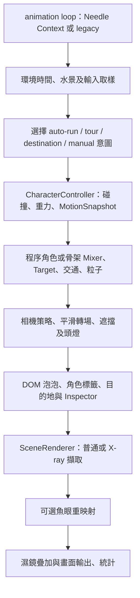

# 3D 基礎知識與專案架構指南

核對日期：2026-11-08（Asia/Taipei）。本指南接續「介紹 3D 技術與專案架構」及 [2A-1]～[2A-8] 知識 chats，提供可長期查閱的總索引。以目前工作樹為準，基底 HEAD 為 `2825627`、分支為 `codex/v02-particle-system`；包含尚未提交的 Needle、多場景、相機輸入、點地與建築整合，不能用該 commit 單獨重現全部內容。

閱讀時區分三種證據：**程式存在**表示目前可以找到實作；**工程驗證**表示指定測試或瀏覽器樣本通過；**人工驗收**表示使用者對明確操作範圍的確認。三者不互相取代。需求來源是 [development-plan](development-plan.md)，人工狀態以 [remaining-acceptance](remaining-acceptance.md) 最新裁定為準；本指南不修改授權或待辦。

## 主題索引

| 原知識主題 | 本文件入口 | 主要程式 |
|---|---|---|
| 2A-1 基礎與建模 | [座標與場景](#座標與場景) | [CityScene](../src/scene/CityScene.ts)、[Character](../src/character/Character.ts) |
| 2A-2 材質光影與效能 | [渲染與光照](#渲染與光照)、[效能與釋放](#效能與釋放) | [SceneRenderer](../src/engine/SceneRenderer.ts) |
| 2A-3 相機與魚眼 | [相機投影與遮擋](#相機投影與遮擋) | [camera](../src/camera/)、[FisheyePass](../src/engine/FisheyePass.ts) |
| 2A-4 移動碰撞導航 | [輸入移動與導航](#輸入移動與導航) | [CharacterController](../src/character/CharacterController.ts)、[navigation](../src/navigation/) |
| 2A-5 GLB 與管線 | [骨架動畫與資產](#骨架動畫與資產) | [RiggedCharacter](../src/character/RiggedCharacter.ts) |
| 2A-6 非同步與復原 | [載入與生命週期](#載入與生命週期) | [CharacterAssets](../src/character/CharacterAssets.ts) |
| 2A-7 泡泡與手機 | [DOM 與互動介面](#dom-與互動介面) | [expression](../src/expression/)、[input](../src/input/) |
| 2A-8 架構與發佈 | [整體架構與逐幀流程](#整體架構與逐幀流程)、[驗證與發佈](#驗證與發佈) | [ViewerApp](../src/engine/ViewerApp.ts)、[main](../src/main.ts) |
| 後續擴充 | [粒子水景與鏡頭效果](#粒子水景與鏡頭效果)、[多場景與編輯工具](#多場景與編輯工具)、[交通模擬](#交通模擬) | lighting、water、simulation、scene |

建議先讀座標、渲染、架構，再依正在觀察的功能深入。閱讀程式可從 `main.ts → ViewerApp → 所屬模組`，不要從 shader 或數學公式開始猜整體行為。

## 座標與場景

### 位置、方向與變換

本專案以 1 unit = 1 公尺、Y 軸向上；地面主要使用 XZ 平面。太陽與指北針約定北為 -Z、東為 +X。角色朝向 heading 的水平前進向量為 `(sin(heading), 0, cos(heading))`，因此 heading=0 朝 +Z，不等於北。

| 名詞 | 意義與專案例子 |
|---|---|
| Vector 向量 | 有方向與長度的數值組；位置差 `target - position` 指向目標。正規化後長度為 1，適合表示方向。 |
| Radian 弧度 | 旋轉角度單位，π=180°；Three.js 的 rotation 通常用弧度，UI 角度需轉換。 |
| Transform 變換 | 平移 position、旋轉 rotation/quaternion、縮放 scale 的組合。角色根節點控制世界位置，內層視覺節點負責模型尺寸與腳底對齊。 |
| Local space 局部空間 | 相對父節點；掛在角色頭上的光源 offset 會跟隨角色轉動。 |
| World space 世界空間 | 累積祖先變換後的位置；標籤、碰撞與相機需對齊同一空間。 |
| Matrix 矩陣 | 將變換組合成可計算的映射。局部點轉世界點可寫作 `p_world = M_parent × M_local × p_local`。 |
| Normal 法線 | 表面朝外方向，影響照明與可走面判定。非均勻縮放時不能直接套位置矩陣，需 normal matrix。 |
| Quaternion 四元數 | 表示三維旋轉；相機用插值平滑轉向，避免直接線性混合 Euler 角的繞轉問題。 |

例：人物向東跑 4 m/s，這幀 dt=1/60 秒，無碰撞時 X 增加約 0.0667m。人物視覺模型放大兩倍不代表控制器速度也變兩倍；視覺變換和運動狀態是不同責任。

### 幾何、材質與場景樹

Geometry（幾何）儲存頂點 vertex、三角形 triangle、法線與 UV。UV 是貼圖上的二維座標，不是世界 XZ。Material（材質）定義表面怎麼著色；Mesh（網格物件）把幾何和材質放到場景裡。Group 用來組合物件，自己沒有可見表面。Scene graph（場景樹）描述父子關係，每個節點都可有變換；轉軸 pivot 是旋轉所圍繞的原點，所以同一棵樹的枝葉和樹幹能一起移動。

城市道路、人行道、樹、路燈與家具以程序幾何建立：用程式與參數組裝形狀，而非全部手工建模。共用 Geometry/Material 能節省資源，但多個 Mesh 共用幾何並不自動合成一次 draw call。改共用材質也會同時影響所有引用者；[SceneAppearance](../src/scene/SceneAppearance.ts) 管理遮擋外觀時須保留原材質，避免永久污染。

目前建築是混合管線：八棟 Blender GLB 替換程序建築的視覺外觀，道路及碰撞權威仍由既有場景資料提供。看見更精細的 GLB 不表示碰撞會自動依每個三角形更新。

## 渲染與光照

### CPU、GPU 與畫面形成

TypeScript 經 Vite 處理後在瀏覽器執行。CPU 處理輸入、導航、動畫狀態、場景遍歷與繪圖命令；GPU 執行頂點／片段 shader、光柵化與像素深度測試。Canvas 是畫面承載面，WebGL2 是呼叫 GPU 的介面，Three.js 是幫程式管理場景與繪圖的函式庫；Needle 是目前整合的執行排程層，不能將四者視為同一層。

基本渲染路徑：模型頂點經 model、view、projection 矩陣轉到裁切空間，除以 w 得到 NDC，三角形光柵化為片段，再依材質、燈光、深度與混色寫入像素。Depth buffer（深度緩衝）記錄較近表面，讓牆遮住後方角色；透明混色另涉及繪製順序，不能只把 opacity 設小就保證所有交疊正確。

[SceneRenderer](../src/engine/SceneRenderer.ts) 現用 `WebGLRenderer`、抗鋸齒、PCF 陰影、ACESFilmicToneMapping 與曝光 1.3，DPR 上限 2。ACES 將高亮場景值壓到可顯示範圍；曝光不是新增一盞光，也不會增加被遮住區域的物理照明。Fog（霧）依場景距離調整顏色，提供深度感，並非完整體積散射。

WebGPU 已做本機相容性評估，正式入口仍用 WebGL2。當時新 renderer 的標準材質探針成功，但專案依賴的 GLSL ShaderMaterial 在新 renderer 的 WebGPU 與 WebGL backend 都未達等效呈現。這是本專案鎖定版本與測試的結論，不是所有 WebGPU 技術的永久限制；完整條件見 [WebGPU assessment](webgpu-assessment.md)。

### 材質與燈光的差別

| 名詞 | 原理與目前用途 |
|---|---|
| PBR 實體導向渲染 | 以一致的光與材質參數描述表面。MeshStandardMaterial 使用 roughness（粗糙度）及 metalness（金屬度）；越粗糙，高光越散。它不代表整個場景都做真實光線追蹤。 |
| MeshBasicMaterial | 不受場景燈光影響，適合標記；單純讓顏色變亮不會照亮鄰近地面。 |
| Emissive 自發光 | 材質本身看起來亮；沒有全域光照時，不會自動變成照亮其他物體的光源。 |
| HemisphereLight 半球光 | 天空／地面方向的環境填光，避免陰面全黑，不產生幾何遮蔽陰影。 |
| DirectionalLight 方向光 | 近似遠處太陽，方向平行，可投射 shadow map。 |
| PointLight 點光 | 向各方向發光，有距離衰減；現用於路燈與粒子附掛光源。 |
| SpotLight 聚光燈 | 有錐形方向與範圍；洞穴頭燈及天井光使用此類光源。 |
| Shadow map 陰影貼圖 | 從光源看出去記錄深度，再比較表面是否被擋；bias 減少自遮蔽斑點，過大會讓影子浮離物體。PCF 用多次比較柔化邊緣。 |

[ObjectLightPool](../src/lighting/ObjectLightPool.ts) 用固定數量燈槽限制資源；街道六路燈和粒子八槽分開管理。夜間路燈現在確實照亮支援光照的材質，並能依手選或主角三維距離啟用多燈陰影。點光陰影需要六個方向的畫面，六盞同投影可能大幅增加繪圖成本。粒子附掛光無陰影，可能穿牆；水 shader 也不會自動採用 Three.js 標準點光。細節與範圍見 [Lighting API](lighting-api.md)。

[SolarPosition](../src/scene/SolarPosition.ts) 依太陽時間、代表季節與緯度算方向，再驅動城市光照及指北針；這是視覺太陽模型，不是含時區、折射與精密曆法的民用日照預報。洞穴 [CaveLighting](../src/scene/CaveLighting.ts) 另外處理天井開口、太陽方向及光束外觀，透過 [EnvironmentLights](../src/scene/EnvironmentLights.ts) 統一控制。光束網格與光塵是視覺近似，不是沿每條視線求解體積散射。

[Headlamp](../src/scene/Headlamp.ts) 將 SpotLight 與有界光塵分開：光照改變表面亮度，光塵使錐形方向可見。它跟隨角色，第一人稱可使用實際相機方向；場景切換、減少動態效果及 dispose 都是其生命週期的一部分。

## 整體架構與逐幀流程

| 層次 | 責任 | 不應混淆的界線 |
|---|---|---|
| `main.ts`、ui | 建立頁面、載入 app、繫結按鈕與狀態顯示 | DOM 表單不直接取得運動權威。 |
| `ViewerApp` | 組裝模組、統一逐幀更新、公開操作 API、清理 | 是共用應用層，Needle 與 legacy 不各自複製一套角色。 |
| `NeedleRuntime` | Context、Behaviour.update、composer 排程橋接 | 共用 SceneRenderer 的 WebGLRenderer，效果仍由既有 passes 繪製。 |
| input/navigation/controller | 手勢→意圖→路徑→合法運動 | 模型動畫不決定世界位移。 |
| scene/character/simulation | 環境、視覺角色、交通狀態 | 環境提供可走世界及能力契約。 |
| camera/engine/water | 構圖、投影、遮擋、渲染與後處理 | 畫面上的穿透效果不改變實際碰撞。 |

預設嘗試 Needle；`?engine=legacy` 明確使用原排程，Needle 初始化失敗也可回退。兩者都呼叫同一 `ViewerApp.update`。Needle 建立 Context，把 ViewerFrame Behaviour 掛到根場景，animation loop 呼叫 Context.update；繪圖則由 Context.renderNow 經自訂 composer pass 呼叫原有 SceneRenderer。此設計保留水、魚眼、X-ray 的 GLSL 與多通道順序，並不是把整個產品換成 Needle 專用場景／資產格式。



這是依目前 update 整理的主要先後順序；部分狀態回報在中途發生。delta time（幀間時間）上限約 0.05 秒，避免切回視窗時一次跨越很遠；水／交通時間另對隱藏頁面處理。這種變動步長加上限的更新不等於固定步長、完全決定性的物理引擎。

## 相機投影與遮擋

PerspectiveCamera（透視相機）讓遠物變小。FOV 是視角、aspect 是寬高比、near/far 是裁切距離，合起來形成 frustum（視錐）。增加 FOV 會讓畫面容納更多景物並拉伸邊緣；移動相機位置會改變透視關係，兩者不是同一種縮放。near 太接近零及 far 太遠也會降低深度精度。

[CameraController](../src/camera/CameraController.ts) 協調第三人稱、第一人稱、Front、Overhead、Low-angle、Orbit 與魚眼等模式，Follow 決定是否追蹤角色。理想相機與實際呈現相機分開，平滑位置與旋轉後再處理遮擋；Front 近牆可能採斜前候選構圖，不保證任何封閉角落都維持正前方。[CameraModeManager](../src/camera/CameraModeManager.ts) 集中處理模式切換與輸入政策，避免切換時殘留拖曳／檢視狀態。

### 魚眼不是單純把 FOV 調很大

一般透視投影的徑向距離約為 `r = f × tan(θ)`，等距魚眼則為 `r = f × θ`。本專案將半角 80° 映射到圓半徑 1：`r = θ / 80°`，所以完整圓的直徑視角為 160°。例如偏離中心 40° 的方向落在半徑 0.5 處。

[FisheyePass](../src/engine/FisheyePass.ts) 先以方形 160° 透視相機畫到 render target（離屏紋理），再用 GLSL shader 依角度重採樣為圓形等距畫面；圓外是背景色。它不是 360° 全景或真實鏡頭光學模擬。依目前程式，離屏邊長在 1536–2048 像素之間，非單純跟 canvas 一樣大。

[AnchorProjection](../src/camera/AnchorProjection.ts) 將世界點投到畫面；[ScreenRay](../src/camera/ScreenRay.ts) 反過來把點擊轉成射線。魚眼需使用對應映射，否則畫面看見的地點、泡泡與點地目標會錯位；圓外點擊也應拒絕。

### 四種遮擋處理

| 模式 | 做法與限制 |
|---|---|
| Auto zoom | 相機遇阻時縮近並平滑恢復；第一人稱保持眼位，狹窄空間構圖仍有限制。 |
| Transparent | 將遮擋環境淡化為約 75% 透明，保留與復原原材質；不更動碰撞。 |
| Wireframe | 用線框顯示環境，主角排除；方便看結構，不代表真實建築透視。 |
| X-ray | 只凸顯操作主角被不透明環境遮住的像素，排除水／粒子／原透明材質。 |

[CharacterXrayPass](../src/engine/CharacterXrayPass.ts) 分別取得正常色彩、環境深度與主角深度。當同一像素的牆深度比主角近，才混合主角遮蔽色；使用同一投影與微小 bias 減少接觸邊噪點。魚眼模式先完成此擷取再重映射，濕鏡最後疊加。這比把整個人物設成永遠畫在最前面更精確，也需要更多 render targets 與 pass。

## 輸入移動與導航

### 從手勢到合法位移

[InputManager](../src/input/InputManager.ts) 收集鍵盤與方向按鈕；TapGesture 和 MouseOrbitGesture 區別短點、長按、拖曳及多指。相同按鍵／拖曳在 standard、running-orbit、inspection 模式可以有不同用途，因此 [CameraInputManager](../src/input/CameraInputManager.ts) 需先詢問模式政策，再決定控制鏡頭或導航。文字輸入焦點、失焦、取消及切換模式也必須清理狀態。

MovementIntent 是「想往哪裡走、是否跑／跳」；MotionSnapshot 是「控制器確認後的位置、朝向、動作、速度」。[CharacterController](../src/character/CharacterController.ts) 是主角世界運動權威：水平方向套速度與 dt，垂直方向用重力 18 m/s²、跳躍速度與 grounded 狀態處理。碰撞用角色半徑、軸對齊障礙 AABB 與分步／分軸解算，避免直接穿牆。AABB 是各軸最小／最大值包住的盒子；它便宜且保守，但不是任意旋轉模型的精密物理碰撞。

[AutoRunControls](../src/input/AutoRunControls.ts) 維護自動奔跑、觀看偏角、縮放與 inspection 狀態；[PathTour](../src/navigation/PathTour.ts) 則管理指定 waypoint 巡迴。兩者不是同一功能。ViewerApp 將輸入來源排序並互斥，手動移動、Stop、點地或切換場景會依既有規則停止／取消相關自動行為，避免兩個控制器同時推動角色。

### 點地穿透與行走是兩個問題

1. 把滑鼠／觸控的像素座標經相機反投影成 ray（射線）。
2. [GroundPicker](../src/navigation/GroundPicker.ts) 僅對宣告 walkable 的可見表面求交；一般牆和裝飾不阻擋點地，角色與明確 groundPickBlocker 才攔截。
3. 宣告的有限 Box 頂面可解析求交，其他幾何用 Raycaster；檢查變換法線、裁切範圍、有限邊界與可走世界。
4. 找到地點後再由 DestinationNavigation 規劃路徑，CharacterController 逐步執行碰撞。

「可點穿牆」只代表選取射線穿過裝飾，不代表人物可以穿牆。GroundPicker 在候選數／三角形數達門檻時預算包圍盒，不等於建立了通用 BVH 或自動 NavMesh。動態骨架 blocker 需更新骨架及包圍體；變更地面幾何或候選集合需重建 picker。

[DestinationNavigation](../src/navigation/DestinationNavigation.ts) 將障礙向外擴張角色半徑，在可見的障礙角點間建立 visibility graph，再用 Dijkstra 找最短路；沿 waypoint 前進，約 0.08m 視為抵達，停滯約 1.5 秒標為 blocked。這套主角導航主要依 XZ 與場景 groundHeight 工作：能選到斜面／多高度的測試，不代表已提供多樓層路網。NPC 使用的 [SurfaceNavMesh](../src/navigation/SurfaceNavMesh.ts) 是另一套凸表面導航；不能再概括說整個專案「未使用 NavMesh」。

## 骨架動畫與資產

glTF 是場景／材質／動畫交換格式，GLB 是其二進位封裝。它能攜帶模型、骨架與動畫，但有副檔名不保證檔案含所有必要 clip。專案用 GLTFLoader 讀取，再以 [assetCatalog](../src/character/assetCatalog.ts) 指定角色尺寸與動作名稱。

| 名詞 | 直觀原理 |
|---|---|
| Bone / Skeleton 骨骼／骨架 | 骨骼是關節變換節點，骨架組合父子關係與綁定資訊。 |
| SkinnedMesh 蒙皮網格 | 頂點由多根骨骼的 skin weights 加權變形；權重錯誤會造成手掌或關節拉扯。 |
| Rest / bind pose | 蒙皮綁定的參考姿勢，不是任何一段動畫播放中的姿勢。 |
| AnimationClip | 一段按時間記錄的軌道資料，例如 walk。 |
| AnimationAction | clip 在特定 mixer 裡的播放實例，包含權重、循環與 timeScale。 |
| AnimationMixer | 依時間評估並混合動作，更新骨骼變換。 |
| Crossfade 交叉淡化 | 舊動作權重下降、新動作上升，讓 idle→run 不瞬間跳姿勢。 |

[RiggedCharacter](../src/character/RiggedCharacter.ts) 要求 SkinnedMesh 與 idle/walk/run/jump，使用 Box3 測尺寸、縮放至目錄指定身高並將腳底置零。世界 root 由 MotionSnapshot 移動，骨架原地步態由 Mixer 播放，稱為 in-place 動畫；沒有讓 clip 的 root motion 再推一次世界位移。動作交接約 0.18 秒，walk/run 的 timeScale 隨速度調整，jump 單次播放並停在尾姿勢直到狀態切換。調快 timeScale 只改動畫時間，世界跑速仍由控制器決定。

成人資產來自既有 CC0 來源；小孩比例及 Jump 含專案衍生處理，不應稱為獨立取得的完整原始小孩動畫包。Blender 在離線管線整理比例、權重及 clips，瀏覽器執行時不需要啟動 Blender。建築也是離線生成的原創資產；街道仍為混合場景。manifest、SHA256、來源與修改記錄用來核對輸出及授權，不會在載入時自動證明視覺品質。詳見 [asset pipeline](asset-pipeline.md)、[角色 attribution](../public/assets/characters/ATTRIBUTION.md) 與 [建築 attribution](../public/assets/city/ATTRIBUTION.md)。

## 載入與生命週期

非同步載入會遇到「選男→立刻選女→男最後才下載完」。[CharacterAssets](../src/character/CharacterAssets.ts) 使用版本 token，僅採用最新請求；過時結果 release，dispose 後也不再掛入場景。這稱 latest request wins；不等於底層網路下載已中止。services 注入 load/create/release 與狀態回報，使流程可用替身測試，而不必每個測試真的下載 GLB。

初始化大致經 `engine → scene → loader → download → prepare → ready`；失敗進 error，提供對應 Retry／Reload。下載 100% 之後還有解析、尺寸／clip 驗證與 GPU 準備，不能提前顯示 ready。知道 Content-Length 時可顯示 bytes 比例，未知總量則維持不定進度，不捏造百分比。載入中的程序角色與建築 fallback 使操作仍可用，Retry 不必重建整個頁面。

[LoadingFeedback](../src/ui/LoadingFeedback.ts) 與 [LoadingPanel](../src/ui/LoadingPanel.ts) 管理狀態呈現；立體 LOADING 字樣來自 DOM/CSS 分層與旋轉，不是 Three.js TextGeometry。reduced-motion 會減少動態表現。Target 具有獨立資產生命週期，換主角不應替換 Target；CityBuildings 驗證八個建築群組及位置後才隱藏 fallback，失敗保留原程序建築。

WebGL context loss 是 GPU 繪圖狀態中斷，不只是下載失敗。ViewerApp 對 canvas 事件停止相關操作並處理恢復；既有故障注入只證明特定情境，不能推論所有 driver/device loss 都能無損恢復。WebGPU device loss 若未來採用，需要另行設計 backend 與資源重建。

## DOM 與互動介面

[ExpressionManager](../src/expression/ExpressionManager.ts) 保存情緒與文字，ExpressionOverlay 顯示 emoji／speech bubble。這是頭頂 UI，不是臉部骨骼或 morph target（形變目標）動畫。內容投影流程為 `世界頭頂 anchor → 相機空間 → NDC → 容器像素`，一般透視可寫 `x_px=(ndc_x+1)×width/2`、`y_px=(1-ndc_y)×height/2`；魚眼另用對應映射，第一人稱隱藏角色上方泡泡。

DOM 疊在 canvas 上，不自動使用 GPU depth buffer，所以牆後泡泡不會自然遵循三角形遮擋。邊界調整、隱藏與文字長度應由 overlay/UI 規則管理。SpeechEditor 另外處理 IME 組字、輸入長度與 Enter，live status 提供無障礙回饋；這些功能存在不等於真實螢幕閱讀器驗收完成。

手機使用 Pointer／Touch 手勢區分 tap、長按、drag、pinch；例如既有短點門檻使用約 350ms／8px，雙指應取消單指置中並交回 OrbitControls。下方移動／動作按鈕與模式專用操作共用 ViewerApp API，窄版 UI 不應另外創造第二份運動狀態。新自動奔跑與手機相機控制的 Chrome 行動尺寸驗證，不能直接沿用較早 Mobile Orbit 的真機驗收宣稱全部通過。

## 粒子水景與鏡頭效果

| 模組 | 原理與界線 |
|---|---|
| [ParticleInteraction](../src/interaction/ParticleInteraction.ts) | Caster 朝發射當時的 Target 方向發射，有速度、半徑、生命時間與總量上限；命中是簡化球形判定和一次回饋，沒有血量、傷害或戰鬥系統。 |
| [WaterShaderModule](../src/water/WaterShaderModule.ts) | 用 GLSL、UV、時間與參數形成水面／瀑布視覺；shader uniform 是每次繪圖共用的參數，attribute 則是每個頂點的資料。這不是流體力學求解。 |
| [WaterFeature](../src/water/WaterFeature.ts) / StreetWaterFeature | 將共用水模組放入街景並提供控制；池岸障礙仍由場景配置，水 shader 不生成碰撞。 |
| [WaterfallSpray](../src/water/WaterfallSpray.ts) | 有限容量 Points 與 shader 形成落水／飛濺；點大小需考慮 GPU 上限、距離與透明混色。 |
| [WetLensEffect](../src/water/WetLensEffect.ts) | 相機接近噴霧源時在最終畫面疊霧／水滴，離開後下滑消退；不是相機鏡片的實體水流模擬，可獨立關閉。 |

透明材質常用 `depthWrite=false`，避免一片半透明霧先寫深度後把後面整片擋掉；但仍可能因排序與交疊出現限制。固定容量、逾時釋放、暫停及 reduced-motion 限制更新成本，沒有保證任意粒子量都達目標 FPS。`water.html` 是獨立原型入口，與街景共用水模組但有自己的 app/renderer；它不等同於多場景系統已接入完整水下環境。API、品質與限制見 [water-api](water-api.md)。

## 多場景與編輯工具

[SceneSwitch](../src/scene/SceneSwitch.ts) 保留長存 root，當前環境提供 scene、environment、walkableWorld、spawn、lights/headlamp 與 controls。切換先準備新環境，失敗保留舊環境，版本 token 排除過時結果；採用後重綁移動世界、GroundPicker、遮擋集合與相機政策，清理粒子／濕鏡／標籤並釋放舊環境。`syncAppearance` 讓 root 使用當前場景 background/fog；僅把子 Scene 掛上去不會自動繼承所有根渲染狀態。

目前可選環境為 city、cave。SceneControlPolicy 已能描述 open、semi-open、semi-enclosed、transition、enclosed、underwater 的能力預設，但這些分類不是六個已交付場景；飛行、水域與太空仍是後續規劃。洞穴用室內構圖與相機邊界，戶外和室內不應硬套相同縮放／跟隨規則。

[SceneObjectInspector](../src/inspector/SceneObjectInspector.ts) 顯示實際場景樹與編號標籤。編號只保證本次頁面生命週期穩定，不是可持久化的資產 ID；checkbox 控制標籤而非物件可見性，regex 與編號範圍取交集。[CharacterEditor](../src/ui/CharacterEditor.ts) 可提交 XYZ、貼地與手動速度，仍由 CharacterController 驗證位置；這是有限的人物編輯器，不是任意拖曳建模／場景存檔工具。

規格文件有已知不同步：multi-scene-foundation 的 tasks 已勾選並有 validation，但 spec.json 仍為 tasks-generated、approvals=false；auto-run-camera-controls 也仍是 tasks-generated。此處只揭露現況，不代替修改核准紀錄。新場景及輸入證據見 [multi-scene validation](../.kiro/specs/multi-scene-foundation/validation.md)、[auto-run validation](../.kiro/specs/auto-run-camera-controls/validation.md)。

## 交通模擬

[TrafficSimulation](../src/simulation/TrafficSimulation.ts) 負責邏輯快照，TrafficView 負責模型與步態；SurfaceNavMesh 以既有街道凸表面與鄰接關係規劃 NPC 行走。它不是針對任意 GLB 自動烘焙的通用導航系統。主角點地的 visibility graph 與 NPC NavMesh 各有適用範圍。

車輛沿雙向車道、維持車距，紅綠燈經綠／黃／全紅與行人進場／清空狀態協調；路口未清空則等待。NPC／車流保守避讓主角與 Target，但不替使用者操控主角，也沒有車禍剛體物理。密集或刻意阻擋可能停等，可減量或重置。

預設關閉，數量上限為 24 名 NPC／8 車。LOD（Level of Detail，細節層級）約在 24m 切換簡化外觀，15% hysteresis（遲滯）避免邊界反覆切換；它減少模型／動畫成本，不停算交通安全。數量上限是工程控制，不是跨裝置 FPS 承諾。見 [交通驗證](../.kiro/specs/city-traffic-simulation/validation.md)。

## 效能與釋放

一幀花太久可能來自 CPU 路徑規劃／DOM、draw calls 太多、三角形太多、像素填色、透明 overdraw 或陰影多 pass。FPS 是觀測結果，不會直接指出瓶頸；60 FPS 約對應每幀 16.7ms，但平均值會掩蓋卡頓，需同看 frame-time 百分位、測試方法與裝置。

SceneRenderer 每幀重設 renderer.info，再累計自訂多 pass 的 calls/triangles；memory.geometries/textures 是資源數，不是 GPU 位元組。DPR 從 1 增至 2，像素數約增為四倍；魚眼離屏與 X-ray 目標還會增加額外成本。關閉陰影、降低粒子／NPC 或觀察 LOD 可協助定位負載，但正式優化仍應先量測。[performance-acceptance](performance-acceptance.md) 記錄本機工程樣本與未核准的正式門檻，不能把 headless 或約 75Hz 上限樣本視為所有手機效能 PASS。

`removeFromParent()` 只把物件移出場景，不會自動釋放 GPU 資源。Geometry、Material、Texture、Skeleton、render target、Mixer cache、controls、ResizeObserver、事件與 DOM 節點都有各自清理方式。共用資源須由擁有者去重處理，避免一個角色釋放另一個仍在用的材質。RiggedCharacter 用集合去重釋放模型資源；ViewerApp 統一停止事件與排程，再清理各模組。非同步結果在 dispose 後抵達也必須 release，否則切換多次容易留下不可見資源。

## 驗證與發佈

測試應分層理解：純數學／狀態測試檢查路徑、手勢與邊界；型別檢查與 build 檢查契約及打包；production 瀏覽器檢查實際載入、GPU pass 與操作；真機／人工驗收補足觸感、跨 GPU、IME 與讀屏。某項 PASS 不足以推論另一層。既有八主題 chat 與 docs/imported 是歷史說明，不能把其舊測試數字當成本次重跑結果。

```powershell
./scripts/project.ps1 test
./scripts/project.ps1 typecheck
./scripts/project.ps1 release
```

release 依序 tests → build → sync，只將 dist 增量發佈至正式 Release：SHA256 相同不重寫，資產先更新、index.html 最後在同目錄替換，不 mirror、不刪陌生檔或舊 hash。固定名稱資產更新不是全版本交易，已開頁面需重新整理。本指南位於 docs，不會因 release 自動變成網站上的教學頁。流程與回退限制見 [release](release.md)。

`preview-release` 使用 localhost:4174；已有服務時不停止原服務。localhost 瀏覽器檢查不是手機 LAN 驗收。現有使用者已確認手機完整操作與 IME 的指定範圍，摺疊專項取消；跨 GPU／瀏覽器仍部分待驗，正式效能門檻與螢幕閱讀器仍有待辦。後續新增輸入與場景功能應查自己的 validation，不能借用舊確認擴張範圍。

## 舊說明的現況修正

| 舊時點說法 | 目前應如何理解 |
|---|---|
| 人物／GLB／骨架動畫尚未實作 | 現有三角色 rigged GLB、四動作、程序 fallback；仍保留資產衍生與驗收限制。 |
| 路燈只有外觀、不照亮環境 | 現有路燈 PointLight、手動／距離陰影，以及獨立粒子光池。 |
| 表情尚未接入 | 已有 DOM emoji、speech bubble 與編輯器；不是臉部 morph 動畫。 |
| 專案沒有 NavMesh、NPC 或巡迴 | 現有 NPC 凸表面 NavMesh、交通與主角 PathTour；主角點地仍是另一套規劃。 |
| 只能單一城市場景 | 工作樹已有 city/cave 切換；其他空間分類是契約，不能當已完成場景。 |
| 使用 Needle 就改用 WebGPU | Needle 共用現有 WebGL2 renderer；WebGPU 仍維持評估結論。 |

閱讀歷史設計請保留其日期與授權背景；遇到不一致，先核對本指南連到的程式、development-plan 最新追加紀錄及對應 validation，而不是只更新舊文件日期。

## 本次文件更新驗證（2A-9）

2026-11-08：對照原知識 chat、目前程式、roadmap、spec phase/tasks 與相關 validation 完成 inline 文件審閱；只新增本指南及修改 README 的歷史說明、development-reference 入口，保留所有先前未提交差異。74 個現況指南／reference 的本地路徑檢查通過，git diff --check 通過（僅既有換行提示）。本次不修改 spec 狀態或產品程式，未 commit／push，未新增真機或 GPU 畫面驗收。

`./scripts/project.ps1 release` exit 0：166/166 tests PASS，`tsc --noEmit && vite build` PASS；保留既有 chunk >500kB 建議提示。22:29:31 +08 完成 Release，比對 30 檔全部相同（Added 0／Updated 0／Skipped 30），沒有重寫建置產物。文件不在 dist，無需為本次文字更新重跑瀏覽器視覺矩陣。

token 用量：無法取得精確值；本次含來源 chat 唯讀交接與本 chat 文件更新，缺少官方起訖讀數，未以估算或 context 比例代替。
