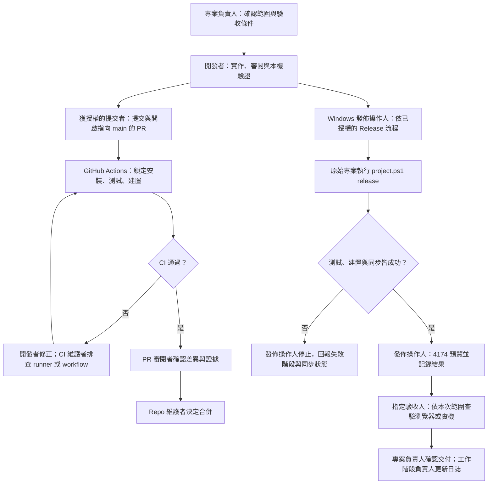

# CI/CD 流程與責任窗口

PR CI 已在本機分支 `codex/pr-ci-pilot` 實作（`12da6d4`），GitHub 試跑與強制合併檢查仍待驗證及決定。Windows Release 已投入本機操作，使用原始專案建置後增量同步。兩條路徑使用相同的測試及建置命令，有各自的驗證證據。

## 流程圖

## 階段與責任窗口

下表列出應找的角色。**角色人選由專案負責人指派**，可由同一人兼任。現有文件未列個別姓名、GitHub 帳號及備援窗口，交接時請補上「姓名或帳號／主要聯絡方式／備援人」。

| 階段 | 主責窗口 | 交接內容與判定 |
| --- | --- | --- |
| 範圍與規格 | 專案負責人（範圍與里程碑核准由使用者確認） | 告知開發者本次授權、對應 spec／task、交付及驗收條件。 |
| 實作與本機驗證 | 開發者（當次任務承接人） | 交付差異、task、測試及建置結果，標出人工待驗。程式或測試失敗時由開發者修正。 |
| 提交與 PR | 獲授權的提交者／有推送權限的維護者（待指派） | 依 [專案規則](../AGENTS.md) 分別處理提交授權與遠端操作。PR 附 commit SHA、改動範圍與驗證證據。 |
| CI 試跑與排障 | CI 維護者（待指派） | 查看 PR 的 **Test and build**。處理 workflow、runner、安裝或權限問題，將程式及測試回歸交還開發者。保留成功和故意失敗的 run 連結。 |
| 審閱與合併 | PR 審閱者與具有合併權限的 repo 維護者（皆待指派） | 審閱者檢查差異、規格及驗證證據，repo 維護者依結果決定合併。試跑完成後由 repo 維護者確認是否啟用必要檢查。 |
| Windows Release 與異常處理 | 發佈操作人，即具備指定工作站與 Release 目錄存取權的維護者（待指派） | 回報來源分支、commit、未提交狀態、測試／建置／同步結果及預覽結果。同步失敗時回報可能已更新的檔案，必要時由專案負責人決定回復。 |
| 瀏覽器與實機驗收 | 指定驗收人（按裝置或工作站指派） | 回報測試版本、裝置、OS／瀏覽器、案例與結果。手機、摺疊裝置及系統匣自啟沿用[既有驗收紀錄](remaining-acceptance.md)與[系統匣驗證](../.kiro/specs/release-system-tray/validation.md)。 |
| 交付與接手 | 專案負責人確認交付，當次工作階段負責人維護紀錄 | 交接 CI、Release、待驗及異常的證據連結。依專案規則更新私人開發日誌，里程碑收尾確認索引。 |

## CI 與 Release 操作

- **PR CI** 由 [workflow](../.github/workflows/pr-ci.yml) 定義，從乾淨 checkout 執行 `pnpm install --frozen-lockfile`、`pnpm run test`、`pnpm run build`。成功與失敗的試跑方式見[團隊交接](onboarding.md#pr-ci-試辦)。
- **Windows Release** 由發佈操作人在原始專案執行 `./scripts/project.ps1 release`。腳本依序測試、建置、同步 `dist` 至正式目錄。成功後以 `./scripts/project.ps1 preview-release` 在 localhost:4174 預覽，並重新整理已開啟頁面。4175 系統匣只服務正式副本。詳見 [Release 操作與回復](release.md)及[系統匣操作](release-tray.md)。
- **發佈失敗** 時停止並保留結果。測試或建置失敗由開發者排查，權限、目錄或同步問題由發佈操作人排查。同步逐檔更新，因此失敗時可能已有部分資產更新。回復整版須有已知良好的 `dist` 備份，依 Release 文件操作。
